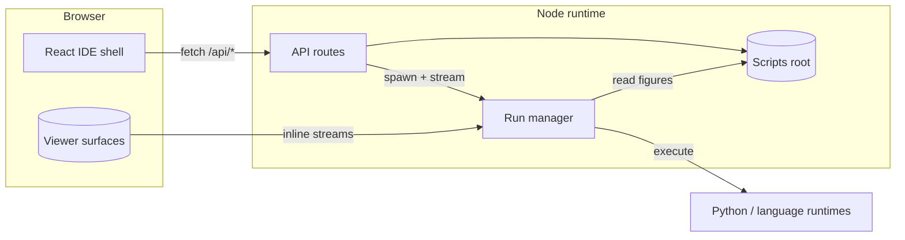
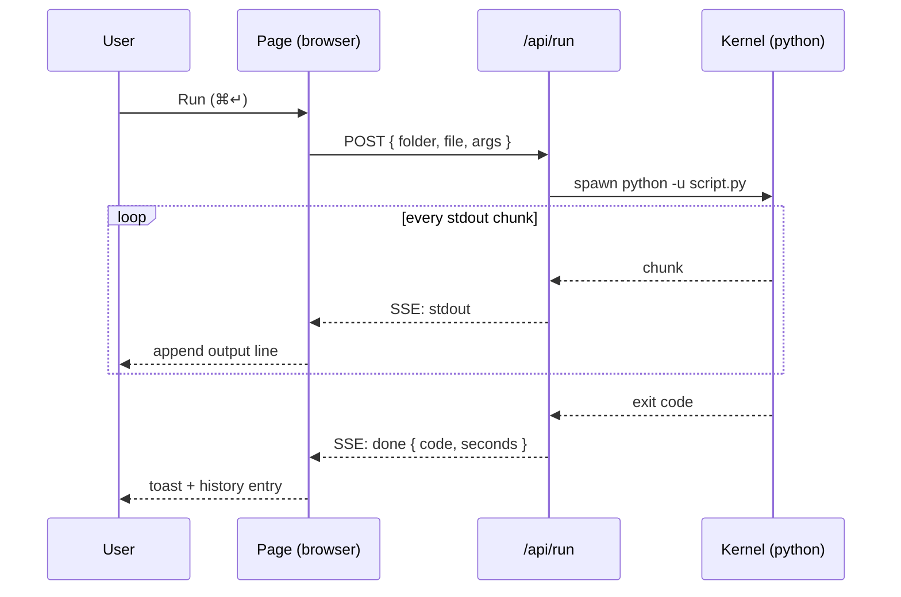
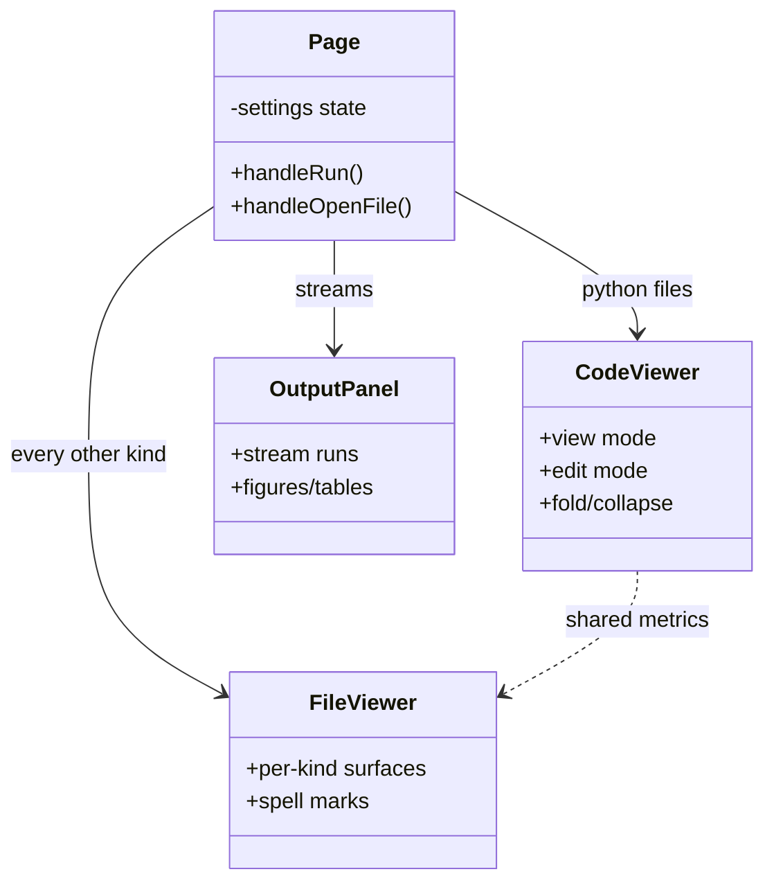
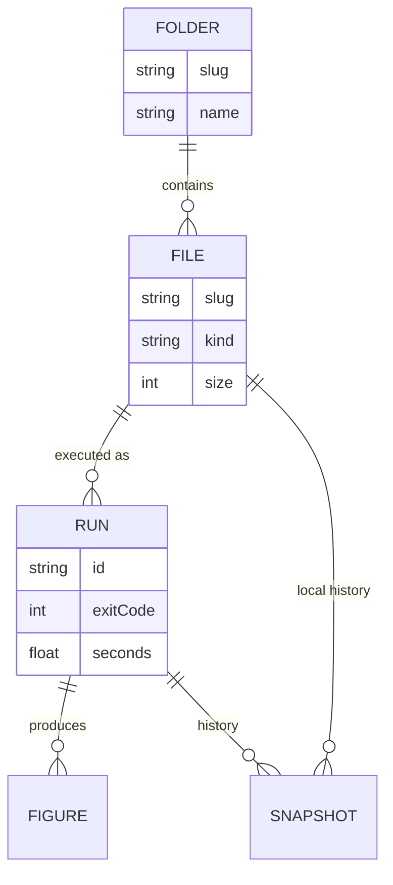

# Architecture — how the pieces fit

The architecture notes for the workspace: diagrams first, decisions
second. Every Mermaid block renders inline; the ASCII layouts are for
the terminals of the world.

## System overview



## Request lifecycle of a run



## Editor module map



## Data model (core entities)



## ASCII layout of the main window

```text
┌────────────────────────────────────────────────────────────────────┐
│ menu bar                                            project chip  │
├────────────┬──────────────────────────────────────┬───────────────┤
│            │ toolbar (Run ▾ · View|Edit · zoom)   │               │
│  Explorer  ├──────────────────────────────────────┤  (panels)     │
│   tree     │                                      │  AI chat /    │
│            │         editor surface               │  tests /      │
│  recent    │   (code viewer · file viewer ·       │  git diff     │
│  favorites │    notebook · studio …)              │               │
│            │                                      │               │
├────────────┴──────────────────────────────────────┴───────────────┤
│ output · terminal · console · diagnostics · notes · todos          │
└────────────────────────────────────────────────────────────────────┘
```

## Deployment topologies

| Topology   | Pieces                                                              | When                      |
|------------|---------------------------------------------------------------------|---------------------------|
| Local dev  | `bun run dev` on :3000, scripts under `python_scripts/`             | day-to-day editing        |
| Standalone | `bun run build` → `.next/standalone/server.js` + vendored `bin/7za` | single-host deploy        |
| Container  | Docker image (Bun + Python + sci stack), volume-mounted scripts     | reproducible hosting      |
| Proxied    | Caddy in front, token guard at the proxy                            | anything beyond localhost |

## Decision records

### ADR-001 — Runs are server-side spawns, not WASM

**Status:** accepted.

The IDE runs code through the host's language runtimes (spawn + stream)
rather than compiling Python to WASM in the browser. The filesystem is
the source of truth; every run sees the same files the editor edits.

### ADR-002 — One slug system for every path

**Status:** accepted.

Files and folders are addressed by lossless slugs end-to-end (API,
tree, tabs, exports). Nested paths encode transparently, so every route
accepts the same identifier without special cases.

### ADR-003 — Progressive rendering for long code

**Status:** accepted.

Long files expand in 500-line chunks mounted one per animation frame at
triple-quote-safe boundaries. The first rows paint immediately, a
loader covers the tail, and the tab never freezes on the tokenize.

### ADR-004 — Capability-probed archive support

**Status:** accepted.

Archive handling depends on host binaries (tar, unrar, xz, bzip2,
7-Zip). The app probes once, reports what exists, and falls back
honestly (bsdtar last, with tar-style flags) instead of pretending a
format is supported.

## Performance budgets

- First paint of the shell: under a second on a dev laptop.
- File open (warm cache): instant; cold fetch overlaps the render via
  prefetch.
- Scroll on a 5 000-line expanded file: no dropped frames; overlays
  stay glued to their glyphs.
- Markdown preview of a 4 000-line README: renders without freezing
  the tab; the outline stays responsive.
