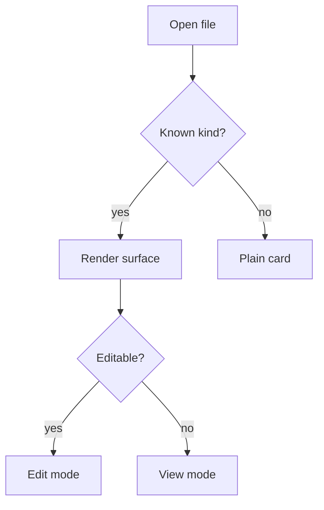
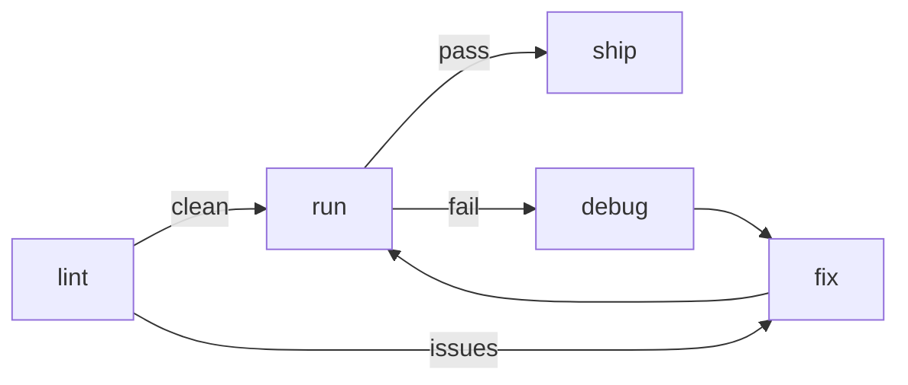
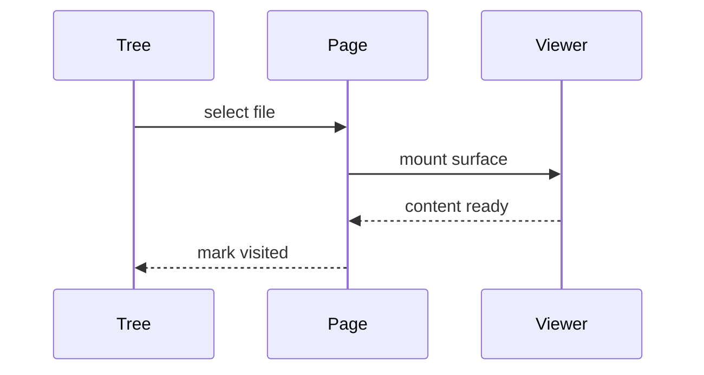

# The Very Long README — a Markdown stress document

> This file exists to answer one question: **does the IDE's Markdown
> viewer stay responsive on a document of realistic-but-extreme
> length?** It packs every block type the renderer supports into a
> single file. Scroll it, outline it, edit it — nothing should freeze.

[TOC marker: the viewer's own outline replaces a hand-written table of
contents; every heading below is one jump target.]

---

## Chapter map

- [1. Getting around](#1-getting-around)
- [2. Reading code](#2-reading-code)
- [3. Editing](#3-editing)
- [4. Running](#4-running)
- [5. Diagnostics](#5-diagnostics)
- [6. Data files](#6-data-files)
- [7. Databases](#7-databases)
- [8. Notebooks](#8-notebooks)
- [9. Markdown](#9-markdown)
- [10. Archives](#10-archives)
- [11. AI features](#11-ai-features)
- [12. Focus & polish](#12-focus--polish)

---

## 1. Getting around

*Navigation, tabs, and the explorer tree. This chapter repeats the standard block mix so the renderer sees every
combination in every position of a long file.*

### 1.1 — Section 01

Paragraph 1. The quick brown fox jumps over the lazy dog while five wizards **quiz** him about *hexadecimal* `jmp`
tables and the difference between a [linked heading](#1-getting-around) and a footnote[^1]. Long documents live or die
by the small things: consistent ~~strikethrough~~ spacing, inline `code` that does not break the line rhythm, and
punctuation that survives every font.

```c
int clamp(int v, int lo, int hi) { return v < lo ? lo : (v > hi ? hi : v); }
```

### 1.2 — Section 02

Paragraph 2. The quick brown fox jumps over the lazy dog while five wizards **quiz** him about *hexadecimal* `jmp`
tables and the difference between a [linked heading](#1-getting-around) and a footnote[^2]. Long documents live or die
by the small things: consistent ~~strikethrough~~ spacing, inline `code` that does not break the line rhythm, and
punctuation that survives every font.

### 1.3 — Section 03

Paragraph 3. The quick brown fox jumps over the lazy dog while five wizards **quiz** him about *hexadecimal* `jmp`
tables and the difference between a [linked heading](#1-getting-around) and a footnote[^3]. Long documents live or die
by the small things: consistent ~~strikethrough~~ spacing, inline `code` that does not break the line rhythm, and
punctuation that survives every font.

```r
trim <- function(x) { x[abs(x - median(x)) < 3 * mad(x)] }
```

| # | Column A    | Column B    | Column C    | Column D    | Column E    | Column F    |
|---|-------------|-------------|-------------|-------------|-------------|-------------|
| 1 | `value-0-0` | `value-0-1` | `value-0-2` | `value-0-3` | `value-0-4` | `value-0-5` |
| 2 | `value-1-0` | `value-1-1` | `value-1-2` | `value-1-3` | `value-1-4` | `value-1-5` |
| 3 | `value-2-0` | `value-2-1` | `value-2-2` | `value-2-3` | `value-2-4` | `value-2-5` |
| 4 | `value-3-0` | `value-3-1` | `value-3-2` | `value-3-3` | `value-3-4` | `value-3-5` |
| 5 | `value-4-0` | `value-4-1` | `value-4-2` | `value-4-3` | `value-4-4` | `value-4-5` |
| 6 | `value-5-0` | `value-5-1` | `value-5-2` | `value-5-3` | `value-5-4` | `value-5-5` |

### 1.4 — Section 04

Paragraph 4. The quick brown fox jumps over the lazy dog while five wizards **quiz** him about *hexadecimal* `jmp`
tables and the difference between a [linked heading](#1-getting-around) and a footnote[^4]. Long documents live or die
by the small things: consistent ~~strikethrough~~ spacing, inline `code` that does not break the line rhythm, and
punctuation that survives every font.

<details>
<summary>Collapsible details block (click to expand)</summary>

Hidden content still renders: **bold**, *italic*, `code`, and a list:

- one
- two
    - nested
- three

</details>

### 1.5 — Section 05

Paragraph 5. The quick brown fox jumps over the lazy dog while five wizards **quiz** him about *hexadecimal* `jmp`
tables and the difference between a [linked heading](#1-getting-around) and a footnote[^5]. Long documents live or die
by the small things: consistent ~~strikethrough~~ spacing, inline `code` that does not break the line rhythm, and
punctuation that survives every font.

```ruby
words.group_by(&:size).transform_values(&:count)
```



### 1.6 — Section 06

Paragraph 6. The quick brown fox jumps over the lazy dog while five wizards **quiz** him about *hexadecimal* `jmp`
tables and the difference between a [linked heading](#1-getting-around) and a footnote[^6]. Long documents live or die
by the small things: consistent ~~strikethrough~~ spacing, inline `code` that does not break the line rhythm, and
punctuation that survives every font.

| # | Column A    | Column B    | Column C    | Column D    | Column E    | Column F    |
|---|-------------|-------------|-------------|-------------|-------------|-------------|
| 1 | `value-0-0` | `value-0-1` | `value-0-2` | `value-0-3` | `value-0-4` | `value-0-5` |
| 2 | `value-1-0` | `value-1-1` | `value-1-2` | `value-1-3` | `value-1-4` | `value-1-5` |
| 3 | `value-2-0` | `value-2-1` | `value-2-2` | `value-2-3` | `value-2-4` | `value-2-5` |
| 4 | `value-3-0` | `value-3-1` | `value-3-2` | `value-3-3` | `value-3-4` | `value-3-5` |
| 5 | `value-4-0` | `value-4-1` | `value-4-2` | `value-4-3` | `value-4-4` | `value-4-5` |
| 6 | `value-5-0` | `value-5-1` | `value-5-2` | `value-5-3` | `value-5-4` | `value-5-5` |

### 1.7 — Section 07

Paragraph 7. The quick brown fox jumps over the lazy dog while five wizards **quiz** him about *hexadecimal* `jmp`
tables and the difference between a [linked heading](#1-getting-around) and a footnote[^7]. Long documents live or die
by the small things: consistent ~~strikethrough~~ spacing, inline `code` that does not break the line rhythm, and
punctuation that survives every font.

```lua
local function map(t, f) local o = {} for i, v in ipairs(t) do o[i] = f(v) end return o end
```

> [!NOTE]
> A GitHub-style alert. The renderer paints these with their accent
> color and icon, exactly like GitHub does.

> [!WARNING]
> Alerts can stack; each keeps its own accent.

> [!TIP]
> Inline math like $e^{i\pi} + 1 = 0$ renders through KaTeX.

### 1.8 — Section 08

Paragraph 8. The quick brown fox jumps over the lazy dog while five wizards **quiz** him about *hexadecimal* `jmp`
tables and the difference between a [linked heading](#1-getting-around) and a footnote[^8]. Long documents live or die
by the small things: consistent ~~strikethrough~~ spacing, inline `code` that does not break the line rhythm, and
punctuation that survives every font.

<details>
<summary>Collapsible details block (click to expand)</summary>

Hidden content still renders: **bold**, *italic*, `code`, and a list:

- one
- two
    - nested
- three

</details>

### 1.9 — Section 09

Paragraph 9. The quick brown fox jumps over the lazy dog while five wizards **quiz** him about *hexadecimal* `jmp`
tables and the difference between a [linked heading](#1-getting-around) and a footnote[^9]. Long documents live or die
by the small things: consistent ~~strikethrough~~ spacing, inline `code` that does not break the line rhythm, and
punctuation that survives every font.

```julia
mymean(xs) = sum(xs) / length(xs)
```

| # | Column A    | Column B    | Column C    | Column D    | Column E    | Column F    |
|---|-------------|-------------|-------------|-------------|-------------|-------------|
| 1 | `value-0-0` | `value-0-1` | `value-0-2` | `value-0-3` | `value-0-4` | `value-0-5` |
| 2 | `value-1-0` | `value-1-1` | `value-1-2` | `value-1-3` | `value-1-4` | `value-1-5` |
| 3 | `value-2-0` | `value-2-1` | `value-2-2` | `value-2-3` | `value-2-4` | `value-2-5` |
| 4 | `value-3-0` | `value-3-1` | `value-3-2` | `value-3-3` | `value-3-4` | `value-3-5` |
| 5 | `value-4-0` | `value-4-1` | `value-4-2` | `value-4-3` | `value-4-4` | `value-4-5` |
| 6 | `value-5-0` | `value-5-1` | `value-5-2` | `value-5-3` | `value-5-4` | `value-5-5` |

Task list:

- [x] headings nest six levels deep
- [x] tables stay aligned when columns widen
- [ ] a 4 000-line document scrolls at 60 fps
- [ ] the outline jumps precisely
    - [ ] nested checkbox renders indented
- [x] footnotes resolve at the bottom[^footnote-header]

And a display block:

$$
\int_{0}^{\infty} e^{-x^2}\,dx = \frac{\sqrt{\pi}}{2}
$$

### 1.10 — Section 10

Paragraph 10. The quick brown fox jumps over the lazy dog while five wizards **quiz** him about *hexadecimal* `jmp`
tables and the difference between a [linked heading](#1-getting-around) and a footnote[^10]. Long documents live or die
by the small things: consistent ~~strikethrough~~ spacing, inline `code` that does not break the line rhythm, and
punctuation that survives every font.



#### Level-four heading inside a section

##### Level five, why not

###### Level six — the deepest nest

Even at depth six the text is a normal paragraph and the outline lists the heading. Horizontal rules separate the
sections that need visual air.

---

### 1.11 — Section 11

Paragraph 11. The quick brown fox jumps over the lazy dog while five wizards **quiz** him about *hexadecimal* `jmp`
tables and the difference between a [linked heading](#1-getting-around) and a footnote[^11]. Long documents live or die
by the small things: consistent ~~strikethrough~~ spacing, inline `code` that does not break the line rhythm, and
punctuation that survives every font.

```swift
let squares = (1...10).map { $0 * $0 }
```

### 1.12 — Section 12

Paragraph 12. The quick brown fox jumps over the lazy dog while five wizards **quiz** him about *hexadecimal* `jmp`
tables and the difference between a [linked heading](#1-getting-around) and a footnote[^12]. Long documents live or die
by the small things: consistent ~~strikethrough~~ spacing, inline `code` that does not break the line rhythm, and
punctuation that survives every font.

| # | Column A    | Column B    | Column C    | Column D    | Column E    | Column F    |
|---|-------------|-------------|-------------|-------------|-------------|-------------|
| 1 | `value-0-0` | `value-0-1` | `value-0-2` | `value-0-3` | `value-0-4` | `value-0-5` |
| 2 | `value-1-0` | `value-1-1` | `value-1-2` | `value-1-3` | `value-1-4` | `value-1-5` |
| 3 | `value-2-0` | `value-2-1` | `value-2-2` | `value-2-3` | `value-2-4` | `value-2-5` |
| 4 | `value-3-0` | `value-3-1` | `value-3-2` | `value-3-3` | `value-3-4` | `value-3-5` |
| 5 | `value-4-0` | `value-4-1` | `value-4-2` | `value-4-3` | `value-4-4` | `value-4-5` |
| 6 | `value-5-0` | `value-5-1` | `value-5-2` | `value-5-3` | `value-5-4` | `value-5-5` |

<details>
<summary>Collapsible details block (click to expand)</summary>

Hidden content still renders: **bold**, *italic*, `code`, and a list:

- one
- two
    - nested
- three

</details>

### 1.13 — Section 13

Paragraph 13. The quick brown fox jumps over the lazy dog while five wizards **quiz** him about *hexadecimal* `jmp`
tables and the difference between a [linked heading](#1-getting-around) and a footnote[^13]. Long documents live or die
by the small things: consistent ~~strikethrough~~ spacing, inline `code` that does not break the line rhythm, and
punctuation that survives every font.

```javascript
const zip = (a, b) => a.map((v, i) => [v, b[i]]);
```

### 1.14 — Section 14

Paragraph 14. The quick brown fox jumps over the lazy dog while five wizards **quiz** him about *hexadecimal* `jmp`
tables and the difference between a [linked heading](#1-getting-around) and a footnote[^14]. Long documents live or die
by the small things: consistent ~~strikethrough~~ spacing, inline `code` that does not break the line rhythm, and
punctuation that survives every font.

### 1.15 — Section 15

Paragraph 15. The quick brown fox jumps over the lazy dog while five wizards **quiz** him about *hexadecimal* `jmp`
tables and the difference between a [linked heading](#1-getting-around) and a footnote[^15]. Long documents live or die
by the small things: consistent ~~strikethrough~~ spacing, inline `code` that does not break the line rhythm, and
punctuation that survives every font.

```bash
for f in *.log; do gzip -k "$f"; done
```

| # | Column A    | Column B    | Column C    | Column D    | Column E    | Column F    |
|---|-------------|-------------|-------------|-------------|-------------|-------------|
| 1 | `value-0-0` | `value-0-1` | `value-0-2` | `value-0-3` | `value-0-4` | `value-0-5` |
| 2 | `value-1-0` | `value-1-1` | `value-1-2` | `value-1-3` | `value-1-4` | `value-1-5` |
| 3 | `value-2-0` | `value-2-1` | `value-2-2` | `value-2-3` | `value-2-4` | `value-2-5` |
| 4 | `value-3-0` | `value-3-1` | `value-3-2` | `value-3-3` | `value-3-4` | `value-3-5` |
| 5 | `value-4-0` | `value-4-1` | `value-4-2` | `value-4-3` | `value-4-4` | `value-4-5` |
| 6 | `value-5-0` | `value-5-1` | `value-5-2` | `value-5-3` | `value-5-4` | `value-5-5` |



### 1.16 — Section 16

Paragraph 16. The quick brown fox jumps over the lazy dog while five wizards **quiz** him about *hexadecimal* `jmp`
tables and the difference between a [linked heading](#1-getting-around) and a footnote[^16]. Long documents live or die
by the small things: consistent ~~strikethrough~~ spacing, inline `code` that does not break the line rhythm, and
punctuation that survives every font.

<details>
<summary>Collapsible details block (click to expand)</summary>

Hidden content still renders: **bold**, *italic*, `code`, and a list:

- one
- two
    - nested
- three

</details>

### 1.17 — Section 17

Paragraph 17. The quick brown fox jumps over the lazy dog while five wizards **quiz** him about *hexadecimal* `jmp`
tables and the difference between a [linked heading](#1-getting-around) and a footnote[^17]. Long documents live or die
by the small things: consistent ~~strikethrough~~ spacing, inline `code` that does not break the line rhythm, and
punctuation that survives every font.

```json
{
  "ok": true,
  "items": [
    {"id": 1, "label": "first"},
    {"id": 2, "label": "second"}
  ]
}
```

### 1.18 — Section 18

Paragraph 18. The quick brown fox jumps over the lazy dog while five wizards **quiz** him about *hexadecimal* `jmp`
tables and the difference between a [linked heading](#1-getting-around) and a footnote[^18]. Long documents live or die
by the small things: consistent ~~strikethrough~~ spacing, inline `code` that does not break the line rhythm, and
punctuation that survives every font.

| # | Column A    | Column B    | Column C    | Column D    | Column E    | Column F    |
|---|-------------|-------------|-------------|-------------|-------------|-------------|
| 1 | `value-0-0` | `value-0-1` | `value-0-2` | `value-0-3` | `value-0-4` | `value-0-5` |
| 2 | `value-1-0` | `value-1-1` | `value-1-2` | `value-1-3` | `value-1-4` | `value-1-5` |
| 3 | `value-2-0` | `value-2-1` | `value-2-2` | `value-2-3` | `value-2-4` | `value-2-5` |
| 4 | `value-3-0` | `value-3-1` | `value-3-2` | `value-3-3` | `value-3-4` | `value-3-5` |
| 5 | `value-4-0` | `value-4-1` | `value-4-2` | `value-4-3` | `value-4-4` | `value-4-5` |
| 6 | `value-5-0` | `value-5-1` | `value-5-2` | `value-5-3` | `value-5-4` | `value-5-5` |

## 2. Reading code

*The view surface and its overlays. This chapter repeats the standard block mix so the renderer sees every combination
in every position of a long file.*

### 2.1 — Section 01

Paragraph 1. The quick brown fox jumps over the lazy dog while five wizards **quiz** him about *hexadecimal* `jmp`
tables and the difference between a [linked heading](#1-getting-around) and a footnote[^19]. Long documents live or die
by the small things: consistent ~~strikethrough~~ spacing, inline `code` that does not break the line rhythm, and
punctuation that survives every font.

```swift
let squares = (1...10).map { $0 * $0 }
```

### 2.2 — Section 02

Paragraph 2. The quick brown fox jumps over the lazy dog while five wizards **quiz** him about *hexadecimal* `jmp`
tables and the difference between a [linked heading](#1-getting-around) and a footnote[^20]. Long documents live or die
by the small things: consistent ~~strikethrough~~ spacing, inline `code` that does not break the line rhythm, and
punctuation that survives every font.

### 2.3 — Section 03

Paragraph 3. The quick brown fox jumps over the lazy dog while five wizards **quiz** him about *hexadecimal* `jmp`
tables and the difference between a [linked heading](#1-getting-around) and a footnote[^21]. Long documents live or die
by the small things: consistent ~~strikethrough~~ spacing, inline `code` that does not break the line rhythm, and
punctuation that survives every font.

```javascript
const zip = (a, b) => a.map((v, i) => [v, b[i]]);
```

| # | Column A    | Column B    | Column C    | Column D    | Column E    | Column F    |
|---|-------------|-------------|-------------|-------------|-------------|-------------|
| 1 | `value-0-0` | `value-0-1` | `value-0-2` | `value-0-3` | `value-0-4` | `value-0-5` |
| 2 | `value-1-0` | `value-1-1` | `value-1-2` | `value-1-3` | `value-1-4` | `value-1-5` |
| 3 | `value-2-0` | `value-2-1` | `value-2-2` | `value-2-3` | `value-2-4` | `value-2-5` |
| 4 | `value-3-0` | `value-3-1` | `value-3-2` | `value-3-3` | `value-3-4` | `value-3-5` |
| 5 | `value-4-0` | `value-4-1` | `value-4-2` | `value-4-3` | `value-4-4` | `value-4-5` |
| 6 | `value-5-0` | `value-5-1` | `value-5-2` | `value-5-3` | `value-5-4` | `value-5-5` |

### 2.4 — Section 04

Paragraph 4. The quick brown fox jumps over the lazy dog while five wizards **quiz** him about *hexadecimal* `jmp`
tables and the difference between a [linked heading](#1-getting-around) and a footnote[^22]. Long documents live or die
by the small things: consistent ~~strikethrough~~ spacing, inline `code` that does not break the line rhythm, and
punctuation that survives every font.

<details>
<summary>Collapsible details block (click to expand)</summary>

Hidden content still renders: **bold**, *italic*, `code`, and a list:

- one
- two
    - nested
- three

</details>

### 2.5 — Section 05

Paragraph 5. The quick brown fox jumps over the lazy dog while five wizards **quiz** him about *hexadecimal* `jmp`
tables and the difference between a [linked heading](#1-getting-around) and a footnote[^23]. Long documents live or die
by the small things: consistent ~~strikethrough~~ spacing, inline `code` that does not break the line rhythm, and
punctuation that survives every font.

```bash
for f in *.log; do gzip -k "$f"; done
```


### 2.6 — Section 06

Paragraph 6. The quick brown fox jumps over the lazy dog while five wizards **quiz** him about *hexadecimal* `jmp`
tables and the difference between a [linked heading](#1-getting-around) and a footnote[^24]. Long documents live or die
by the small things: consistent ~~strikethrough~~ spacing, inline `code` that does not break the line rhythm, and
punctuation that survives every font.

| # | Column A    | Column B    | Column C    | Column D    | Column E    | Column F    |
|---|-------------|-------------|-------------|-------------|-------------|-------------|
| 1 | `value-0-0` | `value-0-1` | `value-0-2` | `value-0-3` | `value-0-4` | `value-0-5` |
| 2 | `value-1-0` | `value-1-1` | `value-1-2` | `value-1-3` | `value-1-4` | `value-1-5` |
| 3 | `value-2-0` | `value-2-1` | `value-2-2` | `value-2-3` | `value-2-4` | `value-2-5` |
| 4 | `value-3-0` | `value-3-1` | `value-3-2` | `value-3-3` | `value-3-4` | `value-3-5` |
| 5 | `value-4-0` | `value-4-1` | `value-4-2` | `value-4-3` | `value-4-4` | `value-4-5` |
| 6 | `value-5-0` | `value-5-1` | `value-5-2` | `value-5-3` | `value-5-4` | `value-5-5` |

### 2.7 — Section 07

Paragraph 7. The quick brown fox jumps over the lazy dog while five wizards **quiz** him about *hexadecimal* `jmp`
tables and the difference between a [linked heading](#1-getting-around) and a footnote[^25]. Long documents live or die
by the small things: consistent ~~strikethrough~~ spacing, inline `code` that does not break the line rhythm, and
punctuation that survives every font.

```json
{
  "ok": true,
  "items": [
    {"id": 1, "label": "first"},
    {"id": 2, "label": "second"}
  ]
}
```

> [!NOTE]
> A GitHub-style alert. The renderer paints these with their accent
> color and icon, exactly like GitHub does.

> [!WARNING]
> Alerts can stack; each keeps its own accent.

> [!TIP]
> Inline math like $e^{i\pi} + 1 = 0$ renders through KaTeX.

### 2.8 — Section 08

Paragraph 8. The quick brown fox jumps over the lazy dog while five wizards **quiz** him about *hexadecimal* `jmp`
tables and the difference between a [linked heading](#1-getting-around) and a footnote[^26]. Long documents live or die
by the small things: consistent ~~strikethrough~~ spacing, inline `code` that does not break the line rhythm, and
punctuation that survives every font.

<details>
<summary>Collapsible details block (click to expand)</summary>

Hidden content still renders: **bold**, *italic*, `code`, and a list:

- one
- two
    - nested
- three

</details>

### 2.9 — Section 09

Paragraph 9. The quick brown fox jumps over the lazy dog while five wizards **quiz** him about *hexadecimal* `jmp`
tables and the difference between a [linked heading](#1-getting-around) and a footnote[^27]. Long documents live or die
by the small things: consistent ~~strikethrough~~ spacing, inline `code` that does not break the line rhythm, and
punctuation that survives every font.

```toml
[tool.praxis]
level = "info"
features = ["spell", "folding"]
```

| # | Column A    | Column B    | Column C    | Column D    | Column E    | Column F    |
|---|-------------|-------------|-------------|-------------|-------------|-------------|
| 1 | `value-0-0` | `value-0-1` | `value-0-2` | `value-0-3` | `value-0-4` | `value-0-5` |
| 2 | `value-1-0` | `value-1-1` | `value-1-2` | `value-1-3` | `value-1-4` | `value-1-5` |
| 3 | `value-2-0` | `value-2-1` | `value-2-2` | `value-2-3` | `value-2-4` | `value-2-5` |
| 4 | `value-3-0` | `value-3-1` | `value-3-2` | `value-3-3` | `value-3-4` | `value-3-5` |
| 5 | `value-4-0` | `value-4-1` | `value-4-2` | `value-4-3` | `value-4-4` | `value-4-5` |
| 6 | `value-5-0` | `value-5-1` | `value-5-2` | `value-5-3` | `value-5-4` | `value-5-5` |

Task list:

- [x] headings nest six levels deep
- [x] tables stay aligned when columns widen
- [ ] a 4 000-line document scrolls at 60 fps
- [ ] the outline jumps precisely
    - [ ] nested checkbox renders indented
- [x] footnotes resolve at the bottom[^footnote-header]

And a display block:

$$
\int_{0}^{\infty} e^{-x^2}\,dx = \frac{\sqrt{\pi}}{2}
$$

### 2.10 — Section 10

Paragraph 10. The quick brown fox jumps over the lazy dog while five wizards **quiz** him about *hexadecimal* `jmp`
tables and the difference between a [linked heading](#1-getting-around) and a footnote[^28]. Long documents live or die
by the small things: consistent ~~strikethrough~~ spacing, inline `code` that does not break the line rhythm, and
punctuation that survives every font.


#### Level-four heading inside a section

##### Level five, why not

###### Level six — the deepest nest

Even at depth six the text is a normal paragraph and the outline lists the heading. Horizontal rules separate the
sections that need visual air.

---

### 2.11 — Section 11

Paragraph 11. The quick brown fox jumps over the lazy dog while five wizards **quiz** him about *hexadecimal* `jmp`
tables and the difference between a [linked heading](#1-getting-around) and a footnote[^29]. Long documents live or die
by the small things: consistent ~~strikethrough~~ spacing, inline `code` that does not break the line rhythm, and
punctuation that survives every font.

```rust
fn square(n: i64) -> i64 { n * n }
```

### 2.12 — Section 12

Paragraph 12. The quick brown fox jumps over the lazy dog while five wizards **quiz** him about *hexadecimal* `jmp`
tables and the difference between a [linked heading](#1-getting-around) and a footnote[^30]. Long documents live or die
by the small things: consistent ~~strikethrough~~ spacing, inline `code` that does not break the line rhythm, and
punctuation that survives every font.

| # | Column A    | Column B    | Column C    | Column D    | Column E    | Column F    |
|---|-------------|-------------|-------------|-------------|-------------|-------------|
| 1 | `value-0-0` | `value-0-1` | `value-0-2` | `value-0-3` | `value-0-4` | `value-0-5` |
| 2 | `value-1-0` | `value-1-1` | `value-1-2` | `value-1-3` | `value-1-4` | `value-1-5` |
| 3 | `value-2-0` | `value-2-1` | `value-2-2` | `value-2-3` | `value-2-4` | `value-2-5` |
| 4 | `value-3-0` | `value-3-1` | `value-3-2` | `value-3-3` | `value-3-4` | `value-3-5` |
| 5 | `value-4-0` | `value-4-1` | `value-4-2` | `value-4-3` | `value-4-4` | `value-4-5` |
| 6 | `value-5-0` | `value-5-1` | `value-5-2` | `value-5-3` | `value-5-4` | `value-5-5` |

<details>
<summary>Collapsible details block (click to expand)</summary>

Hidden content still renders: **bold**, *italic*, `code`, and a list:

- one
- two
    - nested
- three

</details>

### 2.13 — Section 13

Paragraph 13. The quick brown fox jumps over the lazy dog while five wizards **quiz** him about *hexadecimal* `jmp`
tables and the difference between a [linked heading](#1-getting-around) and a footnote[^31]. Long documents live or die
by the small things: consistent ~~strikethrough~~ spacing, inline `code` that does not break the line rhythm, and
punctuation that survives every font.

```c
int clamp(int v, int lo, int hi) { return v < lo ? lo : (v > hi ? hi : v); }
```

### 2.14 — Section 14

Paragraph 14. The quick brown fox jumps over the lazy dog while five wizards **quiz** him about *hexadecimal* `jmp`
tables and the difference between a [linked heading](#1-getting-around) and a footnote[^32]. Long documents live or die
by the small things: consistent ~~strikethrough~~ spacing, inline `code` that does not break the line rhythm, and
punctuation that survives every font.

### 2.15 — Section 15

Paragraph 15. The quick brown fox jumps over the lazy dog while five wizards **quiz** him about *hexadecimal* `jmp`
tables and the difference between a [linked heading](#1-getting-around) and a footnote[^33]. Long documents live or die
by the small things: consistent ~~strikethrough~~ spacing, inline `code` that does not break the line rhythm, and
punctuation that survives every font.

```r
trim <- function(x) { x[abs(x - median(x)) < 3 * mad(x)] }
```

| # | Column A    | Column B    | Column C    | Column D    | Column E    | Column F    |
|---|-------------|-------------|-------------|-------------|-------------|-------------|
| 1 | `value-0-0` | `value-0-1` | `value-0-2` | `value-0-3` | `value-0-4` | `value-0-5` |
| 2 | `value-1-0` | `value-1-1` | `value-1-2` | `value-1-3` | `value-1-4` | `value-1-5` |
| 3 | `value-2-0` | `value-2-1` | `value-2-2` | `value-2-3` | `value-2-4` | `value-2-5` |
| 4 | `value-3-0` | `value-3-1` | `value-3-2` | `value-3-3` | `value-3-4` | `value-3-5` |
| 5 | `value-4-0` | `value-4-1` | `value-4-2` | `value-4-3` | `value-4-4` | `value-4-5` |
| 6 | `value-5-0` | `value-5-1` | `value-5-2` | `value-5-3` | `value-5-4` | `value-5-5` |


### 2.16 — Section 16

Paragraph 16. The quick brown fox jumps over the lazy dog while five wizards **quiz** him about *hexadecimal* `jmp`
tables and the difference between a [linked heading](#1-getting-around) and a footnote[^34]. Long documents live or die
by the small things: consistent ~~strikethrough~~ spacing, inline `code` that does not break the line rhythm, and
punctuation that survives every font.

<details>
<summary>Collapsible details block (click to expand)</summary>

Hidden content still renders: **bold**, *italic*, `code`, and a list:

- one
- two
    - nested
- three

</details>

### 2.17 — Section 17

Paragraph 17. The quick brown fox jumps over the lazy dog while five wizards **quiz** him about *hexadecimal* `jmp`
tables and the difference between a [linked heading](#1-getting-around) and a footnote[^35]. Long documents live or die
by the small things: consistent ~~strikethrough~~ spacing, inline `code` that does not break the line rhythm, and
punctuation that survives every font.

```ruby
words.group_by(&:size).transform_values(&:count)
```

### 2.18 — Section 18

Paragraph 18. The quick brown fox jumps over the lazy dog while five wizards **quiz** him about *hexadecimal* `jmp`
tables and the difference between a [linked heading](#1-getting-around) and a footnote[^36]. Long documents live or die
by the small things: consistent ~~strikethrough~~ spacing, inline `code` that does not break the line rhythm, and
punctuation that survives every font.

| # | Column A    | Column B    | Column C    | Column D    | Column E    | Column F    |
|---|-------------|-------------|-------------|-------------|-------------|-------------|
| 1 | `value-0-0` | `value-0-1` | `value-0-2` | `value-0-3` | `value-0-4` | `value-0-5` |
| 2 | `value-1-0` | `value-1-1` | `value-1-2` | `value-1-3` | `value-1-4` | `value-1-5` |
| 3 | `value-2-0` | `value-2-1` | `value-2-2` | `value-2-3` | `value-2-4` | `value-2-5` |
| 4 | `value-3-0` | `value-3-1` | `value-3-2` | `value-3-3` | `value-3-4` | `value-3-5` |
| 5 | `value-4-0` | `value-4-1` | `value-4-2` | `value-4-3` | `value-4-4` | `value-4-5` |
| 6 | `value-5-0` | `value-5-1` | `value-5-2` | `value-5-3` | `value-5-4` | `value-5-5` |

## 3. Editing

*The edit surface, undo, and multi-cursor. This chapter repeats the standard block mix so the renderer sees every
combination in every position of a long file.*

### 3.1 — Section 01

Paragraph 1. The quick brown fox jumps over the lazy dog while five wizards **quiz** him about *hexadecimal* `jmp`
tables and the difference between a [linked heading](#1-getting-around) and a footnote[^37]. Long documents live or die
by the small things: consistent ~~strikethrough~~ spacing, inline `code` that does not break the line rhythm, and
punctuation that survives every font.

```rust
fn square(n: i64) -> i64 { n * n }
```

### 3.2 — Section 02

Paragraph 2. The quick brown fox jumps over the lazy dog while five wizards **quiz** him about *hexadecimal* `jmp`
tables and the difference between a [linked heading](#1-getting-around) and a footnote[^38]. Long documents live or die
by the small things: consistent ~~strikethrough~~ spacing, inline `code` that does not break the line rhythm, and
punctuation that survives every font.

### 3.3 — Section 03

Paragraph 3. The quick brown fox jumps over the lazy dog while five wizards **quiz** him about *hexadecimal* `jmp`
tables and the difference between a [linked heading](#1-getting-around) and a footnote[^39]. Long documents live or die
by the small things: consistent ~~strikethrough~~ spacing, inline `code` that does not break the line rhythm, and
punctuation that survives every font.

```c
int clamp(int v, int lo, int hi) { return v < lo ? lo : (v > hi ? hi : v); }
```

| # | Column A    | Column B    | Column C    | Column D    | Column E    | Column F    |
|---|-------------|-------------|-------------|-------------|-------------|-------------|
| 1 | `value-0-0` | `value-0-1` | `value-0-2` | `value-0-3` | `value-0-4` | `value-0-5` |
| 2 | `value-1-0` | `value-1-1` | `value-1-2` | `value-1-3` | `value-1-4` | `value-1-5` |
| 3 | `value-2-0` | `value-2-1` | `value-2-2` | `value-2-3` | `value-2-4` | `value-2-5` |
| 4 | `value-3-0` | `value-3-1` | `value-3-2` | `value-3-3` | `value-3-4` | `value-3-5` |
| 5 | `value-4-0` | `value-4-1` | `value-4-2` | `value-4-3` | `value-4-4` | `value-4-5` |
| 6 | `value-5-0` | `value-5-1` | `value-5-2` | `value-5-3` | `value-5-4` | `value-5-5` |

### 3.4 — Section 04

Paragraph 4. The quick brown fox jumps over the lazy dog while five wizards **quiz** him about *hexadecimal* `jmp`
tables and the difference between a [linked heading](#1-getting-around) and a footnote[^40]. Long documents live or die
by the small things: consistent ~~strikethrough~~ spacing, inline `code` that does not break the line rhythm, and
punctuation that survives every font.

<details>
<summary>Collapsible details block (click to expand)</summary>

Hidden content still renders: **bold**, *italic*, `code`, and a list:

- one
- two
    - nested
- three

</details>

### 3.5 — Section 05

Paragraph 5. The quick brown fox jumps over the lazy dog while five wizards **quiz** him about *hexadecimal* `jmp`
tables and the difference between a [linked heading](#1-getting-around) and a footnote[^41]. Long documents live or die
by the small things: consistent ~~strikethrough~~ spacing, inline `code` that does not break the line rhythm, and
punctuation that survives every font.

```r
trim <- function(x) { x[abs(x - median(x)) < 3 * mad(x)] }
```


### 3.6 — Section 06

Paragraph 6. The quick brown fox jumps over the lazy dog while five wizards **quiz** him about *hexadecimal* `jmp`
tables and the difference between a [linked heading](#1-getting-around) and a footnote[^42]. Long documents live or die
by the small things: consistent ~~strikethrough~~ spacing, inline `code` that does not break the line rhythm, and
punctuation that survives every font.

| # | Column A    | Column B    | Column C    | Column D    | Column E    | Column F    |
|---|-------------|-------------|-------------|-------------|-------------|-------------|
| 1 | `value-0-0` | `value-0-1` | `value-0-2` | `value-0-3` | `value-0-4` | `value-0-5` |
| 2 | `value-1-0` | `value-1-1` | `value-1-2` | `value-1-3` | `value-1-4` | `value-1-5` |
| 3 | `value-2-0` | `value-2-1` | `value-2-2` | `value-2-3` | `value-2-4` | `value-2-5` |
| 4 | `value-3-0` | `value-3-1` | `value-3-2` | `value-3-3` | `value-3-4` | `value-3-5` |
| 5 | `value-4-0` | `value-4-1` | `value-4-2` | `value-4-3` | `value-4-4` | `value-4-5` |
| 6 | `value-5-0` | `value-5-1` | `value-5-2` | `value-5-3` | `value-5-4` | `value-5-5` |

### 3.7 — Section 07

Paragraph 7. The quick brown fox jumps over the lazy dog while five wizards **quiz** him about *hexadecimal* `jmp`
tables and the difference between a [linked heading](#1-getting-around) and a footnote[^43]. Long documents live or die
by the small things: consistent ~~strikethrough~~ spacing, inline `code` that does not break the line rhythm, and
punctuation that survives every font.

```ruby
words.group_by(&:size).transform_values(&:count)
```

> [!NOTE]
> A GitHub-style alert. The renderer paints these with their accent
> color and icon, exactly like GitHub does.

> [!WARNING]
> Alerts can stack; each keeps its own accent.

> [!TIP]
> Inline math like $e^{i\pi} + 1 = 0$ renders through KaTeX.

### 3.8 — Section 08

Paragraph 8. The quick brown fox jumps over the lazy dog while five wizards **quiz** him about *hexadecimal* `jmp`
tables and the difference between a [linked heading](#1-getting-around) and a footnote[^44]. Long documents live or die
by the small things: consistent ~~strikethrough~~ spacing, inline `code` that does not break the line rhythm, and
punctuation that survives every font.

<details>
<summary>Collapsible details block (click to expand)</summary>

Hidden content still renders: **bold**, *italic*, `code`, and a list:

- one
- two
    - nested
- three

</details>

### 3.9 — Section 09

Paragraph 9. The quick brown fox jumps over the lazy dog while five wizards **quiz** him about *hexadecimal* `jmp`
tables and the difference between a [linked heading](#1-getting-around) and a footnote[^45]. Long documents live or die
by the small things: consistent ~~strikethrough~~ spacing, inline `code` that does not break the line rhythm, and
punctuation that survives every font.

```lua
local function map(t, f) local o = {} for i, v in ipairs(t) do o[i] = f(v) end return o end
```

| # | Column A    | Column B    | Column C    | Column D    | Column E    | Column F    |
|---|-------------|-------------|-------------|-------------|-------------|-------------|
| 1 | `value-0-0` | `value-0-1` | `value-0-2` | `value-0-3` | `value-0-4` | `value-0-5` |
| 2 | `value-1-0` | `value-1-1` | `value-1-2` | `value-1-3` | `value-1-4` | `value-1-5` |
| 3 | `value-2-0` | `value-2-1` | `value-2-2` | `value-2-3` | `value-2-4` | `value-2-5` |
| 4 | `value-3-0` | `value-3-1` | `value-3-2` | `value-3-3` | `value-3-4` | `value-3-5` |
| 5 | `value-4-0` | `value-4-1` | `value-4-2` | `value-4-3` | `value-4-4` | `value-4-5` |
| 6 | `value-5-0` | `value-5-1` | `value-5-2` | `value-5-3` | `value-5-4` | `value-5-5` |

Task list:

- [x] headings nest six levels deep
- [x] tables stay aligned when columns widen
- [ ] a 4 000-line document scrolls at 60 fps
- [ ] the outline jumps precisely
    - [ ] nested checkbox renders indented
- [x] footnotes resolve at the bottom[^footnote-header]

And a display block:

$$
\int_{0}^{\infty} e^{-x^2}\,dx = \frac{\sqrt{\pi}}{2}
$$

### 3.10 — Section 10

Paragraph 10. The quick brown fox jumps over the lazy dog while five wizards **quiz** him about *hexadecimal* `jmp`
tables and the difference between a [linked heading](#1-getting-around) and a footnote[^46]. Long documents live or die
by the small things: consistent ~~strikethrough~~ spacing, inline `code` that does not break the line rhythm, and
punctuation that survives every font.


#### Level-four heading inside a section

##### Level five, why not

###### Level six — the deepest nest

Even at depth six the text is a normal paragraph and the outline lists the heading. Horizontal rules separate the
sections that need visual air.

---

### 3.11 — Section 11

Paragraph 11. The quick brown fox jumps over the lazy dog while five wizards **quiz** him about *hexadecimal* `jmp`
tables and the difference between a [linked heading](#1-getting-around) and a footnote[^47]. Long documents live or die
by the small things: consistent ~~strikethrough~~ spacing, inline `code` that does not break the line rhythm, and
punctuation that survives every font.

```julia
mymean(xs) = sum(xs) / length(xs)
```

### 3.12 — Section 12

Paragraph 12. The quick brown fox jumps over the lazy dog while five wizards **quiz** him about *hexadecimal* `jmp`
tables and the difference between a [linked heading](#1-getting-around) and a footnote[^48]. Long documents live or die
by the small things: consistent ~~strikethrough~~ spacing, inline `code` that does not break the line rhythm, and
punctuation that survives every font.

| # | Column A    | Column B    | Column C    | Column D    | Column E    | Column F    |
|---|-------------|-------------|-------------|-------------|-------------|-------------|
| 1 | `value-0-0` | `value-0-1` | `value-0-2` | `value-0-3` | `value-0-4` | `value-0-5` |
| 2 | `value-1-0` | `value-1-1` | `value-1-2` | `value-1-3` | `value-1-4` | `value-1-5` |
| 3 | `value-2-0` | `value-2-1` | `value-2-2` | `value-2-3` | `value-2-4` | `value-2-5` |
| 4 | `value-3-0` | `value-3-1` | `value-3-2` | `value-3-3` | `value-3-4` | `value-3-5` |
| 5 | `value-4-0` | `value-4-1` | `value-4-2` | `value-4-3` | `value-4-4` | `value-4-5` |
| 6 | `value-5-0` | `value-5-1` | `value-5-2` | `value-5-3` | `value-5-4` | `value-5-5` |

<details>
<summary>Collapsible details block (click to expand)</summary>

Hidden content still renders: **bold**, *italic*, `code`, and a list:

- one
- two
    - nested
- three

</details>

### 3.13 — Section 13

Paragraph 13. The quick brown fox jumps over the lazy dog while five wizards **quiz** him about *hexadecimal* `jmp`
tables and the difference between a [linked heading](#1-getting-around) and a footnote[^49]. Long documents live or die
by the small things: consistent ~~strikethrough~~ spacing, inline `code` that does not break the line rhythm, and
punctuation that survives every font.

```swift
let squares = (1...10).map { $0 * $0 }
```

### 3.14 — Section 14

Paragraph 14. The quick brown fox jumps over the lazy dog while five wizards **quiz** him about *hexadecimal* `jmp`
tables and the difference between a [linked heading](#1-getting-around) and a footnote[^50]. Long documents live or die
by the small things: consistent ~~strikethrough~~ spacing, inline `code` that does not break the line rhythm, and
punctuation that survives every font.

### 3.15 — Section 15

Paragraph 15. The quick brown fox jumps over the lazy dog while five wizards **quiz** him about *hexadecimal* `jmp`
tables and the difference between a [linked heading](#1-getting-around) and a footnote[^51]. Long documents live or die
by the small things: consistent ~~strikethrough~~ spacing, inline `code` that does not break the line rhythm, and
punctuation that survives every font.

```javascript
const zip = (a, b) => a.map((v, i) => [v, b[i]]);
```

| # | Column A    | Column B    | Column C    | Column D    | Column E    | Column F    |
|---|-------------|-------------|-------------|-------------|-------------|-------------|
| 1 | `value-0-0` | `value-0-1` | `value-0-2` | `value-0-3` | `value-0-4` | `value-0-5` |
| 2 | `value-1-0` | `value-1-1` | `value-1-2` | `value-1-3` | `value-1-4` | `value-1-5` |
| 3 | `value-2-0` | `value-2-1` | `value-2-2` | `value-2-3` | `value-2-4` | `value-2-5` |
| 4 | `value-3-0` | `value-3-1` | `value-3-2` | `value-3-3` | `value-3-4` | `value-3-5` |
| 5 | `value-4-0` | `value-4-1` | `value-4-2` | `value-4-3` | `value-4-4` | `value-4-5` |
| 6 | `value-5-0` | `value-5-1` | `value-5-2` | `value-5-3` | `value-5-4` | `value-5-5` |


### 3.16 — Section 16

Paragraph 16. The quick brown fox jumps over the lazy dog while five wizards **quiz** him about *hexadecimal* `jmp`
tables and the difference between a [linked heading](#1-getting-around) and a footnote[^52]. Long documents live or die
by the small things: consistent ~~strikethrough~~ spacing, inline `code` that does not break the line rhythm, and
punctuation that survives every font.

<details>
<summary>Collapsible details block (click to expand)</summary>

Hidden content still renders: **bold**, *italic*, `code`, and a list:

- one
- two
    - nested
- three

</details>

### 3.17 — Section 17

Paragraph 17. The quick brown fox jumps over the lazy dog while five wizards **quiz** him about *hexadecimal* `jmp`
tables and the difference between a [linked heading](#1-getting-around) and a footnote[^53]. Long documents live or die
by the small things: consistent ~~strikethrough~~ spacing, inline `code` that does not break the line rhythm, and
punctuation that survives every font.

```bash
for f in *.log; do gzip -k "$f"; done
```

### 3.18 — Section 18

Paragraph 18. The quick brown fox jumps over the lazy dog while five wizards **quiz** him about *hexadecimal* `jmp`
tables and the difference between a [linked heading](#1-getting-around) and a footnote[^54]. Long documents live or die
by the small things: consistent ~~strikethrough~~ spacing, inline `code` that does not break the line rhythm, and
punctuation that survives every font.

| # | Column A    | Column B    | Column C    | Column D    | Column E    | Column F    |
|---|-------------|-------------|-------------|-------------|-------------|-------------|
| 1 | `value-0-0` | `value-0-1` | `value-0-2` | `value-0-3` | `value-0-4` | `value-0-5` |
| 2 | `value-1-0` | `value-1-1` | `value-1-2` | `value-1-3` | `value-1-4` | `value-1-5` |
| 3 | `value-2-0` | `value-2-1` | `value-2-2` | `value-2-3` | `value-2-4` | `value-2-5` |
| 4 | `value-3-0` | `value-3-1` | `value-3-2` | `value-3-3` | `value-3-4` | `value-3-5` |
| 5 | `value-4-0` | `value-4-1` | `value-4-2` | `value-4-3` | `value-4-4` | `value-4-5` |
| 6 | `value-5-0` | `value-5-1` | `value-5-2` | `value-5-3` | `value-5-4` | `value-5-5` |

## 4. Running

*Run modes, streaming, and the queue. This chapter repeats the standard block mix so the renderer sees every combination
in every position of a long file.*

### 4.1 — Section 01

Paragraph 1. The quick brown fox jumps over the lazy dog while five wizards **quiz** him about *hexadecimal* `jmp`
tables and the difference between a [linked heading](#1-getting-around) and a footnote[^55]. Long documents live or die
by the small things: consistent ~~strikethrough~~ spacing, inline `code` that does not break the line rhythm, and
punctuation that survives every font.

```julia
mymean(xs) = sum(xs) / length(xs)
```

### 4.2 — Section 02

Paragraph 2. The quick brown fox jumps over the lazy dog while five wizards **quiz** him about *hexadecimal* `jmp`
tables and the difference between a [linked heading](#1-getting-around) and a footnote[^56]. Long documents live or die
by the small things: consistent ~~strikethrough~~ spacing, inline `code` that does not break the line rhythm, and
punctuation that survives every font.

### 4.3 — Section 03

Paragraph 3. The quick brown fox jumps over the lazy dog while five wizards **quiz** him about *hexadecimal* `jmp`
tables and the difference between a [linked heading](#1-getting-around) and a footnote[^57]. Long documents live or die
by the small things: consistent ~~strikethrough~~ spacing, inline `code` that does not break the line rhythm, and
punctuation that survives every font.

```swift
let squares = (1...10).map { $0 * $0 }
```

| # | Column A    | Column B    | Column C    | Column D    | Column E    | Column F    |
|---|-------------|-------------|-------------|-------------|-------------|-------------|
| 1 | `value-0-0` | `value-0-1` | `value-0-2` | `value-0-3` | `value-0-4` | `value-0-5` |
| 2 | `value-1-0` | `value-1-1` | `value-1-2` | `value-1-3` | `value-1-4` | `value-1-5` |
| 3 | `value-2-0` | `value-2-1` | `value-2-2` | `value-2-3` | `value-2-4` | `value-2-5` |
| 4 | `value-3-0` | `value-3-1` | `value-3-2` | `value-3-3` | `value-3-4` | `value-3-5` |
| 5 | `value-4-0` | `value-4-1` | `value-4-2` | `value-4-3` | `value-4-4` | `value-4-5` |
| 6 | `value-5-0` | `value-5-1` | `value-5-2` | `value-5-3` | `value-5-4` | `value-5-5` |

### 4.4 — Section 04

Paragraph 4. The quick brown fox jumps over the lazy dog while five wizards **quiz** him about *hexadecimal* `jmp`
tables and the difference between a [linked heading](#1-getting-around) and a footnote[^58]. Long documents live or die
by the small things: consistent ~~strikethrough~~ spacing, inline `code` that does not break the line rhythm, and
punctuation that survives every font.

<details>
<summary>Collapsible details block (click to expand)</summary>

Hidden content still renders: **bold**, *italic*, `code`, and a list:

- one
- two
    - nested
- three

</details>

### 4.5 — Section 05

Paragraph 5. The quick brown fox jumps over the lazy dog while five wizards **quiz** him about *hexadecimal* `jmp`
tables and the difference between a [linked heading](#1-getting-around) and a footnote[^59]. Long documents live or die
by the small things: consistent ~~strikethrough~~ spacing, inline `code` that does not break the line rhythm, and
punctuation that survives every font.

```javascript
const zip = (a, b) => a.map((v, i) => [v, b[i]]);
```


### 4.6 — Section 06

Paragraph 6. The quick brown fox jumps over the lazy dog while five wizards **quiz** him about *hexadecimal* `jmp`
tables and the difference between a [linked heading](#1-getting-around) and a footnote[^60]. Long documents live or die
by the small things: consistent ~~strikethrough~~ spacing, inline `code` that does not break the line rhythm, and
punctuation that survives every font.

| # | Column A    | Column B    | Column C    | Column D    | Column E    | Column F    |
|---|-------------|-------------|-------------|-------------|-------------|-------------|
| 1 | `value-0-0` | `value-0-1` | `value-0-2` | `value-0-3` | `value-0-4` | `value-0-5` |
| 2 | `value-1-0` | `value-1-1` | `value-1-2` | `value-1-3` | `value-1-4` | `value-1-5` |
| 3 | `value-2-0` | `value-2-1` | `value-2-2` | `value-2-3` | `value-2-4` | `value-2-5` |
| 4 | `value-3-0` | `value-3-1` | `value-3-2` | `value-3-3` | `value-3-4` | `value-3-5` |
| 5 | `value-4-0` | `value-4-1` | `value-4-2` | `value-4-3` | `value-4-4` | `value-4-5` |
| 6 | `value-5-0` | `value-5-1` | `value-5-2` | `value-5-3` | `value-5-4` | `value-5-5` |

### 4.7 — Section 07

Paragraph 7. The quick brown fox jumps over the lazy dog while five wizards **quiz** him about *hexadecimal* `jmp`
tables and the difference between a [linked heading](#1-getting-around) and a footnote[^61]. Long documents live or die
by the small things: consistent ~~strikethrough~~ spacing, inline `code` that does not break the line rhythm, and
punctuation that survives every font.

```bash
for f in *.log; do gzip -k "$f"; done
```

> [!NOTE]
> A GitHub-style alert. The renderer paints these with their accent
> color and icon, exactly like GitHub does.

> [!WARNING]
> Alerts can stack; each keeps its own accent.

> [!TIP]
> Inline math like $e^{i\pi} + 1 = 0$ renders through KaTeX.

### 4.8 — Section 08

Paragraph 8. The quick brown fox jumps over the lazy dog while five wizards **quiz** him about *hexadecimal* `jmp`
tables and the difference between a [linked heading](#1-getting-around) and a footnote[^62]. Long documents live or die
by the small things: consistent ~~strikethrough~~ spacing, inline `code` that does not break the line rhythm, and
punctuation that survives every font.

<details>
<summary>Collapsible details block (click to expand)</summary>

Hidden content still renders: **bold**, *italic*, `code`, and a list:

- one
- two
    - nested
- three

</details>

### 4.9 — Section 09

Paragraph 9. The quick brown fox jumps over the lazy dog while five wizards **quiz** him about *hexadecimal* `jmp`
tables and the difference between a [linked heading](#1-getting-around) and a footnote[^63]. Long documents live or die
by the small things: consistent ~~strikethrough~~ spacing, inline `code` that does not break the line rhythm, and
punctuation that survives every font.

```json
{
  "ok": true,
  "items": [
    {"id": 1, "label": "first"},
    {"id": 2, "label": "second"}
  ]
}
```

| # | Column A    | Column B    | Column C    | Column D    | Column E    | Column F    |
|---|-------------|-------------|-------------|-------------|-------------|-------------|
| 1 | `value-0-0` | `value-0-1` | `value-0-2` | `value-0-3` | `value-0-4` | `value-0-5` |
| 2 | `value-1-0` | `value-1-1` | `value-1-2` | `value-1-3` | `value-1-4` | `value-1-5` |
| 3 | `value-2-0` | `value-2-1` | `value-2-2` | `value-2-3` | `value-2-4` | `value-2-5` |
| 4 | `value-3-0` | `value-3-1` | `value-3-2` | `value-3-3` | `value-3-4` | `value-3-5` |
| 5 | `value-4-0` | `value-4-1` | `value-4-2` | `value-4-3` | `value-4-4` | `value-4-5` |
| 6 | `value-5-0` | `value-5-1` | `value-5-2` | `value-5-3` | `value-5-4` | `value-5-5` |

Task list:

- [x] headings nest six levels deep
- [x] tables stay aligned when columns widen
- [ ] a 4 000-line document scrolls at 60 fps
- [ ] the outline jumps precisely
    - [ ] nested checkbox renders indented
- [x] footnotes resolve at the bottom[^footnote-header]

And a display block:

$$
\int_{0}^{\infty} e^{-x^2}\,dx = \frac{\sqrt{\pi}}{2}
$$

### 4.10 — Section 10

Paragraph 10. The quick brown fox jumps over the lazy dog while five wizards **quiz** him about *hexadecimal* `jmp`
tables and the difference between a [linked heading](#1-getting-around) and a footnote[^64]. Long documents live or die
by the small things: consistent ~~strikethrough~~ spacing, inline `code` that does not break the line rhythm, and
punctuation that survives every font.


#### Level-four heading inside a section

##### Level five, why not

###### Level six — the deepest nest

Even at depth six the text is a normal paragraph and the outline lists the heading. Horizontal rules separate the
sections that need visual air.

---

### 4.11 — Section 11

Paragraph 11. The quick brown fox jumps over the lazy dog while five wizards **quiz** him about *hexadecimal* `jmp`
tables and the difference between a [linked heading](#1-getting-around) and a footnote[^65]. Long documents live or die
by the small things: consistent ~~strikethrough~~ spacing, inline `code` that does not break the line rhythm, and
punctuation that survives every font.

```toml
[tool.praxis]
level = "info"
features = ["spell", "folding"]
```

### 4.12 — Section 12

Paragraph 12. The quick brown fox jumps over the lazy dog while five wizards **quiz** him about *hexadecimal* `jmp`
tables and the difference between a [linked heading](#1-getting-around) and a footnote[^66]. Long documents live or die
by the small things: consistent ~~strikethrough~~ spacing, inline `code` that does not break the line rhythm, and
punctuation that survives every font.

| # | Column A    | Column B    | Column C    | Column D    | Column E    | Column F    |
|---|-------------|-------------|-------------|-------------|-------------|-------------|
| 1 | `value-0-0` | `value-0-1` | `value-0-2` | `value-0-3` | `value-0-4` | `value-0-5` |
| 2 | `value-1-0` | `value-1-1` | `value-1-2` | `value-1-3` | `value-1-4` | `value-1-5` |
| 3 | `value-2-0` | `value-2-1` | `value-2-2` | `value-2-3` | `value-2-4` | `value-2-5` |
| 4 | `value-3-0` | `value-3-1` | `value-3-2` | `value-3-3` | `value-3-4` | `value-3-5` |
| 5 | `value-4-0` | `value-4-1` | `value-4-2` | `value-4-3` | `value-4-4` | `value-4-5` |
| 6 | `value-5-0` | `value-5-1` | `value-5-2` | `value-5-3` | `value-5-4` | `value-5-5` |

<details>
<summary>Collapsible details block (click to expand)</summary>

Hidden content still renders: **bold**, *italic*, `code`, and a list:

- one
- two
    - nested
- three

</details>

### 4.13 — Section 13

Paragraph 13. The quick brown fox jumps over the lazy dog while five wizards **quiz** him about *hexadecimal* `jmp`
tables and the difference between a [linked heading](#1-getting-around) and a footnote[^67]. Long documents live or die
by the small things: consistent ~~strikethrough~~ spacing, inline `code` that does not break the line rhythm, and
punctuation that survives every font.

```rust
fn square(n: i64) -> i64 { n * n }
```

### 4.14 — Section 14

Paragraph 14. The quick brown fox jumps over the lazy dog while five wizards **quiz** him about *hexadecimal* `jmp`
tables and the difference between a [linked heading](#1-getting-around) and a footnote[^68]. Long documents live or die
by the small things: consistent ~~strikethrough~~ spacing, inline `code` that does not break the line rhythm, and
punctuation that survives every font.

### 4.15 — Section 15

Paragraph 15. The quick brown fox jumps over the lazy dog while five wizards **quiz** him about *hexadecimal* `jmp`
tables and the difference between a [linked heading](#1-getting-around) and a footnote[^69]. Long documents live or die
by the small things: consistent ~~strikethrough~~ spacing, inline `code` that does not break the line rhythm, and
punctuation that survives every font.

```c
int clamp(int v, int lo, int hi) { return v < lo ? lo : (v > hi ? hi : v); }
```

| # | Column A    | Column B    | Column C    | Column D    | Column E    | Column F    |
|---|-------------|-------------|-------------|-------------|-------------|-------------|
| 1 | `value-0-0` | `value-0-1` | `value-0-2` | `value-0-3` | `value-0-4` | `value-0-5` |
| 2 | `value-1-0` | `value-1-1` | `value-1-2` | `value-1-3` | `value-1-4` | `value-1-5` |
| 3 | `value-2-0` | `value-2-1` | `value-2-2` | `value-2-3` | `value-2-4` | `value-2-5` |
| 4 | `value-3-0` | `value-3-1` | `value-3-2` | `value-3-3` | `value-3-4` | `value-3-5` |
| 5 | `value-4-0` | `value-4-1` | `value-4-2` | `value-4-3` | `value-4-4` | `value-4-5` |
| 6 | `value-5-0` | `value-5-1` | `value-5-2` | `value-5-3` | `value-5-4` | `value-5-5` |


### 4.16 — Section 16

Paragraph 16. The quick brown fox jumps over the lazy dog while five wizards **quiz** him about *hexadecimal* `jmp`
tables and the difference between a [linked heading](#1-getting-around) and a footnote[^70]. Long documents live or die
by the small things: consistent ~~strikethrough~~ spacing, inline `code` that does not break the line rhythm, and
punctuation that survives every font.

<details>
<summary>Collapsible details block (click to expand)</summary>

Hidden content still renders: **bold**, *italic*, `code`, and a list:

- one
- two
    - nested
- three

</details>

### 4.17 — Section 17

Paragraph 17. The quick brown fox jumps over the lazy dog while five wizards **quiz** him about *hexadecimal* `jmp`
tables and the difference between a [linked heading](#1-getting-around) and a footnote[^71]. Long documents live or die
by the small things: consistent ~~strikethrough~~ spacing, inline `code` that does not break the line rhythm, and
punctuation that survives every font.

```r
trim <- function(x) { x[abs(x - median(x)) < 3 * mad(x)] }
```

### 4.18 — Section 18

Paragraph 18. The quick brown fox jumps over the lazy dog while five wizards **quiz** him about *hexadecimal* `jmp`
tables and the difference between a [linked heading](#1-getting-around) and a footnote[^72]. Long documents live or die
by the small things: consistent ~~strikethrough~~ spacing, inline `code` that does not break the line rhythm, and
punctuation that survives every font.

| # | Column A    | Column B    | Column C    | Column D    | Column E    | Column F    |
|---|-------------|-------------|-------------|-------------|-------------|-------------|
| 1 | `value-0-0` | `value-0-1` | `value-0-2` | `value-0-3` | `value-0-4` | `value-0-5` |
| 2 | `value-1-0` | `value-1-1` | `value-1-2` | `value-1-3` | `value-1-4` | `value-1-5` |
| 3 | `value-2-0` | `value-2-1` | `value-2-2` | `value-2-3` | `value-2-4` | `value-2-5` |
| 4 | `value-3-0` | `value-3-1` | `value-3-2` | `value-3-3` | `value-3-4` | `value-3-5` |
| 5 | `value-4-0` | `value-4-1` | `value-4-2` | `value-4-3` | `value-4-4` | `value-4-5` |
| 6 | `value-5-0` | `value-5-1` | `value-5-2` | `value-5-3` | `value-5-4` | `value-5-5` |

## 5. Diagnostics

*Lint, typecheck, tests, and coverage. This chapter repeats the standard block mix so the renderer sees every
combination in every position of a long file.*

### 5.1 — Section 01

Paragraph 1. The quick brown fox jumps over the lazy dog while five wizards **quiz** him about *hexadecimal* `jmp`
tables and the difference between a [linked heading](#1-getting-around) and a footnote[^73]. Long documents live or die
by the small things: consistent ~~strikethrough~~ spacing, inline `code` that does not break the line rhythm, and
punctuation that survives every font.

```toml
[tool.praxis]
level = "info"
features = ["spell", "folding"]
```

### 5.2 — Section 02

Paragraph 2. The quick brown fox jumps over the lazy dog while five wizards **quiz** him about *hexadecimal* `jmp`
tables and the difference between a [linked heading](#1-getting-around) and a footnote[^74]. Long documents live or die
by the small things: consistent ~~strikethrough~~ spacing, inline `code` that does not break the line rhythm, and
punctuation that survives every font.

### 5.3 — Section 03

Paragraph 3. The quick brown fox jumps over the lazy dog while five wizards **quiz** him about *hexadecimal* `jmp`
tables and the difference between a [linked heading](#1-getting-around) and a footnote[^75]. Long documents live or die
by the small things: consistent ~~strikethrough~~ spacing, inline `code` that does not break the line rhythm, and
punctuation that survives every font.

```rust
fn square(n: i64) -> i64 { n * n }
```

| # | Column A    | Column B    | Column C    | Column D    | Column E    | Column F    |
|---|-------------|-------------|-------------|-------------|-------------|-------------|
| 1 | `value-0-0` | `value-0-1` | `value-0-2` | `value-0-3` | `value-0-4` | `value-0-5` |
| 2 | `value-1-0` | `value-1-1` | `value-1-2` | `value-1-3` | `value-1-4` | `value-1-5` |
| 3 | `value-2-0` | `value-2-1` | `value-2-2` | `value-2-3` | `value-2-4` | `value-2-5` |
| 4 | `value-3-0` | `value-3-1` | `value-3-2` | `value-3-3` | `value-3-4` | `value-3-5` |
| 5 | `value-4-0` | `value-4-1` | `value-4-2` | `value-4-3` | `value-4-4` | `value-4-5` |
| 6 | `value-5-0` | `value-5-1` | `value-5-2` | `value-5-3` | `value-5-4` | `value-5-5` |

### 5.4 — Section 04

Paragraph 4. The quick brown fox jumps over the lazy dog while five wizards **quiz** him about *hexadecimal* `jmp`
tables and the difference between a [linked heading](#1-getting-around) and a footnote[^76]. Long documents live or die
by the small things: consistent ~~strikethrough~~ spacing, inline `code` that does not break the line rhythm, and
punctuation that survives every font.

<details>
<summary>Collapsible details block (click to expand)</summary>

Hidden content still renders: **bold**, *italic*, `code`, and a list:

- one
- two
    - nested
- three

</details>

### 5.5 — Section 05

Paragraph 5. The quick brown fox jumps over the lazy dog while five wizards **quiz** him about *hexadecimal* `jmp`
tables and the difference between a [linked heading](#1-getting-around) and a footnote[^77]. Long documents live or die
by the small things: consistent ~~strikethrough~~ spacing, inline `code` that does not break the line rhythm, and
punctuation that survives every font.

```c
int clamp(int v, int lo, int hi) { return v < lo ? lo : (v > hi ? hi : v); }
```


### 5.6 — Section 06

Paragraph 6. The quick brown fox jumps over the lazy dog while five wizards **quiz** him about *hexadecimal* `jmp`
tables and the difference between a [linked heading](#1-getting-around) and a footnote[^78]. Long documents live or die
by the small things: consistent ~~strikethrough~~ spacing, inline `code` that does not break the line rhythm, and
punctuation that survives every font.

| # | Column A    | Column B    | Column C    | Column D    | Column E    | Column F    |
|---|-------------|-------------|-------------|-------------|-------------|-------------|
| 1 | `value-0-0` | `value-0-1` | `value-0-2` | `value-0-3` | `value-0-4` | `value-0-5` |
| 2 | `value-1-0` | `value-1-1` | `value-1-2` | `value-1-3` | `value-1-4` | `value-1-5` |
| 3 | `value-2-0` | `value-2-1` | `value-2-2` | `value-2-3` | `value-2-4` | `value-2-5` |
| 4 | `value-3-0` | `value-3-1` | `value-3-2` | `value-3-3` | `value-3-4` | `value-3-5` |
| 5 | `value-4-0` | `value-4-1` | `value-4-2` | `value-4-3` | `value-4-4` | `value-4-5` |
| 6 | `value-5-0` | `value-5-1` | `value-5-2` | `value-5-3` | `value-5-4` | `value-5-5` |

### 5.7 — Section 07

Paragraph 7. The quick brown fox jumps over the lazy dog while five wizards **quiz** him about *hexadecimal* `jmp`
tables and the difference between a [linked heading](#1-getting-around) and a footnote[^79]. Long documents live or die
by the small things: consistent ~~strikethrough~~ spacing, inline `code` that does not break the line rhythm, and
punctuation that survives every font.

```r
trim <- function(x) { x[abs(x - median(x)) < 3 * mad(x)] }
```

> [!NOTE]
> A GitHub-style alert. The renderer paints these with their accent
> color and icon, exactly like GitHub does.

> [!WARNING]
> Alerts can stack; each keeps its own accent.

> [!TIP]
> Inline math like $e^{i\pi} + 1 = 0$ renders through KaTeX.

### 5.8 — Section 08

Paragraph 8. The quick brown fox jumps over the lazy dog while five wizards **quiz** him about *hexadecimal* `jmp`
tables and the difference between a [linked heading](#1-getting-around) and a footnote[^80]. Long documents live or die
by the small things: consistent ~~strikethrough~~ spacing, inline `code` that does not break the line rhythm, and
punctuation that survives every font.

<details>
<summary>Collapsible details block (click to expand)</summary>

Hidden content still renders: **bold**, *italic*, `code`, and a list:

- one
- two
    - nested
- three

</details>

### 5.9 — Section 09

Paragraph 9. The quick brown fox jumps over the lazy dog while five wizards **quiz** him about *hexadecimal* `jmp`
tables and the difference between a [linked heading](#1-getting-around) and a footnote[^81]. Long documents live or die
by the small things: consistent ~~strikethrough~~ spacing, inline `code` that does not break the line rhythm, and
punctuation that survives every font.

```ruby
words.group_by(&:size).transform_values(&:count)
```

| # | Column A    | Column B    | Column C    | Column D    | Column E    | Column F    |
|---|-------------|-------------|-------------|-------------|-------------|-------------|
| 1 | `value-0-0` | `value-0-1` | `value-0-2` | `value-0-3` | `value-0-4` | `value-0-5` |
| 2 | `value-1-0` | `value-1-1` | `value-1-2` | `value-1-3` | `value-1-4` | `value-1-5` |
| 3 | `value-2-0` | `value-2-1` | `value-2-2` | `value-2-3` | `value-2-4` | `value-2-5` |
| 4 | `value-3-0` | `value-3-1` | `value-3-2` | `value-3-3` | `value-3-4` | `value-3-5` |
| 5 | `value-4-0` | `value-4-1` | `value-4-2` | `value-4-3` | `value-4-4` | `value-4-5` |
| 6 | `value-5-0` | `value-5-1` | `value-5-2` | `value-5-3` | `value-5-4` | `value-5-5` |

Task list:

- [x] headings nest six levels deep
- [x] tables stay aligned when columns widen
- [ ] a 4 000-line document scrolls at 60 fps
- [ ] the outline jumps precisely
    - [ ] nested checkbox renders indented
- [x] footnotes resolve at the bottom[^footnote-header]

And a display block:

$$
\int_{0}^{\infty} e^{-x^2}\,dx = \frac{\sqrt{\pi}}{2}
$$

### 5.10 — Section 10

Paragraph 10. The quick brown fox jumps over the lazy dog while five wizards **quiz** him about *hexadecimal* `jmp`
tables and the difference between a [linked heading](#1-getting-around) and a footnote[^82]. Long documents live or die
by the small things: consistent ~~strikethrough~~ spacing, inline `code` that does not break the line rhythm, and
punctuation that survives every font.


#### Level-four heading inside a section

##### Level five, why not

###### Level six — the deepest nest

Even at depth six the text is a normal paragraph and the outline lists the heading. Horizontal rules separate the
sections that need visual air.

---

### 5.11 — Section 11

Paragraph 11. The quick brown fox jumps over the lazy dog while five wizards **quiz** him about *hexadecimal* `jmp`
tables and the difference between a [linked heading](#1-getting-around) and a footnote[^83]. Long documents live or die
by the small things: consistent ~~strikethrough~~ spacing, inline `code` that does not break the line rhythm, and
punctuation that survives every font.

```lua
local function map(t, f) local o = {} for i, v in ipairs(t) do o[i] = f(v) end return o end
```

### 5.12 — Section 12

Paragraph 12. The quick brown fox jumps over the lazy dog while five wizards **quiz** him about *hexadecimal* `jmp`
tables and the difference between a [linked heading](#1-getting-around) and a footnote[^84]. Long documents live or die
by the small things: consistent ~~strikethrough~~ spacing, inline `code` that does not break the line rhythm, and
punctuation that survives every font.

| # | Column A    | Column B    | Column C    | Column D    | Column E    | Column F    |
|---|-------------|-------------|-------------|-------------|-------------|-------------|
| 1 | `value-0-0` | `value-0-1` | `value-0-2` | `value-0-3` | `value-0-4` | `value-0-5` |
| 2 | `value-1-0` | `value-1-1` | `value-1-2` | `value-1-3` | `value-1-4` | `value-1-5` |
| 3 | `value-2-0` | `value-2-1` | `value-2-2` | `value-2-3` | `value-2-4` | `value-2-5` |
| 4 | `value-3-0` | `value-3-1` | `value-3-2` | `value-3-3` | `value-3-4` | `value-3-5` |
| 5 | `value-4-0` | `value-4-1` | `value-4-2` | `value-4-3` | `value-4-4` | `value-4-5` |
| 6 | `value-5-0` | `value-5-1` | `value-5-2` | `value-5-3` | `value-5-4` | `value-5-5` |

<details>
<summary>Collapsible details block (click to expand)</summary>

Hidden content still renders: **bold**, *italic*, `code`, and a list:

- one
- two
    - nested
- three

</details>

### 5.13 — Section 13

Paragraph 13. The quick brown fox jumps over the lazy dog while five wizards **quiz** him about *hexadecimal* `jmp`
tables and the difference between a [linked heading](#1-getting-around) and a footnote[^85]. Long documents live or die
by the small things: consistent ~~strikethrough~~ spacing, inline `code` that does not break the line rhythm, and
punctuation that survives every font.

```julia
mymean(xs) = sum(xs) / length(xs)
```

### 5.14 — Section 14

Paragraph 14. The quick brown fox jumps over the lazy dog while five wizards **quiz** him about *hexadecimal* `jmp`
tables and the difference between a [linked heading](#1-getting-around) and a footnote[^86]. Long documents live or die
by the small things: consistent ~~strikethrough~~ spacing, inline `code` that does not break the line rhythm, and
punctuation that survives every font.

### 5.15 — Section 15

Paragraph 15. The quick brown fox jumps over the lazy dog while five wizards **quiz** him about *hexadecimal* `jmp`
tables and the difference between a [linked heading](#1-getting-around) and a footnote[^87]. Long documents live or die
by the small things: consistent ~~strikethrough~~ spacing, inline `code` that does not break the line rhythm, and
punctuation that survives every font.

```swift
let squares = (1...10).map { $0 * $0 }
```

| # | Column A    | Column B    | Column C    | Column D    | Column E    | Column F    |
|---|-------------|-------------|-------------|-------------|-------------|-------------|
| 1 | `value-0-0` | `value-0-1` | `value-0-2` | `value-0-3` | `value-0-4` | `value-0-5` |
| 2 | `value-1-0` | `value-1-1` | `value-1-2` | `value-1-3` | `value-1-4` | `value-1-5` |
| 3 | `value-2-0` | `value-2-1` | `value-2-2` | `value-2-3` | `value-2-4` | `value-2-5` |
| 4 | `value-3-0` | `value-3-1` | `value-3-2` | `value-3-3` | `value-3-4` | `value-3-5` |
| 5 | `value-4-0` | `value-4-1` | `value-4-2` | `value-4-3` | `value-4-4` | `value-4-5` |
| 6 | `value-5-0` | `value-5-1` | `value-5-2` | `value-5-3` | `value-5-4` | `value-5-5` |


### 5.16 — Section 16

Paragraph 16. The quick brown fox jumps over the lazy dog while five wizards **quiz** him about *hexadecimal* `jmp`
tables and the difference between a [linked heading](#1-getting-around) and a footnote[^88]. Long documents live or die
by the small things: consistent ~~strikethrough~~ spacing, inline `code` that does not break the line rhythm, and
punctuation that survives every font.

<details>
<summary>Collapsible details block (click to expand)</summary>

Hidden content still renders: **bold**, *italic*, `code`, and a list:

- one
- two
    - nested
- three

</details>

### 5.17 — Section 17

Paragraph 17. The quick brown fox jumps over the lazy dog while five wizards **quiz** him about *hexadecimal* `jmp`
tables and the difference between a [linked heading](#1-getting-around) and a footnote[^89]. Long documents live or die
by the small things: consistent ~~strikethrough~~ spacing, inline `code` that does not break the line rhythm, and
punctuation that survives every font.

```javascript
const zip = (a, b) => a.map((v, i) => [v, b[i]]);
```

### 5.18 — Section 18

Paragraph 18. The quick brown fox jumps over the lazy dog while five wizards **quiz** him about *hexadecimal* `jmp`
tables and the difference between a [linked heading](#1-getting-around) and a footnote[^90]. Long documents live or die
by the small things: consistent ~~strikethrough~~ spacing, inline `code` that does not break the line rhythm, and
punctuation that survives every font.

| # | Column A    | Column B    | Column C    | Column D    | Column E    | Column F    |
|---|-------------|-------------|-------------|-------------|-------------|-------------|
| 1 | `value-0-0` | `value-0-1` | `value-0-2` | `value-0-3` | `value-0-4` | `value-0-5` |
| 2 | `value-1-0` | `value-1-1` | `value-1-2` | `value-1-3` | `value-1-4` | `value-1-5` |
| 3 | `value-2-0` | `value-2-1` | `value-2-2` | `value-2-3` | `value-2-4` | `value-2-5` |
| 4 | `value-3-0` | `value-3-1` | `value-3-2` | `value-3-3` | `value-3-4` | `value-3-5` |
| 5 | `value-4-0` | `value-4-1` | `value-4-2` | `value-4-3` | `value-4-4` | `value-4-5` |
| 6 | `value-5-0` | `value-5-1` | `value-5-2` | `value-5-3` | `value-5-4` | `value-5-5` |

## 6. Data files

*CSV, spreadsheets, and the grid editor. This chapter repeats the standard block mix so the renderer sees every
combination in every position of a long file.*

### 6.1 — Section 01

Paragraph 1. The quick brown fox jumps over the lazy dog while five wizards **quiz** him about *hexadecimal* `jmp`
tables and the difference between a [linked heading](#1-getting-around) and a footnote[^91]. Long documents live or die
by the small things: consistent ~~strikethrough~~ spacing, inline `code` that does not break the line rhythm, and
punctuation that survives every font.

```lua
local function map(t, f) local o = {} for i, v in ipairs(t) do o[i] = f(v) end return o end
```

### 6.2 — Section 02

Paragraph 2. The quick brown fox jumps over the lazy dog while five wizards **quiz** him about *hexadecimal* `jmp`
tables and the difference between a [linked heading](#1-getting-around) and a footnote[^92]. Long documents live or die
by the small things: consistent ~~strikethrough~~ spacing, inline `code` that does not break the line rhythm, and
punctuation that survives every font.

### 6.3 — Section 03

Paragraph 3. The quick brown fox jumps over the lazy dog while five wizards **quiz** him about *hexadecimal* `jmp`
tables and the difference between a [linked heading](#1-getting-around) and a footnote[^93]. Long documents live or die
by the small things: consistent ~~strikethrough~~ spacing, inline `code` that does not break the line rhythm, and
punctuation that survives every font.

```julia
mymean(xs) = sum(xs) / length(xs)
```

| # | Column A    | Column B    | Column C    | Column D    | Column E    | Column F    |
|---|-------------|-------------|-------------|-------------|-------------|-------------|
| 1 | `value-0-0` | `value-0-1` | `value-0-2` | `value-0-3` | `value-0-4` | `value-0-5` |
| 2 | `value-1-0` | `value-1-1` | `value-1-2` | `value-1-3` | `value-1-4` | `value-1-5` |
| 3 | `value-2-0` | `value-2-1` | `value-2-2` | `value-2-3` | `value-2-4` | `value-2-5` |
| 4 | `value-3-0` | `value-3-1` | `value-3-2` | `value-3-3` | `value-3-4` | `value-3-5` |
| 5 | `value-4-0` | `value-4-1` | `value-4-2` | `value-4-3` | `value-4-4` | `value-4-5` |
| 6 | `value-5-0` | `value-5-1` | `value-5-2` | `value-5-3` | `value-5-4` | `value-5-5` |

### 6.4 — Section 04

Paragraph 4. The quick brown fox jumps over the lazy dog while five wizards **quiz** him about *hexadecimal* `jmp`
tables and the difference between a [linked heading](#1-getting-around) and a footnote[^94]. Long documents live or die
by the small things: consistent ~~strikethrough~~ spacing, inline `code` that does not break the line rhythm, and
punctuation that survives every font.

<details>
<summary>Collapsible details block (click to expand)</summary>

Hidden content still renders: **bold**, *italic*, `code`, and a list:

- one
- two
    - nested
- three

</details>

### 6.5 — Section 05

Paragraph 5. The quick brown fox jumps over the lazy dog while five wizards **quiz** him about *hexadecimal* `jmp`
tables and the difference between a [linked heading](#1-getting-around) and a footnote[^95]. Long documents live or die
by the small things: consistent ~~strikethrough~~ spacing, inline `code` that does not break the line rhythm, and
punctuation that survives every font.

```swift
let squares = (1...10).map { $0 * $0 }
```


### 6.6 — Section 06

Paragraph 6. The quick brown fox jumps over the lazy dog while five wizards **quiz** him about *hexadecimal* `jmp`
tables and the difference between a [linked heading](#1-getting-around) and a footnote[^96]. Long documents live or die
by the small things: consistent ~~strikethrough~~ spacing, inline `code` that does not break the line rhythm, and
punctuation that survives every font.

| # | Column A    | Column B    | Column C    | Column D    | Column E    | Column F    |
|---|-------------|-------------|-------------|-------------|-------------|-------------|
| 1 | `value-0-0` | `value-0-1` | `value-0-2` | `value-0-3` | `value-0-4` | `value-0-5` |
| 2 | `value-1-0` | `value-1-1` | `value-1-2` | `value-1-3` | `value-1-4` | `value-1-5` |
| 3 | `value-2-0` | `value-2-1` | `value-2-2` | `value-2-3` | `value-2-4` | `value-2-5` |
| 4 | `value-3-0` | `value-3-1` | `value-3-2` | `value-3-3` | `value-3-4` | `value-3-5` |
| 5 | `value-4-0` | `value-4-1` | `value-4-2` | `value-4-3` | `value-4-4` | `value-4-5` |
| 6 | `value-5-0` | `value-5-1` | `value-5-2` | `value-5-3` | `value-5-4` | `value-5-5` |

### 6.7 — Section 07

Paragraph 7. The quick brown fox jumps over the lazy dog while five wizards **quiz** him about *hexadecimal* `jmp`
tables and the difference between a [linked heading](#1-getting-around) and a footnote[^97]. Long documents live or die
by the small things: consistent ~~strikethrough~~ spacing, inline `code` that does not break the line rhythm, and
punctuation that survives every font.

```javascript
const zip = (a, b) => a.map((v, i) => [v, b[i]]);
```

> [!NOTE]
> A GitHub-style alert. The renderer paints these with their accent
> color and icon, exactly like GitHub does.

> [!WARNING]
> Alerts can stack; each keeps its own accent.

> [!TIP]
> Inline math like $e^{i\pi} + 1 = 0$ renders through KaTeX.

### 6.8 — Section 08

Paragraph 8. The quick brown fox jumps over the lazy dog while five wizards **quiz** him about *hexadecimal* `jmp`
tables and the difference between a [linked heading](#1-getting-around) and a footnote[^98]. Long documents live or die
by the small things: consistent ~~strikethrough~~ spacing, inline `code` that does not break the line rhythm, and
punctuation that survives every font.

<details>
<summary>Collapsible details block (click to expand)</summary>

Hidden content still renders: **bold**, *italic*, `code`, and a list:

- one
- two
    - nested
- three

</details>

### 6.9 — Section 09

Paragraph 9. The quick brown fox jumps over the lazy dog while five wizards **quiz** him about *hexadecimal* `jmp`
tables and the difference between a [linked heading](#1-getting-around) and a footnote[^99]. Long documents live or die
by the small things: consistent ~~strikethrough~~ spacing, inline `code` that does not break the line rhythm, and
punctuation that survives every font.

```bash
for f in *.log; do gzip -k "$f"; done
```

| # | Column A    | Column B    | Column C    | Column D    | Column E    | Column F    |
|---|-------------|-------------|-------------|-------------|-------------|-------------|
| 1 | `value-0-0` | `value-0-1` | `value-0-2` | `value-0-3` | `value-0-4` | `value-0-5` |
| 2 | `value-1-0` | `value-1-1` | `value-1-2` | `value-1-3` | `value-1-4` | `value-1-5` |
| 3 | `value-2-0` | `value-2-1` | `value-2-2` | `value-2-3` | `value-2-4` | `value-2-5` |
| 4 | `value-3-0` | `value-3-1` | `value-3-2` | `value-3-3` | `value-3-4` | `value-3-5` |
| 5 | `value-4-0` | `value-4-1` | `value-4-2` | `value-4-3` | `value-4-4` | `value-4-5` |
| 6 | `value-5-0` | `value-5-1` | `value-5-2` | `value-5-3` | `value-5-4` | `value-5-5` |

Task list:

- [x] headings nest six levels deep
- [x] tables stay aligned when columns widen
- [ ] a 4 000-line document scrolls at 60 fps
- [ ] the outline jumps precisely
    - [ ] nested checkbox renders indented
- [x] footnotes resolve at the bottom[^footnote-header]

And a display block:

$$
\int_{0}^{\infty} e^{-x^2}\,dx = \frac{\sqrt{\pi}}{2}
$$

### 6.10 — Section 10

Paragraph 10. The quick brown fox jumps over the lazy dog while five wizards **quiz** him about *hexadecimal* `jmp`
tables and the difference between a [linked heading](#1-getting-around) and a footnote[^100]. Long documents live or die
by the small things: consistent ~~strikethrough~~ spacing, inline `code` that does not break the line rhythm, and
punctuation that survives every font.


#### Level-four heading inside a section

##### Level five, why not

###### Level six — the deepest nest

Even at depth six the text is a normal paragraph and the outline lists the heading. Horizontal rules separate the
sections that need visual air.

---

### 6.11 — Section 11

Paragraph 11. The quick brown fox jumps over the lazy dog while five wizards **quiz** him about *hexadecimal* `jmp`
tables and the difference between a [linked heading](#1-getting-around) and a footnote[^101]. Long documents live or die
by the small things: consistent ~~strikethrough~~ spacing, inline `code` that does not break the line rhythm, and
punctuation that survives every font.

```json
{
  "ok": true,
  "items": [
    {"id": 1, "label": "first"},
    {"id": 2, "label": "second"}
  ]
}
```

### 6.12 — Section 12

Paragraph 12. The quick brown fox jumps over the lazy dog while five wizards **quiz** him about *hexadecimal* `jmp`
tables and the difference between a [linked heading](#1-getting-around) and a footnote[^102]. Long documents live or die
by the small things: consistent ~~strikethrough~~ spacing, inline `code` that does not break the line rhythm, and
punctuation that survives every font.

| # | Column A    | Column B    | Column C    | Column D    | Column E    | Column F    |
|---|-------------|-------------|-------------|-------------|-------------|-------------|
| 1 | `value-0-0` | `value-0-1` | `value-0-2` | `value-0-3` | `value-0-4` | `value-0-5` |
| 2 | `value-1-0` | `value-1-1` | `value-1-2` | `value-1-3` | `value-1-4` | `value-1-5` |
| 3 | `value-2-0` | `value-2-1` | `value-2-2` | `value-2-3` | `value-2-4` | `value-2-5` |
| 4 | `value-3-0` | `value-3-1` | `value-3-2` | `value-3-3` | `value-3-4` | `value-3-5` |
| 5 | `value-4-0` | `value-4-1` | `value-4-2` | `value-4-3` | `value-4-4` | `value-4-5` |
| 6 | `value-5-0` | `value-5-1` | `value-5-2` | `value-5-3` | `value-5-4` | `value-5-5` |

<details>
<summary>Collapsible details block (click to expand)</summary>

Hidden content still renders: **bold**, *italic*, `code`, and a list:

- one
- two
    - nested
- three

</details>

### 6.13 — Section 13

Paragraph 13. The quick brown fox jumps over the lazy dog while five wizards **quiz** him about *hexadecimal* `jmp`
tables and the difference between a [linked heading](#1-getting-around) and a footnote[^103]. Long documents live or die
by the small things: consistent ~~strikethrough~~ spacing, inline `code` that does not break the line rhythm, and
punctuation that survives every font.

```toml
[tool.praxis]
level = "info"
features = ["spell", "folding"]
```

### 6.14 — Section 14

Paragraph 14. The quick brown fox jumps over the lazy dog while five wizards **quiz** him about *hexadecimal* `jmp`
tables and the difference between a [linked heading](#1-getting-around) and a footnote[^104]. Long documents live or die
by the small things: consistent ~~strikethrough~~ spacing, inline `code` that does not break the line rhythm, and
punctuation that survives every font.

### 6.15 — Section 15

Paragraph 15. The quick brown fox jumps over the lazy dog while five wizards **quiz** him about *hexadecimal* `jmp`
tables and the difference between a [linked heading](#1-getting-around) and a footnote[^105]. Long documents live or die
by the small things: consistent ~~strikethrough~~ spacing, inline `code` that does not break the line rhythm, and
punctuation that survives every font.

```rust
fn square(n: i64) -> i64 { n * n }
```

| # | Column A    | Column B    | Column C    | Column D    | Column E    | Column F    |
|---|-------------|-------------|-------------|-------------|-------------|-------------|
| 1 | `value-0-0` | `value-0-1` | `value-0-2` | `value-0-3` | `value-0-4` | `value-0-5` |
| 2 | `value-1-0` | `value-1-1` | `value-1-2` | `value-1-3` | `value-1-4` | `value-1-5` |
| 3 | `value-2-0` | `value-2-1` | `value-2-2` | `value-2-3` | `value-2-4` | `value-2-5` |
| 4 | `value-3-0` | `value-3-1` | `value-3-2` | `value-3-3` | `value-3-4` | `value-3-5` |
| 5 | `value-4-0` | `value-4-1` | `value-4-2` | `value-4-3` | `value-4-4` | `value-4-5` |
| 6 | `value-5-0` | `value-5-1` | `value-5-2` | `value-5-3` | `value-5-4` | `value-5-5` |


### 6.16 — Section 16

Paragraph 16. The quick brown fox jumps over the lazy dog while five wizards **quiz** him about *hexadecimal* `jmp`
tables and the difference between a [linked heading](#1-getting-around) and a footnote[^106]. Long documents live or die
by the small things: consistent ~~strikethrough~~ spacing, inline `code` that does not break the line rhythm, and
punctuation that survives every font.

<details>
<summary>Collapsible details block (click to expand)</summary>

Hidden content still renders: **bold**, *italic*, `code`, and a list:

- one
- two
    - nested
- three

</details>

### 6.17 — Section 17

Paragraph 17. The quick brown fox jumps over the lazy dog while five wizards **quiz** him about *hexadecimal* `jmp`
tables and the difference between a [linked heading](#1-getting-around) and a footnote[^107]. Long documents live or die
by the small things: consistent ~~strikethrough~~ spacing, inline `code` that does not break the line rhythm, and
punctuation that survives every font.

```c
int clamp(int v, int lo, int hi) { return v < lo ? lo : (v > hi ? hi : v); }
```

### 6.18 — Section 18

Paragraph 18. The quick brown fox jumps over the lazy dog while five wizards **quiz** him about *hexadecimal* `jmp`
tables and the difference between a [linked heading](#1-getting-around) and a footnote[^108]. Long documents live or die
by the small things: consistent ~~strikethrough~~ spacing, inline `code` that does not break the line rhythm, and
punctuation that survives every font.

| # | Column A    | Column B    | Column C    | Column D    | Column E    | Column F    |
|---|-------------|-------------|-------------|-------------|-------------|-------------|
| 1 | `value-0-0` | `value-0-1` | `value-0-2` | `value-0-3` | `value-0-4` | `value-0-5` |
| 2 | `value-1-0` | `value-1-1` | `value-1-2` | `value-1-3` | `value-1-4` | `value-1-5` |
| 3 | `value-2-0` | `value-2-1` | `value-2-2` | `value-2-3` | `value-2-4` | `value-2-5` |
| 4 | `value-3-0` | `value-3-1` | `value-3-2` | `value-3-3` | `value-3-4` | `value-3-5` |
| 5 | `value-4-0` | `value-4-1` | `value-4-2` | `value-4-3` | `value-4-4` | `value-4-5` |
| 6 | `value-5-0` | `value-5-1` | `value-5-2` | `value-5-3` | `value-5-4` | `value-5-5` |

## 7. Databases

*SQLite, the workbench, and schema views. This chapter repeats the standard block mix so the renderer sees every
combination in every position of a long file.*

### 7.1 — Section 01

Paragraph 1. The quick brown fox jumps over the lazy dog while five wizards **quiz** him about *hexadecimal* `jmp`
tables and the difference between a [linked heading](#1-getting-around) and a footnote[^109]. Long documents live or die
by the small things: consistent ~~strikethrough~~ spacing, inline `code` that does not break the line rhythm, and
punctuation that survives every font.

```json
{
  "ok": true,
  "items": [
    {"id": 1, "label": "first"},
    {"id": 2, "label": "second"}
  ]
}
```

### 7.2 — Section 02

Paragraph 2. The quick brown fox jumps over the lazy dog while five wizards **quiz** him about *hexadecimal* `jmp`
tables and the difference between a [linked heading](#1-getting-around) and a footnote[^110]. Long documents live or die
by the small things: consistent ~~strikethrough~~ spacing, inline `code` that does not break the line rhythm, and
punctuation that survives every font.

### 7.3 — Section 03

Paragraph 3. The quick brown fox jumps over the lazy dog while five wizards **quiz** him about *hexadecimal* `jmp`
tables and the difference between a [linked heading](#1-getting-around) and a footnote[^111]. Long documents live or die
by the small things: consistent ~~strikethrough~~ spacing, inline `code` that does not break the line rhythm, and
punctuation that survives every font.

```toml
[tool.praxis]
level = "info"
features = ["spell", "folding"]
```

| # | Column A    | Column B    | Column C    | Column D    | Column E    | Column F    |
|---|-------------|-------------|-------------|-------------|-------------|-------------|
| 1 | `value-0-0` | `value-0-1` | `value-0-2` | `value-0-3` | `value-0-4` | `value-0-5` |
| 2 | `value-1-0` | `value-1-1` | `value-1-2` | `value-1-3` | `value-1-4` | `value-1-5` |
| 3 | `value-2-0` | `value-2-1` | `value-2-2` | `value-2-3` | `value-2-4` | `value-2-5` |
| 4 | `value-3-0` | `value-3-1` | `value-3-2` | `value-3-3` | `value-3-4` | `value-3-5` |
| 5 | `value-4-0` | `value-4-1` | `value-4-2` | `value-4-3` | `value-4-4` | `value-4-5` |
| 6 | `value-5-0` | `value-5-1` | `value-5-2` | `value-5-3` | `value-5-4` | `value-5-5` |

### 7.4 — Section 04

Paragraph 4. The quick brown fox jumps over the lazy dog while five wizards **quiz** him about *hexadecimal* `jmp`
tables and the difference between a [linked heading](#1-getting-around) and a footnote[^112]. Long documents live or die
by the small things: consistent ~~strikethrough~~ spacing, inline `code` that does not break the line rhythm, and
punctuation that survives every font.

<details>
<summary>Collapsible details block (click to expand)</summary>

Hidden content still renders: **bold**, *italic*, `code`, and a list:

- one
- two
    - nested
- three

</details>

### 7.5 — Section 05

Paragraph 5. The quick brown fox jumps over the lazy dog while five wizards **quiz** him about *hexadecimal* `jmp`
tables and the difference between a [linked heading](#1-getting-around) and a footnote[^113]. Long documents live or die
by the small things: consistent ~~strikethrough~~ spacing, inline `code` that does not break the line rhythm, and
punctuation that survives every font.

```rust
fn square(n: i64) -> i64 { n * n }
```


### 7.6 — Section 06

Paragraph 6. The quick brown fox jumps over the lazy dog while five wizards **quiz** him about *hexadecimal* `jmp`
tables and the difference between a [linked heading](#1-getting-around) and a footnote[^114]. Long documents live or die
by the small things: consistent ~~strikethrough~~ spacing, inline `code` that does not break the line rhythm, and
punctuation that survives every font.

| # | Column A    | Column B    | Column C    | Column D    | Column E    | Column F    |
|---|-------------|-------------|-------------|-------------|-------------|-------------|
| 1 | `value-0-0` | `value-0-1` | `value-0-2` | `value-0-3` | `value-0-4` | `value-0-5` |
| 2 | `value-1-0` | `value-1-1` | `value-1-2` | `value-1-3` | `value-1-4` | `value-1-5` |
| 3 | `value-2-0` | `value-2-1` | `value-2-2` | `value-2-3` | `value-2-4` | `value-2-5` |
| 4 | `value-3-0` | `value-3-1` | `value-3-2` | `value-3-3` | `value-3-4` | `value-3-5` |
| 5 | `value-4-0` | `value-4-1` | `value-4-2` | `value-4-3` | `value-4-4` | `value-4-5` |
| 6 | `value-5-0` | `value-5-1` | `value-5-2` | `value-5-3` | `value-5-4` | `value-5-5` |

### 7.7 — Section 07

Paragraph 7. The quick brown fox jumps over the lazy dog while five wizards **quiz** him about *hexadecimal* `jmp`
tables and the difference between a [linked heading](#1-getting-around) and a footnote[^115]. Long documents live or die
by the small things: consistent ~~strikethrough~~ spacing, inline `code` that does not break the line rhythm, and
punctuation that survives every font.

```c
int clamp(int v, int lo, int hi) { return v < lo ? lo : (v > hi ? hi : v); }
```

> [!NOTE]
> A GitHub-style alert. The renderer paints these with their accent
> color and icon, exactly like GitHub does.

> [!WARNING]
> Alerts can stack; each keeps its own accent.

> [!TIP]
> Inline math like $e^{i\pi} + 1 = 0$ renders through KaTeX.

### 7.8 — Section 08

Paragraph 8. The quick brown fox jumps over the lazy dog while five wizards **quiz** him about *hexadecimal* `jmp`
tables and the difference between a [linked heading](#1-getting-around) and a footnote[^116]. Long documents live or die
by the small things: consistent ~~strikethrough~~ spacing, inline `code` that does not break the line rhythm, and
punctuation that survives every font.

<details>
<summary>Collapsible details block (click to expand)</summary>

Hidden content still renders: **bold**, *italic*, `code`, and a list:

- one
- two
    - nested
- three

</details>

### 7.9 — Section 09

Paragraph 9. The quick brown fox jumps over the lazy dog while five wizards **quiz** him about *hexadecimal* `jmp`
tables and the difference between a [linked heading](#1-getting-around) and a footnote[^117]. Long documents live or die
by the small things: consistent ~~strikethrough~~ spacing, inline `code` that does not break the line rhythm, and
punctuation that survives every font.

```r
trim <- function(x) { x[abs(x - median(x)) < 3 * mad(x)] }
```

| # | Column A    | Column B    | Column C    | Column D    | Column E    | Column F    |
|---|-------------|-------------|-------------|-------------|-------------|-------------|
| 1 | `value-0-0` | `value-0-1` | `value-0-2` | `value-0-3` | `value-0-4` | `value-0-5` |
| 2 | `value-1-0` | `value-1-1` | `value-1-2` | `value-1-3` | `value-1-4` | `value-1-5` |
| 3 | `value-2-0` | `value-2-1` | `value-2-2` | `value-2-3` | `value-2-4` | `value-2-5` |
| 4 | `value-3-0` | `value-3-1` | `value-3-2` | `value-3-3` | `value-3-4` | `value-3-5` |
| 5 | `value-4-0` | `value-4-1` | `value-4-2` | `value-4-3` | `value-4-4` | `value-4-5` |
| 6 | `value-5-0` | `value-5-1` | `value-5-2` | `value-5-3` | `value-5-4` | `value-5-5` |

Task list:

- [x] headings nest six levels deep
- [x] tables stay aligned when columns widen
- [ ] a 4 000-line document scrolls at 60 fps
- [ ] the outline jumps precisely
    - [ ] nested checkbox renders indented
- [x] footnotes resolve at the bottom[^footnote-header]

And a display block:

$$
\int_{0}^{\infty} e^{-x^2}\,dx = \frac{\sqrt{\pi}}{2}
$$

### 7.10 — Section 10

Paragraph 10. The quick brown fox jumps over the lazy dog while five wizards **quiz** him about *hexadecimal* `jmp`
tables and the difference between a [linked heading](#1-getting-around) and a footnote[^118]. Long documents live or die
by the small things: consistent ~~strikethrough~~ spacing, inline `code` that does not break the line rhythm, and
punctuation that survives every font.


#### Level-four heading inside a section

##### Level five, why not

###### Level six — the deepest nest

Even at depth six the text is a normal paragraph and the outline lists the heading. Horizontal rules separate the
sections that need visual air.

---

### 7.11 — Section 11

Paragraph 11. The quick brown fox jumps over the lazy dog while five wizards **quiz** him about *hexadecimal* `jmp`
tables and the difference between a [linked heading](#1-getting-around) and a footnote[^119]. Long documents live or die
by the small things: consistent ~~strikethrough~~ spacing, inline `code` that does not break the line rhythm, and
punctuation that survives every font.

```ruby
words.group_by(&:size).transform_values(&:count)
```

### 7.12 — Section 12

Paragraph 12. The quick brown fox jumps over the lazy dog while five wizards **quiz** him about *hexadecimal* `jmp`
tables and the difference between a [linked heading](#1-getting-around) and a footnote[^120]. Long documents live or die
by the small things: consistent ~~strikethrough~~ spacing, inline `code` that does not break the line rhythm, and
punctuation that survives every font.

| # | Column A    | Column B    | Column C    | Column D    | Column E    | Column F    |
|---|-------------|-------------|-------------|-------------|-------------|-------------|
| 1 | `value-0-0` | `value-0-1` | `value-0-2` | `value-0-3` | `value-0-4` | `value-0-5` |
| 2 | `value-1-0` | `value-1-1` | `value-1-2` | `value-1-3` | `value-1-4` | `value-1-5` |
| 3 | `value-2-0` | `value-2-1` | `value-2-2` | `value-2-3` | `value-2-4` | `value-2-5` |
| 4 | `value-3-0` | `value-3-1` | `value-3-2` | `value-3-3` | `value-3-4` | `value-3-5` |
| 5 | `value-4-0` | `value-4-1` | `value-4-2` | `value-4-3` | `value-4-4` | `value-4-5` |
| 6 | `value-5-0` | `value-5-1` | `value-5-2` | `value-5-3` | `value-5-4` | `value-5-5` |

<details>
<summary>Collapsible details block (click to expand)</summary>

Hidden content still renders: **bold**, *italic*, `code`, and a list:

- one
- two
    - nested
- three

</details>

### 7.13 — Section 13

Paragraph 13. The quick brown fox jumps over the lazy dog while five wizards **quiz** him about *hexadecimal* `jmp`
tables and the difference between a [linked heading](#1-getting-around) and a footnote[^121]. Long documents live or die
by the small things: consistent ~~strikethrough~~ spacing, inline `code` that does not break the line rhythm, and
punctuation that survives every font.

```lua
local function map(t, f) local o = {} for i, v in ipairs(t) do o[i] = f(v) end return o end
```

### 7.14 — Section 14

Paragraph 14. The quick brown fox jumps over the lazy dog while five wizards **quiz** him about *hexadecimal* `jmp`
tables and the difference between a [linked heading](#1-getting-around) and a footnote[^122]. Long documents live or die
by the small things: consistent ~~strikethrough~~ spacing, inline `code` that does not break the line rhythm, and
punctuation that survives every font.

### 7.15 — Section 15

Paragraph 15. The quick brown fox jumps over the lazy dog while five wizards **quiz** him about *hexadecimal* `jmp`
tables and the difference between a [linked heading](#1-getting-around) and a footnote[^123]. Long documents live or die
by the small things: consistent ~~strikethrough~~ spacing, inline `code` that does not break the line rhythm, and
punctuation that survives every font.

```julia
mymean(xs) = sum(xs) / length(xs)
```

| # | Column A    | Column B    | Column C    | Column D    | Column E    | Column F    |
|---|-------------|-------------|-------------|-------------|-------------|-------------|
| 1 | `value-0-0` | `value-0-1` | `value-0-2` | `value-0-3` | `value-0-4` | `value-0-5` |
| 2 | `value-1-0` | `value-1-1` | `value-1-2` | `value-1-3` | `value-1-4` | `value-1-5` |
| 3 | `value-2-0` | `value-2-1` | `value-2-2` | `value-2-3` | `value-2-4` | `value-2-5` |
| 4 | `value-3-0` | `value-3-1` | `value-3-2` | `value-3-3` | `value-3-4` | `value-3-5` |
| 5 | `value-4-0` | `value-4-1` | `value-4-2` | `value-4-3` | `value-4-4` | `value-4-5` |
| 6 | `value-5-0` | `value-5-1` | `value-5-2` | `value-5-3` | `value-5-4` | `value-5-5` |

```mermaid
sequenceDiagram
    participant T as Tree
    participant P as Page
    participant V as Viewer
    T->>P: select file
    P->>V: mount surface
    V-->>P: content ready
    P-->>T: mark visited
```

### 7.16 — Section 16

Paragraph 16. The quick brown fox jumps over the lazy dog while five wizards **quiz** him about *hexadecimal* `jmp`
tables and the difference between a [linked heading](#1-getting-around) and a footnote[^124]. Long documents live or die
by the small things: consistent ~~strikethrough~~ spacing, inline `code` that does not break the line rhythm, and
punctuation that survives every font.

<details>
<summary>Collapsible details block (click to expand)</summary>

Hidden content still renders: **bold**, *italic*, `code`, and a list:

- one
- two
    - nested
- three

</details>

### 7.17 — Section 17

Paragraph 17. The quick brown fox jumps over the lazy dog while five wizards **quiz** him about *hexadecimal* `jmp`
tables and the difference between a [linked heading](#1-getting-around) and a footnote[^125]. Long documents live or die
by the small things: consistent ~~strikethrough~~ spacing, inline `code` that does not break the line rhythm, and
punctuation that survives every font.

```swift
let squares = (1...10).map { $0 * $0 }
```

### 7.18 — Section 18

Paragraph 18. The quick brown fox jumps over the lazy dog while five wizards **quiz** him about *hexadecimal* `jmp`
tables and the difference between a [linked heading](#1-getting-around) and a footnote[^126]. Long documents live or die
by the small things: consistent ~~strikethrough~~ spacing, inline `code` that does not break the line rhythm, and
punctuation that survives every font.

| # | Column A    | Column B    | Column C    | Column D    | Column E    | Column F    |
|---|-------------|-------------|-------------|-------------|-------------|-------------|
| 1 | `value-0-0` | `value-0-1` | `value-0-2` | `value-0-3` | `value-0-4` | `value-0-5` |
| 2 | `value-1-0` | `value-1-1` | `value-1-2` | `value-1-3` | `value-1-4` | `value-1-5` |
| 3 | `value-2-0` | `value-2-1` | `value-2-2` | `value-2-3` | `value-2-4` | `value-2-5` |
| 4 | `value-3-0` | `value-3-1` | `value-3-2` | `value-3-3` | `value-3-4` | `value-3-5` |
| 5 | `value-4-0` | `value-4-1` | `value-4-2` | `value-4-3` | `value-4-4` | `value-4-5` |
| 6 | `value-5-0` | `value-5-1` | `value-5-2` | `value-5-3` | `value-5-4` | `value-5-5` |

## 8. Notebooks

*Cell view, imports, and exports. This chapter repeats the standard block mix so the renderer sees every combination in
every position of a long file.*

### 8.1 — Section 01

Paragraph 1. The quick brown fox jumps over the lazy dog while five wizards **quiz** him about *hexadecimal* `jmp`
tables and the difference between a [linked heading](#1-getting-around) and a footnote[^127]. Long documents live or die
by the small things: consistent ~~strikethrough~~ spacing, inline `code` that does not break the line rhythm, and
punctuation that survives every font.

```ruby
words.group_by(&:size).transform_values(&:count)
```

### 8.2 — Section 02

Paragraph 2. The quick brown fox jumps over the lazy dog while five wizards **quiz** him about *hexadecimal* `jmp`
tables and the difference between a [linked heading](#1-getting-around) and a footnote[^128]. Long documents live or die
by the small things: consistent ~~strikethrough~~ spacing, inline `code` that does not break the line rhythm, and
punctuation that survives every font.

### 8.3 — Section 03

Paragraph 3. The quick brown fox jumps over the lazy dog while five wizards **quiz** him about *hexadecimal* `jmp`
tables and the difference between a [linked heading](#1-getting-around) and a footnote[^129]. Long documents live or die
by the small things: consistent ~~strikethrough~~ spacing, inline `code` that does not break the line rhythm, and
punctuation that survives every font.

```lua
local function map(t, f) local o = {} for i, v in ipairs(t) do o[i] = f(v) end return o end
```

| # | Column A    | Column B    | Column C    | Column D    | Column E    | Column F    |
|---|-------------|-------------|-------------|-------------|-------------|-------------|
| 1 | `value-0-0` | `value-0-1` | `value-0-2` | `value-0-3` | `value-0-4` | `value-0-5` |
| 2 | `value-1-0` | `value-1-1` | `value-1-2` | `value-1-3` | `value-1-4` | `value-1-5` |
| 3 | `value-2-0` | `value-2-1` | `value-2-2` | `value-2-3` | `value-2-4` | `value-2-5` |
| 4 | `value-3-0` | `value-3-1` | `value-3-2` | `value-3-3` | `value-3-4` | `value-3-5` |
| 5 | `value-4-0` | `value-4-1` | `value-4-2` | `value-4-3` | `value-4-4` | `value-4-5` |
| 6 | `value-5-0` | `value-5-1` | `value-5-2` | `value-5-3` | `value-5-4` | `value-5-5` |

### 8.4 — Section 04

Paragraph 4. The quick brown fox jumps over the lazy dog while five wizards **quiz** him about *hexadecimal* `jmp`
tables and the difference between a [linked heading](#1-getting-around) and a footnote[^130]. Long documents live or die
by the small things: consistent ~~strikethrough~~ spacing, inline `code` that does not break the line rhythm, and
punctuation that survives every font.

<details>
<summary>Collapsible details block (click to expand)</summary>

Hidden content still renders: **bold**, *italic*, `code`, and a list:

- one
- two
    - nested
- three

</details>

### 8.5 — Section 05

Paragraph 5. The quick brown fox jumps over the lazy dog while five wizards **quiz** him about *hexadecimal* `jmp`
tables and the difference between a [linked heading](#1-getting-around) and a footnote[^131]. Long documents live or die
by the small things: consistent ~~strikethrough~~ spacing, inline `code` that does not break the line rhythm, and
punctuation that survives every font.

```julia
mymean(xs) = sum(xs) / length(xs)
```

```mermaid
sequenceDiagram
    participant T as Tree
    participant P as Page
    participant V as Viewer
    T->>P: select file
    P->>V: mount surface
    V-->>P: content ready
    P-->>T: mark visited
```

### 8.6 — Section 06

Paragraph 6. The quick brown fox jumps over the lazy dog while five wizards **quiz** him about *hexadecimal* `jmp`
tables and the difference between a [linked heading](#1-getting-around) and a footnote[^132]. Long documents live or die
by the small things: consistent ~~strikethrough~~ spacing, inline `code` that does not break the line rhythm, and
punctuation that survives every font.

| # | Column A    | Column B    | Column C    | Column D    | Column E    | Column F    |
|---|-------------|-------------|-------------|-------------|-------------|-------------|
| 1 | `value-0-0` | `value-0-1` | `value-0-2` | `value-0-3` | `value-0-4` | `value-0-5` |
| 2 | `value-1-0` | `value-1-1` | `value-1-2` | `value-1-3` | `value-1-4` | `value-1-5` |
| 3 | `value-2-0` | `value-2-1` | `value-2-2` | `value-2-3` | `value-2-4` | `value-2-5` |
| 4 | `value-3-0` | `value-3-1` | `value-3-2` | `value-3-3` | `value-3-4` | `value-3-5` |
| 5 | `value-4-0` | `value-4-1` | `value-4-2` | `value-4-3` | `value-4-4` | `value-4-5` |
| 6 | `value-5-0` | `value-5-1` | `value-5-2` | `value-5-3` | `value-5-4` | `value-5-5` |

### 8.7 — Section 07

Paragraph 7. The quick brown fox jumps over the lazy dog while five wizards **quiz** him about *hexadecimal* `jmp`
tables and the difference between a [linked heading](#1-getting-around) and a footnote[^133]. Long documents live or die
by the small things: consistent ~~strikethrough~~ spacing, inline `code` that does not break the line rhythm, and
punctuation that survives every font.

```swift
let squares = (1...10).map { $0 * $0 }
```

> [!NOTE]
> A GitHub-style alert. The renderer paints these with their accent
> color and icon, exactly like GitHub does.

> [!WARNING]
> Alerts can stack; each keeps its own accent.

> [!TIP]
> Inline math like $e^{i\pi} + 1 = 0$ renders through KaTeX.

### 8.8 — Section 08

Paragraph 8. The quick brown fox jumps over the lazy dog while five wizards **quiz** him about *hexadecimal* `jmp`
tables and the difference between a [linked heading](#1-getting-around) and a footnote[^134]. Long documents live or die
by the small things: consistent ~~strikethrough~~ spacing, inline `code` that does not break the line rhythm, and
punctuation that survives every font.

<details>
<summary>Collapsible details block (click to expand)</summary>

Hidden content still renders: **bold**, *italic*, `code`, and a list:

- one
- two
    - nested
- three

</details>

### 8.9 — Section 09

Paragraph 9. The quick brown fox jumps over the lazy dog while five wizards **quiz** him about *hexadecimal* `jmp`
tables and the difference between a [linked heading](#1-getting-around) and a footnote[^135]. Long documents live or die
by the small things: consistent ~~strikethrough~~ spacing, inline `code` that does not break the line rhythm, and
punctuation that survives every font.

```javascript
const zip = (a, b) => a.map((v, i) => [v, b[i]]);
```

| # | Column A    | Column B    | Column C    | Column D    | Column E    | Column F    |
|---|-------------|-------------|-------------|-------------|-------------|-------------|
| 1 | `value-0-0` | `value-0-1` | `value-0-2` | `value-0-3` | `value-0-4` | `value-0-5` |
| 2 | `value-1-0` | `value-1-1` | `value-1-2` | `value-1-3` | `value-1-4` | `value-1-5` |
| 3 | `value-2-0` | `value-2-1` | `value-2-2` | `value-2-3` | `value-2-4` | `value-2-5` |
| 4 | `value-3-0` | `value-3-1` | `value-3-2` | `value-3-3` | `value-3-4` | `value-3-5` |
| 5 | `value-4-0` | `value-4-1` | `value-4-2` | `value-4-3` | `value-4-4` | `value-4-5` |
| 6 | `value-5-0` | `value-5-1` | `value-5-2` | `value-5-3` | `value-5-4` | `value-5-5` |

Task list:

- [x] headings nest six levels deep
- [x] tables stay aligned when columns widen
- [ ] a 4 000-line document scrolls at 60 fps
- [ ] the outline jumps precisely
    - [ ] nested checkbox renders indented
- [x] footnotes resolve at the bottom[^footnote-header]

And a display block:

$$
\int_{0}^{\infty} e^{-x^2}\,dx = \frac{\sqrt{\pi}}{2}
$$

### 8.10 — Section 10

Paragraph 10. The quick brown fox jumps over the lazy dog while five wizards **quiz** him about *hexadecimal* `jmp`
tables and the difference between a [linked heading](#1-getting-around) and a footnote[^136]. Long documents live or die
by the small things: consistent ~~strikethrough~~ spacing, inline `code` that does not break the line rhythm, and
punctuation that survives every font.

```mermaid
flowchart TD
    A[Open file] --> B{Known kind?}
    B -- yes --> C[Render surface]
    B -- no --> D[Plain card]
    C --> E{Editable?}
    E -- yes --> F[Edit mode]
    E -- no --> G[View mode]
```

#### Level-four heading inside a section

##### Level five, why not

###### Level six — the deepest nest

Even at depth six the text is a normal paragraph and the outline lists the heading. Horizontal rules separate the
sections that need visual air.

---

### 8.11 — Section 11

Paragraph 11. The quick brown fox jumps over the lazy dog while five wizards **quiz** him about *hexadecimal* `jmp`
tables and the difference between a [linked heading](#1-getting-around) and a footnote[^137]. Long documents live or die
by the small things: consistent ~~strikethrough~~ spacing, inline `code` that does not break the line rhythm, and
punctuation that survives every font.

```bash
for f in *.log; do gzip -k "$f"; done
```

### 8.12 — Section 12

Paragraph 12. The quick brown fox jumps over the lazy dog while five wizards **quiz** him about *hexadecimal* `jmp`
tables and the difference between a [linked heading](#1-getting-around) and a footnote[^138]. Long documents live or die
by the small things: consistent ~~strikethrough~~ spacing, inline `code` that does not break the line rhythm, and
punctuation that survives every font.

| # | Column A    | Column B    | Column C    | Column D    | Column E    | Column F    |
|---|-------------|-------------|-------------|-------------|-------------|-------------|
| 1 | `value-0-0` | `value-0-1` | `value-0-2` | `value-0-3` | `value-0-4` | `value-0-5` |
| 2 | `value-1-0` | `value-1-1` | `value-1-2` | `value-1-3` | `value-1-4` | `value-1-5` |
| 3 | `value-2-0` | `value-2-1` | `value-2-2` | `value-2-3` | `value-2-4` | `value-2-5` |
| 4 | `value-3-0` | `value-3-1` | `value-3-2` | `value-3-3` | `value-3-4` | `value-3-5` |
| 5 | `value-4-0` | `value-4-1` | `value-4-2` | `value-4-3` | `value-4-4` | `value-4-5` |
| 6 | `value-5-0` | `value-5-1` | `value-5-2` | `value-5-3` | `value-5-4` | `value-5-5` |

<details>
<summary>Collapsible details block (click to expand)</summary>

Hidden content still renders: **bold**, *italic*, `code`, and a list:

- one
- two
    - nested
- three

</details>

### 8.13 — Section 13

Paragraph 13. The quick brown fox jumps over the lazy dog while five wizards **quiz** him about *hexadecimal* `jmp`
tables and the difference between a [linked heading](#1-getting-around) and a footnote[^139]. Long documents live or die
by the small things: consistent ~~strikethrough~~ spacing, inline `code` that does not break the line rhythm, and
punctuation that survives every font.

```json
{
  "ok": true,
  "items": [
    {"id": 1, "label": "first"},
    {"id": 2, "label": "second"}
  ]
}
```

### 8.14 — Section 14

Paragraph 14. The quick brown fox jumps over the lazy dog while five wizards **quiz** him about *hexadecimal* `jmp`
tables and the difference between a [linked heading](#1-getting-around) and a footnote[^140]. Long documents live or die
by the small things: consistent ~~strikethrough~~ spacing, inline `code` that does not break the line rhythm, and
punctuation that survives every font.

### 8.15 — Section 15

Paragraph 15. The quick brown fox jumps over the lazy dog while five wizards **quiz** him about *hexadecimal* `jmp`
tables and the difference between a [linked heading](#1-getting-around) and a footnote[^141]. Long documents live or die
by the small things: consistent ~~strikethrough~~ spacing, inline `code` that does not break the line rhythm, and
punctuation that survives every font.

```toml
[tool.praxis]
level = "info"
features = ["spell", "folding"]
```

| # | Column A    | Column B    | Column C    | Column D    | Column E    | Column F    |
|---|-------------|-------------|-------------|-------------|-------------|-------------|
| 1 | `value-0-0` | `value-0-1` | `value-0-2` | `value-0-3` | `value-0-4` | `value-0-5` |
| 2 | `value-1-0` | `value-1-1` | `value-1-2` | `value-1-3` | `value-1-4` | `value-1-5` |
| 3 | `value-2-0` | `value-2-1` | `value-2-2` | `value-2-3` | `value-2-4` | `value-2-5` |
| 4 | `value-3-0` | `value-3-1` | `value-3-2` | `value-3-3` | `value-3-4` | `value-3-5` |
| 5 | `value-4-0` | `value-4-1` | `value-4-2` | `value-4-3` | `value-4-4` | `value-4-5` |
| 6 | `value-5-0` | `value-5-1` | `value-5-2` | `value-5-3` | `value-5-4` | `value-5-5` |

```mermaid
graph LR
    lint -->|clean| run
    lint -->|issues| fix
    fix --> run
    run -->|pass| ship
    run -->|fail| debug
    debug --> fix
```

### 8.16 — Section 16

Paragraph 16. The quick brown fox jumps over the lazy dog while five wizards **quiz** him about *hexadecimal* `jmp`
tables and the difference between a [linked heading](#1-getting-around) and a footnote[^142]. Long documents live or die
by the small things: consistent ~~strikethrough~~ spacing, inline `code` that does not break the line rhythm, and
punctuation that survives every font.

<details>
<summary>Collapsible details block (click to expand)</summary>

Hidden content still renders: **bold**, *italic*, `code`, and a list:

- one
- two
    - nested
- three

</details>

### 8.17 — Section 17

Paragraph 17. The quick brown fox jumps over the lazy dog while five wizards **quiz** him about *hexadecimal* `jmp`
tables and the difference between a [linked heading](#1-getting-around) and a footnote[^143]. Long documents live or die
by the small things: consistent ~~strikethrough~~ spacing, inline `code` that does not break the line rhythm, and
punctuation that survives every font.

```rust
fn square(n: i64) -> i64 { n * n }
```

### 8.18 — Section 18

Paragraph 18. The quick brown fox jumps over the lazy dog while five wizards **quiz** him about *hexadecimal* `jmp`
tables and the difference between a [linked heading](#1-getting-around) and a footnote[^144]. Long documents live or die
by the small things: consistent ~~strikethrough~~ spacing, inline `code` that does not break the line rhythm, and
punctuation that survives every font.

| # | Column A    | Column B    | Column C    | Column D    | Column E    | Column F    |
|---|-------------|-------------|-------------|-------------|-------------|-------------|
| 1 | `value-0-0` | `value-0-1` | `value-0-2` | `value-0-3` | `value-0-4` | `value-0-5` |
| 2 | `value-1-0` | `value-1-1` | `value-1-2` | `value-1-3` | `value-1-4` | `value-1-5` |
| 3 | `value-2-0` | `value-2-1` | `value-2-2` | `value-2-3` | `value-2-4` | `value-2-5` |
| 4 | `value-3-0` | `value-3-1` | `value-3-2` | `value-3-3` | `value-3-4` | `value-3-5` |
| 5 | `value-4-0` | `value-4-1` | `value-4-2` | `value-4-3` | `value-4-4` | `value-4-5` |
| 6 | `value-5-0` | `value-5-1` | `value-5-2` | `value-5-3` | `value-5-4` | `value-5-5` |

## 9. Markdown

*The studio, the preview, and this folder. This chapter repeats the standard block mix so the renderer sees every
combination in every position of a long file.*

### 9.1 — Section 01

Paragraph 1. The quick brown fox jumps over the lazy dog while five wizards **quiz** him about *hexadecimal* `jmp`
tables and the difference between a [linked heading](#1-getting-around) and a footnote[^145]. Long documents live or die
by the small things: consistent ~~strikethrough~~ spacing, inline `code` that does not break the line rhythm, and
punctuation that survives every font.

```bash
for f in *.log; do gzip -k "$f"; done
```

### 9.2 — Section 02

Paragraph 2. The quick brown fox jumps over the lazy dog while five wizards **quiz** him about *hexadecimal* `jmp`
tables and the difference between a [linked heading](#1-getting-around) and a footnote[^146]. Long documents live or die
by the small things: consistent ~~strikethrough~~ spacing, inline `code` that does not break the line rhythm, and
punctuation that survives every font.

### 9.3 — Section 03

Paragraph 3. The quick brown fox jumps over the lazy dog while five wizards **quiz** him about *hexadecimal* `jmp`
tables and the difference between a [linked heading](#1-getting-around) and a footnote[^147]. Long documents live or die
by the small things: consistent ~~strikethrough~~ spacing, inline `code` that does not break the line rhythm, and
punctuation that survives every font.

```json
{
  "ok": true,
  "items": [
    {"id": 1, "label": "first"},
    {"id": 2, "label": "second"}
  ]
}
```

| # | Column A    | Column B    | Column C    | Column D    | Column E    | Column F    |
|---|-------------|-------------|-------------|-------------|-------------|-------------|
| 1 | `value-0-0` | `value-0-1` | `value-0-2` | `value-0-3` | `value-0-4` | `value-0-5` |
| 2 | `value-1-0` | `value-1-1` | `value-1-2` | `value-1-3` | `value-1-4` | `value-1-5` |
| 3 | `value-2-0` | `value-2-1` | `value-2-2` | `value-2-3` | `value-2-4` | `value-2-5` |
| 4 | `value-3-0` | `value-3-1` | `value-3-2` | `value-3-3` | `value-3-4` | `value-3-5` |
| 5 | `value-4-0` | `value-4-1` | `value-4-2` | `value-4-3` | `value-4-4` | `value-4-5` |
| 6 | `value-5-0` | `value-5-1` | `value-5-2` | `value-5-3` | `value-5-4` | `value-5-5` |

### 9.4 — Section 04

Paragraph 4. The quick brown fox jumps over the lazy dog while five wizards **quiz** him about *hexadecimal* `jmp`
tables and the difference between a [linked heading](#1-getting-around) and a footnote[^148]. Long documents live or die
by the small things: consistent ~~strikethrough~~ spacing, inline `code` that does not break the line rhythm, and
punctuation that survives every font.

<details>
<summary>Collapsible details block (click to expand)</summary>

Hidden content still renders: **bold**, *italic*, `code`, and a list:

- one
- two
    - nested
- three

</details>

### 9.5 — Section 05

Paragraph 5. The quick brown fox jumps over the lazy dog while five wizards **quiz** him about *hexadecimal* `jmp`
tables and the difference between a [linked heading](#1-getting-around) and a footnote[^149]. Long documents live or die
by the small things: consistent ~~strikethrough~~ spacing, inline `code` that does not break the line rhythm, and
punctuation that survives every font.

```toml
[tool.praxis]
level = "info"
features = ["spell", "folding"]
```

```mermaid
graph LR
    lint -->|clean| run
    lint -->|issues| fix
    fix --> run
    run -->|pass| ship
    run -->|fail| debug
    debug --> fix
```

### 9.6 — Section 06

Paragraph 6. The quick brown fox jumps over the lazy dog while five wizards **quiz** him about *hexadecimal* `jmp`
tables and the difference between a [linked heading](#1-getting-around) and a footnote[^150]. Long documents live or die
by the small things: consistent ~~strikethrough~~ spacing, inline `code` that does not break the line rhythm, and
punctuation that survives every font.

| # | Column A    | Column B    | Column C    | Column D    | Column E    | Column F    |
|---|-------------|-------------|-------------|-------------|-------------|-------------|
| 1 | `value-0-0` | `value-0-1` | `value-0-2` | `value-0-3` | `value-0-4` | `value-0-5` |
| 2 | `value-1-0` | `value-1-1` | `value-1-2` | `value-1-3` | `value-1-4` | `value-1-5` |
| 3 | `value-2-0` | `value-2-1` | `value-2-2` | `value-2-3` | `value-2-4` | `value-2-5` |
| 4 | `value-3-0` | `value-3-1` | `value-3-2` | `value-3-3` | `value-3-4` | `value-3-5` |
| 5 | `value-4-0` | `value-4-1` | `value-4-2` | `value-4-3` | `value-4-4` | `value-4-5` |
| 6 | `value-5-0` | `value-5-1` | `value-5-2` | `value-5-3` | `value-5-4` | `value-5-5` |

### 9.7 — Section 07

Paragraph 7. The quick brown fox jumps over the lazy dog while five wizards **quiz** him about *hexadecimal* `jmp`
tables and the difference between a [linked heading](#1-getting-around) and a footnote[^151]. Long documents live or die
by the small things: consistent ~~strikethrough~~ spacing, inline `code` that does not break the line rhythm, and
punctuation that survives every font.

```rust
fn square(n: i64) -> i64 { n * n }
```

> [!NOTE]
> A GitHub-style alert. The renderer paints these with their accent
> color and icon, exactly like GitHub does.

> [!WARNING]
> Alerts can stack; each keeps its own accent.

> [!TIP]
> Inline math like $e^{i\pi} + 1 = 0$ renders through KaTeX.

### 9.8 — Section 08

Paragraph 8. The quick brown fox jumps over the lazy dog while five wizards **quiz** him about *hexadecimal* `jmp`
tables and the difference between a [linked heading](#1-getting-around) and a footnote[^152]. Long documents live or die
by the small things: consistent ~~strikethrough~~ spacing, inline `code` that does not break the line rhythm, and
punctuation that survives every font.

<details>
<summary>Collapsible details block (click to expand)</summary>

Hidden content still renders: **bold**, *italic*, `code`, and a list:

- one
- two
    - nested
- three

</details>

### 9.9 — Section 09

Paragraph 9. The quick brown fox jumps over the lazy dog while five wizards **quiz** him about *hexadecimal* `jmp`
tables and the difference between a [linked heading](#1-getting-around) and a footnote[^153]. Long documents live or die
by the small things: consistent ~~strikethrough~~ spacing, inline `code` that does not break the line rhythm, and
punctuation that survives every font.

```c
int clamp(int v, int lo, int hi) { return v < lo ? lo : (v > hi ? hi : v); }
```

| # | Column A    | Column B    | Column C    | Column D    | Column E    | Column F    |
|---|-------------|-------------|-------------|-------------|-------------|-------------|
| 1 | `value-0-0` | `value-0-1` | `value-0-2` | `value-0-3` | `value-0-4` | `value-0-5` |
| 2 | `value-1-0` | `value-1-1` | `value-1-2` | `value-1-3` | `value-1-4` | `value-1-5` |
| 3 | `value-2-0` | `value-2-1` | `value-2-2` | `value-2-3` | `value-2-4` | `value-2-5` |
| 4 | `value-3-0` | `value-3-1` | `value-3-2` | `value-3-3` | `value-3-4` | `value-3-5` |
| 5 | `value-4-0` | `value-4-1` | `value-4-2` | `value-4-3` | `value-4-4` | `value-4-5` |
| 6 | `value-5-0` | `value-5-1` | `value-5-2` | `value-5-3` | `value-5-4` | `value-5-5` |

Task list:

- [x] headings nest six levels deep
- [x] tables stay aligned when columns widen
- [ ] a 4 000-line document scrolls at 60 fps
- [ ] the outline jumps precisely
    - [ ] nested checkbox renders indented
- [x] footnotes resolve at the bottom[^footnote-header]

And a display block:

$$
\int_{0}^{\infty} e^{-x^2}\,dx = \frac{\sqrt{\pi}}{2}
$$

### 9.10 — Section 10

Paragraph 10. The quick brown fox jumps over the lazy dog while five wizards **quiz** him about *hexadecimal* `jmp`
tables and the difference between a [linked heading](#1-getting-around) and a footnote[^154]. Long documents live or die
by the small things: consistent ~~strikethrough~~ spacing, inline `code` that does not break the line rhythm, and
punctuation that survives every font.

```mermaid
sequenceDiagram
    participant T as Tree
    participant P as Page
    participant V as Viewer
    T->>P: select file
    P->>V: mount surface
    V-->>P: content ready
    P-->>T: mark visited
```

#### Level-four heading inside a section

##### Level five, why not

###### Level six — the deepest nest

Even at depth six the text is a normal paragraph and the outline lists the heading. Horizontal rules separate the
sections that need visual air.

---

### 9.11 — Section 11

Paragraph 11. The quick brown fox jumps over the lazy dog while five wizards **quiz** him about *hexadecimal* `jmp`
tables and the difference between a [linked heading](#1-getting-around) and a footnote[^155]. Long documents live or die
by the small things: consistent ~~strikethrough~~ spacing, inline `code` that does not break the line rhythm, and
punctuation that survives every font.

```r
trim <- function(x) { x[abs(x - median(x)) < 3 * mad(x)] }
```

### 9.12 — Section 12

Paragraph 12. The quick brown fox jumps over the lazy dog while five wizards **quiz** him about *hexadecimal* `jmp`
tables and the difference between a [linked heading](#1-getting-around) and a footnote[^156]. Long documents live or die
by the small things: consistent ~~strikethrough~~ spacing, inline `code` that does not break the line rhythm, and
punctuation that survives every font.

| # | Column A    | Column B    | Column C    | Column D    | Column E    | Column F    |
|---|-------------|-------------|-------------|-------------|-------------|-------------|
| 1 | `value-0-0` | `value-0-1` | `value-0-2` | `value-0-3` | `value-0-4` | `value-0-5` |
| 2 | `value-1-0` | `value-1-1` | `value-1-2` | `value-1-3` | `value-1-4` | `value-1-5` |
| 3 | `value-2-0` | `value-2-1` | `value-2-2` | `value-2-3` | `value-2-4` | `value-2-5` |
| 4 | `value-3-0` | `value-3-1` | `value-3-2` | `value-3-3` | `value-3-4` | `value-3-5` |
| 5 | `value-4-0` | `value-4-1` | `value-4-2` | `value-4-3` | `value-4-4` | `value-4-5` |
| 6 | `value-5-0` | `value-5-1` | `value-5-2` | `value-5-3` | `value-5-4` | `value-5-5` |

<details>
<summary>Collapsible details block (click to expand)</summary>

Hidden content still renders: **bold**, *italic*, `code`, and a list:

- one
- two
    - nested
- three

</details>

### 9.13 — Section 13

Paragraph 13. The quick brown fox jumps over the lazy dog while five wizards **quiz** him about *hexadecimal* `jmp`
tables and the difference between a [linked heading](#1-getting-around) and a footnote[^157]. Long documents live or die
by the small things: consistent ~~strikethrough~~ spacing, inline `code` that does not break the line rhythm, and
punctuation that survives every font.

```ruby
words.group_by(&:size).transform_values(&:count)
```

### 9.14 — Section 14

Paragraph 14. The quick brown fox jumps over the lazy dog while five wizards **quiz** him about *hexadecimal* `jmp`
tables and the difference between a [linked heading](#1-getting-around) and a footnote[^158]. Long documents live or die
by the small things: consistent ~~strikethrough~~ spacing, inline `code` that does not break the line rhythm, and
punctuation that survives every font.

### 9.15 — Section 15

Paragraph 15. The quick brown fox jumps over the lazy dog while five wizards **quiz** him about *hexadecimal* `jmp`
tables and the difference between a [linked heading](#1-getting-around) and a footnote[^159]. Long documents live or die
by the small things: consistent ~~strikethrough~~ spacing, inline `code` that does not break the line rhythm, and
punctuation that survives every font.

```lua
local function map(t, f) local o = {} for i, v in ipairs(t) do o[i] = f(v) end return o end
```

| # | Column A    | Column B    | Column C    | Column D    | Column E    | Column F    |
|---|-------------|-------------|-------------|-------------|-------------|-------------|
| 1 | `value-0-0` | `value-0-1` | `value-0-2` | `value-0-3` | `value-0-4` | `value-0-5` |
| 2 | `value-1-0` | `value-1-1` | `value-1-2` | `value-1-3` | `value-1-4` | `value-1-5` |
| 3 | `value-2-0` | `value-2-1` | `value-2-2` | `value-2-3` | `value-2-4` | `value-2-5` |
| 4 | `value-3-0` | `value-3-1` | `value-3-2` | `value-3-3` | `value-3-4` | `value-3-5` |
| 5 | `value-4-0` | `value-4-1` | `value-4-2` | `value-4-3` | `value-4-4` | `value-4-5` |
| 6 | `value-5-0` | `value-5-1` | `value-5-2` | `value-5-3` | `value-5-4` | `value-5-5` |

```mermaid
flowchart TD
    A[Open file] --> B{Known kind?}
    B -- yes --> C[Render surface]
    B -- no --> D[Plain card]
    C --> E{Editable?}
    E -- yes --> F[Edit mode]
    E -- no --> G[View mode]
```

### 9.16 — Section 16

Paragraph 16. The quick brown fox jumps over the lazy dog while five wizards **quiz** him about *hexadecimal* `jmp`
tables and the difference between a [linked heading](#1-getting-around) and a footnote[^160]. Long documents live or die
by the small things: consistent ~~strikethrough~~ spacing, inline `code` that does not break the line rhythm, and
punctuation that survives every font.

<details>
<summary>Collapsible details block (click to expand)</summary>

Hidden content still renders: **bold**, *italic*, `code`, and a list:

- one
- two
    - nested
- three

</details>

### 9.17 — Section 17

Paragraph 17. The quick brown fox jumps over the lazy dog while five wizards **quiz** him about *hexadecimal* `jmp`
tables and the difference between a [linked heading](#1-getting-around) and a footnote[^161]. Long documents live or die
by the small things: consistent ~~strikethrough~~ spacing, inline `code` that does not break the line rhythm, and
punctuation that survives every font.

```julia
mymean(xs) = sum(xs) / length(xs)
```

### 9.18 — Section 18

Paragraph 18. The quick brown fox jumps over the lazy dog while five wizards **quiz** him about *hexadecimal* `jmp`
tables and the difference between a [linked heading](#1-getting-around) and a footnote[^162]. Long documents live or die
by the small things: consistent ~~strikethrough~~ spacing, inline `code` that does not break the line rhythm, and
punctuation that survives every font.

| # | Column A    | Column B    | Column C    | Column D    | Column E    | Column F    |
|---|-------------|-------------|-------------|-------------|-------------|-------------|
| 1 | `value-0-0` | `value-0-1` | `value-0-2` | `value-0-3` | `value-0-4` | `value-0-5` |
| 2 | `value-1-0` | `value-1-1` | `value-1-2` | `value-1-3` | `value-1-4` | `value-1-5` |
| 3 | `value-2-0` | `value-2-1` | `value-2-2` | `value-2-3` | `value-2-4` | `value-2-5` |
| 4 | `value-3-0` | `value-3-1` | `value-3-2` | `value-3-3` | `value-3-4` | `value-3-5` |
| 5 | `value-4-0` | `value-4-1` | `value-4-2` | `value-4-3` | `value-4-4` | `value-4-5` |
| 6 | `value-5-0` | `value-5-1` | `value-5-2` | `value-5-3` | `value-5-4` | `value-5-5` |

## 10. Archives

*Zip, tar, rar, and 7z handling. This chapter repeats the standard block mix so the renderer sees every combination in
every position of a long file.*

### 10.1 — Section 01

Paragraph 1. The quick brown fox jumps over the lazy dog while five wizards **quiz** him about *hexadecimal* `jmp`
tables and the difference between a [linked heading](#1-getting-around) and a footnote[^163]. Long documents live or die
by the small things: consistent ~~strikethrough~~ spacing, inline `code` that does not break the line rhythm, and
punctuation that survives every font.

```r
trim <- function(x) { x[abs(x - median(x)) < 3 * mad(x)] }
```

### 10.2 — Section 02

Paragraph 2. The quick brown fox jumps over the lazy dog while five wizards **quiz** him about *hexadecimal* `jmp`
tables and the difference between a [linked heading](#1-getting-around) and a footnote[^164]. Long documents live or die
by the small things: consistent ~~strikethrough~~ spacing, inline `code` that does not break the line rhythm, and
punctuation that survives every font.

### 10.3 — Section 03

Paragraph 3. The quick brown fox jumps over the lazy dog while five wizards **quiz** him about *hexadecimal* `jmp`
tables and the difference between a [linked heading](#1-getting-around) and a footnote[^165]. Long documents live or die
by the small things: consistent ~~strikethrough~~ spacing, inline `code` that does not break the line rhythm, and
punctuation that survives every font.

```ruby
words.group_by(&:size).transform_values(&:count)
```

| # | Column A    | Column B    | Column C    | Column D    | Column E    | Column F    |
|---|-------------|-------------|-------------|-------------|-------------|-------------|
| 1 | `value-0-0` | `value-0-1` | `value-0-2` | `value-0-3` | `value-0-4` | `value-0-5` |
| 2 | `value-1-0` | `value-1-1` | `value-1-2` | `value-1-3` | `value-1-4` | `value-1-5` |
| 3 | `value-2-0` | `value-2-1` | `value-2-2` | `value-2-3` | `value-2-4` | `value-2-5` |
| 4 | `value-3-0` | `value-3-1` | `value-3-2` | `value-3-3` | `value-3-4` | `value-3-5` |
| 5 | `value-4-0` | `value-4-1` | `value-4-2` | `value-4-3` | `value-4-4` | `value-4-5` |
| 6 | `value-5-0` | `value-5-1` | `value-5-2` | `value-5-3` | `value-5-4` | `value-5-5` |

### 10.4 — Section 04

Paragraph 4. The quick brown fox jumps over the lazy dog while five wizards **quiz** him about *hexadecimal* `jmp`
tables and the difference between a [linked heading](#1-getting-around) and a footnote[^166]. Long documents live or die
by the small things: consistent ~~strikethrough~~ spacing, inline `code` that does not break the line rhythm, and
punctuation that survives every font.

<details>
<summary>Collapsible details block (click to expand)</summary>

Hidden content still renders: **bold**, *italic*, `code`, and a list:

- one
- two
    - nested
- three

</details>

### 10.5 — Section 05

Paragraph 5. The quick brown fox jumps over the lazy dog while five wizards **quiz** him about *hexadecimal* `jmp`
tables and the difference between a [linked heading](#1-getting-around) and a footnote[^167]. Long documents live or die
by the small things: consistent ~~strikethrough~~ spacing, inline `code` that does not break the line rhythm, and
punctuation that survives every font.

```lua
local function map(t, f) local o = {} for i, v in ipairs(t) do o[i] = f(v) end return o end
```

```mermaid
flowchart TD
    A[Open file] --> B{Known kind?}
    B -- yes --> C[Render surface]
    B -- no --> D[Plain card]
    C --> E{Editable?}
    E -- yes --> F[Edit mode]
    E -- no --> G[View mode]
```

### 10.6 — Section 06

Paragraph 6. The quick brown fox jumps over the lazy dog while five wizards **quiz** him about *hexadecimal* `jmp`
tables and the difference between a [linked heading](#1-getting-around) and a footnote[^168]. Long documents live or die
by the small things: consistent ~~strikethrough~~ spacing, inline `code` that does not break the line rhythm, and
punctuation that survives every font.

| # | Column A    | Column B    | Column C    | Column D    | Column E    | Column F    |
|---|-------------|-------------|-------------|-------------|-------------|-------------|
| 1 | `value-0-0` | `value-0-1` | `value-0-2` | `value-0-3` | `value-0-4` | `value-0-5` |
| 2 | `value-1-0` | `value-1-1` | `value-1-2` | `value-1-3` | `value-1-4` | `value-1-5` |
| 3 | `value-2-0` | `value-2-1` | `value-2-2` | `value-2-3` | `value-2-4` | `value-2-5` |
| 4 | `value-3-0` | `value-3-1` | `value-3-2` | `value-3-3` | `value-3-4` | `value-3-5` |
| 5 | `value-4-0` | `value-4-1` | `value-4-2` | `value-4-3` | `value-4-4` | `value-4-5` |
| 6 | `value-5-0` | `value-5-1` | `value-5-2` | `value-5-3` | `value-5-4` | `value-5-5` |

### 10.7 — Section 07

Paragraph 7. The quick brown fox jumps over the lazy dog while five wizards **quiz** him about *hexadecimal* `jmp`
tables and the difference between a [linked heading](#1-getting-around) and a footnote[^169]. Long documents live or die
by the small things: consistent ~~strikethrough~~ spacing, inline `code` that does not break the line rhythm, and
punctuation that survives every font.

```julia
mymean(xs) = sum(xs) / length(xs)
```

> [!NOTE]
> A GitHub-style alert. The renderer paints these with their accent
> color and icon, exactly like GitHub does.

> [!WARNING]
> Alerts can stack; each keeps its own accent.

> [!TIP]
> Inline math like $e^{i\pi} + 1 = 0$ renders through KaTeX.

### 10.8 — Section 08

Paragraph 8. The quick brown fox jumps over the lazy dog while five wizards **quiz** him about *hexadecimal* `jmp`
tables and the difference between a [linked heading](#1-getting-around) and a footnote[^170]. Long documents live or die
by the small things: consistent ~~strikethrough~~ spacing, inline `code` that does not break the line rhythm, and
punctuation that survives every font.

<details>
<summary>Collapsible details block (click to expand)</summary>

Hidden content still renders: **bold**, *italic*, `code`, and a list:

- one
- two
    - nested
- three

</details>

### 10.9 — Section 09

Paragraph 9. The quick brown fox jumps over the lazy dog while five wizards **quiz** him about *hexadecimal* `jmp`
tables and the difference between a [linked heading](#1-getting-around) and a footnote[^171]. Long documents live or die
by the small things: consistent ~~strikethrough~~ spacing, inline `code` that does not break the line rhythm, and
punctuation that survives every font.

```swift
let squares = (1...10).map { $0 * $0 }
```

| # | Column A    | Column B    | Column C    | Column D    | Column E    | Column F    |
|---|-------------|-------------|-------------|-------------|-------------|-------------|
| 1 | `value-0-0` | `value-0-1` | `value-0-2` | `value-0-3` | `value-0-4` | `value-0-5` |
| 2 | `value-1-0` | `value-1-1` | `value-1-2` | `value-1-3` | `value-1-4` | `value-1-5` |
| 3 | `value-2-0` | `value-2-1` | `value-2-2` | `value-2-3` | `value-2-4` | `value-2-5` |
| 4 | `value-3-0` | `value-3-1` | `value-3-2` | `value-3-3` | `value-3-4` | `value-3-5` |
| 5 | `value-4-0` | `value-4-1` | `value-4-2` | `value-4-3` | `value-4-4` | `value-4-5` |
| 6 | `value-5-0` | `value-5-1` | `value-5-2` | `value-5-3` | `value-5-4` | `value-5-5` |

Task list:

- [x] headings nest six levels deep
- [x] tables stay aligned when columns widen
- [ ] a 4 000-line document scrolls at 60 fps
- [ ] the outline jumps precisely
    - [ ] nested checkbox renders indented
- [x] footnotes resolve at the bottom[^footnote-header]

And a display block:

$$
\int_{0}^{\infty} e^{-x^2}\,dx = \frac{\sqrt{\pi}}{2}
$$

### 10.10 — Section 10

Paragraph 10. The quick brown fox jumps over the lazy dog while five wizards **quiz** him about *hexadecimal* `jmp`
tables and the difference between a [linked heading](#1-getting-around) and a footnote[^172]. Long documents live or die
by the small things: consistent ~~strikethrough~~ spacing, inline `code` that does not break the line rhythm, and
punctuation that survives every font.

```mermaid
graph LR
    lint -->|clean| run
    lint -->|issues| fix
    fix --> run
    run -->|pass| ship
    run -->|fail| debug
    debug --> fix
```

#### Level-four heading inside a section

##### Level five, why not

###### Level six — the deepest nest

Even at depth six the text is a normal paragraph and the outline lists the heading. Horizontal rules separate the
sections that need visual air.

---

### 10.11 — Section 11

Paragraph 11. The quick brown fox jumps over the lazy dog while five wizards **quiz** him about *hexadecimal* `jmp`
tables and the difference between a [linked heading](#1-getting-around) and a footnote[^173]. Long documents live or die
by the small things: consistent ~~strikethrough~~ spacing, inline `code` that does not break the line rhythm, and
punctuation that survives every font.

```javascript
const zip = (a, b) => a.map((v, i) => [v, b[i]]);
```

### 10.12 — Section 12

Paragraph 12. The quick brown fox jumps over the lazy dog while five wizards **quiz** him about *hexadecimal* `jmp`
tables and the difference between a [linked heading](#1-getting-around) and a footnote[^174]. Long documents live or die
by the small things: consistent ~~strikethrough~~ spacing, inline `code` that does not break the line rhythm, and
punctuation that survives every font.

| # | Column A    | Column B    | Column C    | Column D    | Column E    | Column F    |
|---|-------------|-------------|-------------|-------------|-------------|-------------|
| 1 | `value-0-0` | `value-0-1` | `value-0-2` | `value-0-3` | `value-0-4` | `value-0-5` |
| 2 | `value-1-0` | `value-1-1` | `value-1-2` | `value-1-3` | `value-1-4` | `value-1-5` |
| 3 | `value-2-0` | `value-2-1` | `value-2-2` | `value-2-3` | `value-2-4` | `value-2-5` |
| 4 | `value-3-0` | `value-3-1` | `value-3-2` | `value-3-3` | `value-3-4` | `value-3-5` |
| 5 | `value-4-0` | `value-4-1` | `value-4-2` | `value-4-3` | `value-4-4` | `value-4-5` |
| 6 | `value-5-0` | `value-5-1` | `value-5-2` | `value-5-3` | `value-5-4` | `value-5-5` |

<details>
<summary>Collapsible details block (click to expand)</summary>

Hidden content still renders: **bold**, *italic*, `code`, and a list:

- one
- two
    - nested
- three

</details>

### 10.13 — Section 13

Paragraph 13. The quick brown fox jumps over the lazy dog while five wizards **quiz** him about *hexadecimal* `jmp`
tables and the difference between a [linked heading](#1-getting-around) and a footnote[^175]. Long documents live or die
by the small things: consistent ~~strikethrough~~ spacing, inline `code` that does not break the line rhythm, and
punctuation that survives every font.

```bash
for f in *.log; do gzip -k "$f"; done
```

### 10.14 — Section 14

Paragraph 14. The quick brown fox jumps over the lazy dog while five wizards **quiz** him about *hexadecimal* `jmp`
tables and the difference between a [linked heading](#1-getting-around) and a footnote[^176]. Long documents live or die
by the small things: consistent ~~strikethrough~~ spacing, inline `code` that does not break the line rhythm, and
punctuation that survives every font.

### 10.15 — Section 15

Paragraph 15. The quick brown fox jumps over the lazy dog while five wizards **quiz** him about *hexadecimal* `jmp`
tables and the difference between a [linked heading](#1-getting-around) and a footnote[^177]. Long documents live or die
by the small things: consistent ~~strikethrough~~ spacing, inline `code` that does not break the line rhythm, and
punctuation that survives every font.

```json
{
  "ok": true,
  "items": [
    {"id": 1, "label": "first"},
    {"id": 2, "label": "second"}
  ]
}
```

| # | Column A    | Column B    | Column C    | Column D    | Column E    | Column F    |
|---|-------------|-------------|-------------|-------------|-------------|-------------|
| 1 | `value-0-0` | `value-0-1` | `value-0-2` | `value-0-3` | `value-0-4` | `value-0-5` |
| 2 | `value-1-0` | `value-1-1` | `value-1-2` | `value-1-3` | `value-1-4` | `value-1-5` |
| 3 | `value-2-0` | `value-2-1` | `value-2-2` | `value-2-3` | `value-2-4` | `value-2-5` |
| 4 | `value-3-0` | `value-3-1` | `value-3-2` | `value-3-3` | `value-3-4` | `value-3-5` |
| 5 | `value-4-0` | `value-4-1` | `value-4-2` | `value-4-3` | `value-4-4` | `value-4-5` |
| 6 | `value-5-0` | `value-5-1` | `value-5-2` | `value-5-3` | `value-5-4` | `value-5-5` |

```mermaid
sequenceDiagram
    participant T as Tree
    participant P as Page
    participant V as Viewer
    T->>P: select file
    P->>V: mount surface
    V-->>P: content ready
    P-->>T: mark visited
```

### 10.16 — Section 16

Paragraph 16. The quick brown fox jumps over the lazy dog while five wizards **quiz** him about *hexadecimal* `jmp`
tables and the difference between a [linked heading](#1-getting-around) and a footnote[^178]. Long documents live or die
by the small things: consistent ~~strikethrough~~ spacing, inline `code` that does not break the line rhythm, and
punctuation that survives every font.

<details>
<summary>Collapsible details block (click to expand)</summary>

Hidden content still renders: **bold**, *italic*, `code`, and a list:

- one
- two
    - nested
- three

</details>

### 10.17 — Section 17

Paragraph 17. The quick brown fox jumps over the lazy dog while five wizards **quiz** him about *hexadecimal* `jmp`
tables and the difference between a [linked heading](#1-getting-around) and a footnote[^179]. Long documents live or die
by the small things: consistent ~~strikethrough~~ spacing, inline `code` that does not break the line rhythm, and
punctuation that survives every font.

```toml
[tool.praxis]
level = "info"
features = ["spell", "folding"]
```

### 10.18 — Section 18

Paragraph 18. The quick brown fox jumps over the lazy dog while five wizards **quiz** him about *hexadecimal* `jmp`
tables and the difference between a [linked heading](#1-getting-around) and a footnote[^180]. Long documents live or die
by the small things: consistent ~~strikethrough~~ spacing, inline `code` that does not break the line rhythm, and
punctuation that survives every font.

| # | Column A    | Column B    | Column C    | Column D    | Column E    | Column F    |
|---|-------------|-------------|-------------|-------------|-------------|-------------|
| 1 | `value-0-0` | `value-0-1` | `value-0-2` | `value-0-3` | `value-0-4` | `value-0-5` |
| 2 | `value-1-0` | `value-1-1` | `value-1-2` | `value-1-3` | `value-1-4` | `value-1-5` |
| 3 | `value-2-0` | `value-2-1` | `value-2-2` | `value-2-3` | `value-2-4` | `value-2-5` |
| 4 | `value-3-0` | `value-3-1` | `value-3-2` | `value-3-3` | `value-3-4` | `value-3-5` |
| 5 | `value-4-0` | `value-4-1` | `value-4-2` | `value-4-3` | `value-4-4` | `value-4-5` |
| 6 | `value-5-0` | `value-5-1` | `value-5-2` | `value-5-3` | `value-5-4` | `value-5-5` |

## 11. AI features

*Chat, completion, and quick fixes. This chapter repeats the standard block mix so the renderer sees every combination
in every position of a long file.*

### 11.1 — Section 01

Paragraph 1. The quick brown fox jumps over the lazy dog while five wizards **quiz** him about *hexadecimal* `jmp`
tables and the difference between a [linked heading](#1-getting-around) and a footnote[^181]. Long documents live or die
by the small things: consistent ~~strikethrough~~ spacing, inline `code` that does not break the line rhythm, and
punctuation that survives every font.

```javascript
const zip = (a, b) => a.map((v, i) => [v, b[i]]);
```

### 11.2 — Section 02

Paragraph 2. The quick brown fox jumps over the lazy dog while five wizards **quiz** him about *hexadecimal* `jmp`
tables and the difference between a [linked heading](#1-getting-around) and a footnote[^182]. Long documents live or die
by the small things: consistent ~~strikethrough~~ spacing, inline `code` that does not break the line rhythm, and
punctuation that survives every font.

### 11.3 — Section 03

Paragraph 3. The quick brown fox jumps over the lazy dog while five wizards **quiz** him about *hexadecimal* `jmp`
tables and the difference between a [linked heading](#1-getting-around) and a footnote[^183]. Long documents live or die
by the small things: consistent ~~strikethrough~~ spacing, inline `code` that does not break the line rhythm, and
punctuation that survives every font.

```bash
for f in *.log; do gzip -k "$f"; done
```

| # | Column A    | Column B    | Column C    | Column D    | Column E    | Column F    |
|---|-------------|-------------|-------------|-------------|-------------|-------------|
| 1 | `value-0-0` | `value-0-1` | `value-0-2` | `value-0-3` | `value-0-4` | `value-0-5` |
| 2 | `value-1-0` | `value-1-1` | `value-1-2` | `value-1-3` | `value-1-4` | `value-1-5` |
| 3 | `value-2-0` | `value-2-1` | `value-2-2` | `value-2-3` | `value-2-4` | `value-2-5` |
| 4 | `value-3-0` | `value-3-1` | `value-3-2` | `value-3-3` | `value-3-4` | `value-3-5` |
| 5 | `value-4-0` | `value-4-1` | `value-4-2` | `value-4-3` | `value-4-4` | `value-4-5` |
| 6 | `value-5-0` | `value-5-1` | `value-5-2` | `value-5-3` | `value-5-4` | `value-5-5` |

### 11.4 — Section 04

Paragraph 4. The quick brown fox jumps over the lazy dog while five wizards **quiz** him about *hexadecimal* `jmp`
tables and the difference between a [linked heading](#1-getting-around) and a footnote[^184]. Long documents live or die
by the small things: consistent ~~strikethrough~~ spacing, inline `code` that does not break the line rhythm, and
punctuation that survives every font.

<details>
<summary>Collapsible details block (click to expand)</summary>

Hidden content still renders: **bold**, *italic*, `code`, and a list:

- one
- two
    - nested
- three

</details>

### 11.5 — Section 05

Paragraph 5. The quick brown fox jumps over the lazy dog while five wizards **quiz** him about *hexadecimal* `jmp`
tables and the difference between a [linked heading](#1-getting-around) and a footnote[^185]. Long documents live or die
by the small things: consistent ~~strikethrough~~ spacing, inline `code` that does not break the line rhythm, and
punctuation that survives every font.

```json
{
  "ok": true,
  "items": [
    {"id": 1, "label": "first"},
    {"id": 2, "label": "second"}
  ]
}
```

```mermaid
sequenceDiagram
    participant T as Tree
    participant P as Page
    participant V as Viewer
    T->>P: select file
    P->>V: mount surface
    V-->>P: content ready
    P-->>T: mark visited
```

### 11.6 — Section 06

Paragraph 6. The quick brown fox jumps over the lazy dog while five wizards **quiz** him about *hexadecimal* `jmp`
tables and the difference between a [linked heading](#1-getting-around) and a footnote[^186]. Long documents live or die
by the small things: consistent ~~strikethrough~~ spacing, inline `code` that does not break the line rhythm, and
punctuation that survives every font.

| # | Column A    | Column B    | Column C    | Column D    | Column E    | Column F    |
|---|-------------|-------------|-------------|-------------|-------------|-------------|
| 1 | `value-0-0` | `value-0-1` | `value-0-2` | `value-0-3` | `value-0-4` | `value-0-5` |
| 2 | `value-1-0` | `value-1-1` | `value-1-2` | `value-1-3` | `value-1-4` | `value-1-5` |
| 3 | `value-2-0` | `value-2-1` | `value-2-2` | `value-2-3` | `value-2-4` | `value-2-5` |
| 4 | `value-3-0` | `value-3-1` | `value-3-2` | `value-3-3` | `value-3-4` | `value-3-5` |
| 5 | `value-4-0` | `value-4-1` | `value-4-2` | `value-4-3` | `value-4-4` | `value-4-5` |
| 6 | `value-5-0` | `value-5-1` | `value-5-2` | `value-5-3` | `value-5-4` | `value-5-5` |

### 11.7 — Section 07

Paragraph 7. The quick brown fox jumps over the lazy dog while five wizards **quiz** him about *hexadecimal* `jmp`
tables and the difference between a [linked heading](#1-getting-around) and a footnote[^187]. Long documents live or die
by the small things: consistent ~~strikethrough~~ spacing, inline `code` that does not break the line rhythm, and
punctuation that survives every font.

```toml
[tool.praxis]
level = "info"
features = ["spell", "folding"]
```

> [!NOTE]
> A GitHub-style alert. The renderer paints these with their accent
> color and icon, exactly like GitHub does.

> [!WARNING]
> Alerts can stack; each keeps its own accent.

> [!TIP]
> Inline math like $e^{i\pi} + 1 = 0$ renders through KaTeX.

### 11.8 — Section 08

Paragraph 8. The quick brown fox jumps over the lazy dog while five wizards **quiz** him about *hexadecimal* `jmp`
tables and the difference between a [linked heading](#1-getting-around) and a footnote[^188]. Long documents live or die
by the small things: consistent ~~strikethrough~~ spacing, inline `code` that does not break the line rhythm, and
punctuation that survives every font.

<details>
<summary>Collapsible details block (click to expand)</summary>

Hidden content still renders: **bold**, *italic*, `code`, and a list:

- one
- two
    - nested
- three

</details>

### 11.9 — Section 09

Paragraph 9. The quick brown fox jumps over the lazy dog while five wizards **quiz** him about *hexadecimal* `jmp`
tables and the difference between a [linked heading](#1-getting-around) and a footnote[^189]. Long documents live or die
by the small things: consistent ~~strikethrough~~ spacing, inline `code` that does not break the line rhythm, and
punctuation that survives every font.

```rust
fn square(n: i64) -> i64 { n * n }
```

| # | Column A    | Column B    | Column C    | Column D    | Column E    | Column F    |
|---|-------------|-------------|-------------|-------------|-------------|-------------|
| 1 | `value-0-0` | `value-0-1` | `value-0-2` | `value-0-3` | `value-0-4` | `value-0-5` |
| 2 | `value-1-0` | `value-1-1` | `value-1-2` | `value-1-3` | `value-1-4` | `value-1-5` |
| 3 | `value-2-0` | `value-2-1` | `value-2-2` | `value-2-3` | `value-2-4` | `value-2-5` |
| 4 | `value-3-0` | `value-3-1` | `value-3-2` | `value-3-3` | `value-3-4` | `value-3-5` |
| 5 | `value-4-0` | `value-4-1` | `value-4-2` | `value-4-3` | `value-4-4` | `value-4-5` |
| 6 | `value-5-0` | `value-5-1` | `value-5-2` | `value-5-3` | `value-5-4` | `value-5-5` |

Task list:

- [x] headings nest six levels deep
- [x] tables stay aligned when columns widen
- [ ] a 4 000-line document scrolls at 60 fps
- [ ] the outline jumps precisely
    - [ ] nested checkbox renders indented
- [x] footnotes resolve at the bottom[^footnote-header]

And a display block:

$$
\int_{0}^{\infty} e^{-x^2}\,dx = \frac{\sqrt{\pi}}{2}
$$

### 11.10 — Section 10

Paragraph 10. The quick brown fox jumps over the lazy dog while five wizards **quiz** him about *hexadecimal* `jmp`
tables and the difference between a [linked heading](#1-getting-around) and a footnote[^190]. Long documents live or die
by the small things: consistent ~~strikethrough~~ spacing, inline `code` that does not break the line rhythm, and
punctuation that survives every font.

```mermaid
flowchart TD
    A[Open file] --> B{Known kind?}
    B -- yes --> C[Render surface]
    B -- no --> D[Plain card]
    C --> E{Editable?}
    E -- yes --> F[Edit mode]
    E -- no --> G[View mode]
```

#### Level-four heading inside a section

##### Level five, why not

###### Level six — the deepest nest

Even at depth six the text is a normal paragraph and the outline lists the heading. Horizontal rules separate the
sections that need visual air.

---

### 11.11 — Section 11

Paragraph 11. The quick brown fox jumps over the lazy dog while five wizards **quiz** him about *hexadecimal* `jmp`
tables and the difference between a [linked heading](#1-getting-around) and a footnote[^191]. Long documents live or die
by the small things: consistent ~~strikethrough~~ spacing, inline `code` that does not break the line rhythm, and
punctuation that survives every font.

```c
int clamp(int v, int lo, int hi) { return v < lo ? lo : (v > hi ? hi : v); }
```

### 11.12 — Section 12

Paragraph 12. The quick brown fox jumps over the lazy dog while five wizards **quiz** him about *hexadecimal* `jmp`
tables and the difference between a [linked heading](#1-getting-around) and a footnote[^192]. Long documents live or die
by the small things: consistent ~~strikethrough~~ spacing, inline `code` that does not break the line rhythm, and
punctuation that survives every font.

| # | Column A    | Column B    | Column C    | Column D    | Column E    | Column F    |
|---|-------------|-------------|-------------|-------------|-------------|-------------|
| 1 | `value-0-0` | `value-0-1` | `value-0-2` | `value-0-3` | `value-0-4` | `value-0-5` |
| 2 | `value-1-0` | `value-1-1` | `value-1-2` | `value-1-3` | `value-1-4` | `value-1-5` |
| 3 | `value-2-0` | `value-2-1` | `value-2-2` | `value-2-3` | `value-2-4` | `value-2-5` |
| 4 | `value-3-0` | `value-3-1` | `value-3-2` | `value-3-3` | `value-3-4` | `value-3-5` |
| 5 | `value-4-0` | `value-4-1` | `value-4-2` | `value-4-3` | `value-4-4` | `value-4-5` |
| 6 | `value-5-0` | `value-5-1` | `value-5-2` | `value-5-3` | `value-5-4` | `value-5-5` |

<details>
<summary>Collapsible details block (click to expand)</summary>

Hidden content still renders: **bold**, *italic*, `code`, and a list:

- one
- two
    - nested
- three

</details>

### 11.13 — Section 13

Paragraph 13. The quick brown fox jumps over the lazy dog while five wizards **quiz** him about *hexadecimal* `jmp`
tables and the difference between a [linked heading](#1-getting-around) and a footnote[^193]. Long documents live or die
by the small things: consistent ~~strikethrough~~ spacing, inline `code` that does not break the line rhythm, and
punctuation that survives every font.

```r
trim <- function(x) { x[abs(x - median(x)) < 3 * mad(x)] }
```

### 11.14 — Section 14

Paragraph 14. The quick brown fox jumps over the lazy dog while five wizards **quiz** him about *hexadecimal* `jmp`
tables and the difference between a [linked heading](#1-getting-around) and a footnote[^194]. Long documents live or die
by the small things: consistent ~~strikethrough~~ spacing, inline `code` that does not break the line rhythm, and
punctuation that survives every font.

### 11.15 — Section 15

Paragraph 15. The quick brown fox jumps over the lazy dog while five wizards **quiz** him about *hexadecimal* `jmp`
tables and the difference between a [linked heading](#1-getting-around) and a footnote[^195]. Long documents live or die
by the small things: consistent ~~strikethrough~~ spacing, inline `code` that does not break the line rhythm, and
punctuation that survives every font.

```ruby
words.group_by(&:size).transform_values(&:count)
```

| # | Column A    | Column B    | Column C    | Column D    | Column E    | Column F    |
|---|-------------|-------------|-------------|-------------|-------------|-------------|
| 1 | `value-0-0` | `value-0-1` | `value-0-2` | `value-0-3` | `value-0-4` | `value-0-5` |
| 2 | `value-1-0` | `value-1-1` | `value-1-2` | `value-1-3` | `value-1-4` | `value-1-5` |
| 3 | `value-2-0` | `value-2-1` | `value-2-2` | `value-2-3` | `value-2-4` | `value-2-5` |
| 4 | `value-3-0` | `value-3-1` | `value-3-2` | `value-3-3` | `value-3-4` | `value-3-5` |
| 5 | `value-4-0` | `value-4-1` | `value-4-2` | `value-4-3` | `value-4-4` | `value-4-5` |
| 6 | `value-5-0` | `value-5-1` | `value-5-2` | `value-5-3` | `value-5-4` | `value-5-5` |

```mermaid
graph LR
    lint -->|clean| run
    lint -->|issues| fix
    fix --> run
    run -->|pass| ship
    run -->|fail| debug
    debug --> fix
```

### 11.16 — Section 16

Paragraph 16. The quick brown fox jumps over the lazy dog while five wizards **quiz** him about *hexadecimal* `jmp`
tables and the difference between a [linked heading](#1-getting-around) and a footnote[^196]. Long documents live or die
by the small things: consistent ~~strikethrough~~ spacing, inline `code` that does not break the line rhythm, and
punctuation that survives every font.

<details>
<summary>Collapsible details block (click to expand)</summary>

Hidden content still renders: **bold**, *italic*, `code`, and a list:

- one
- two
    - nested
- three

</details>

### 11.17 — Section 17

Paragraph 17. The quick brown fox jumps over the lazy dog while five wizards **quiz** him about *hexadecimal* `jmp`
tables and the difference between a [linked heading](#1-getting-around) and a footnote[^197]. Long documents live or die
by the small things: consistent ~~strikethrough~~ spacing, inline `code` that does not break the line rhythm, and
punctuation that survives every font.

```lua
local function map(t, f) local o = {} for i, v in ipairs(t) do o[i] = f(v) end return o end
```

### 11.18 — Section 18

Paragraph 18. The quick brown fox jumps over the lazy dog while five wizards **quiz** him about *hexadecimal* `jmp`
tables and the difference between a [linked heading](#1-getting-around) and a footnote[^198]. Long documents live or die
by the small things: consistent ~~strikethrough~~ spacing, inline `code` that does not break the line rhythm, and
punctuation that survives every font.

| # | Column A    | Column B    | Column C    | Column D    | Column E    | Column F    |
|---|-------------|-------------|-------------|-------------|-------------|-------------|
| 1 | `value-0-0` | `value-0-1` | `value-0-2` | `value-0-3` | `value-0-4` | `value-0-5` |
| 2 | `value-1-0` | `value-1-1` | `value-1-2` | `value-1-3` | `value-1-4` | `value-1-5` |
| 3 | `value-2-0` | `value-2-1` | `value-2-2` | `value-2-3` | `value-2-4` | `value-2-5` |
| 4 | `value-3-0` | `value-3-1` | `value-3-2` | `value-3-3` | `value-3-4` | `value-3-5` |
| 5 | `value-4-0` | `value-4-1` | `value-4-2` | `value-4-3` | `value-4-4` | `value-4-5` |
| 6 | `value-5-0` | `value-5-1` | `value-5-2` | `value-5-3` | `value-5-4` | `value-5-5` |

## 12. Focus & polish

*Timers, ambience, themes, and a11y. This chapter repeats the standard block mix so the renderer sees every combination
in every position of a long file.*

### 12.1 — Section 01

Paragraph 1. The quick brown fox jumps over the lazy dog while five wizards **quiz** him about *hexadecimal* `jmp`
tables and the difference between a [linked heading](#1-getting-around) and a footnote[^199]. Long documents live or die
by the small things: consistent ~~strikethrough~~ spacing, inline `code` that does not break the line rhythm, and
punctuation that survives every font.

```c
int clamp(int v, int lo, int hi) { return v < lo ? lo : (v > hi ? hi : v); }
```

### 12.2 — Section 02

Paragraph 2. The quick brown fox jumps over the lazy dog while five wizards **quiz** him about *hexadecimal* `jmp`
tables and the difference between a [linked heading](#1-getting-around) and a footnote[^200]. Long documents live or die
by the small things: consistent ~~strikethrough~~ spacing, inline `code` that does not break the line rhythm, and
punctuation that survives every font.

### 12.3 — Section 03

Paragraph 3. The quick brown fox jumps over the lazy dog while five wizards **quiz** him about *hexadecimal* `jmp`
tables and the difference between a [linked heading](#1-getting-around) and a footnote[^201]. Long documents live or die
by the small things: consistent ~~strikethrough~~ spacing, inline `code` that does not break the line rhythm, and
punctuation that survives every font.

```r
trim <- function(x) { x[abs(x - median(x)) < 3 * mad(x)] }
```

| # | Column A    | Column B    | Column C    | Column D    | Column E    | Column F    |
|---|-------------|-------------|-------------|-------------|-------------|-------------|
| 1 | `value-0-0` | `value-0-1` | `value-0-2` | `value-0-3` | `value-0-4` | `value-0-5` |
| 2 | `value-1-0` | `value-1-1` | `value-1-2` | `value-1-3` | `value-1-4` | `value-1-5` |
| 3 | `value-2-0` | `value-2-1` | `value-2-2` | `value-2-3` | `value-2-4` | `value-2-5` |
| 4 | `value-3-0` | `value-3-1` | `value-3-2` | `value-3-3` | `value-3-4` | `value-3-5` |
| 5 | `value-4-0` | `value-4-1` | `value-4-2` | `value-4-3` | `value-4-4` | `value-4-5` |
| 6 | `value-5-0` | `value-5-1` | `value-5-2` | `value-5-3` | `value-5-4` | `value-5-5` |

### 12.4 — Section 04

Paragraph 4. The quick brown fox jumps over the lazy dog while five wizards **quiz** him about *hexadecimal* `jmp`
tables and the difference between a [linked heading](#1-getting-around) and a footnote[^202]. Long documents live or die
by the small things: consistent ~~strikethrough~~ spacing, inline `code` that does not break the line rhythm, and
punctuation that survives every font.

<details>
<summary>Collapsible details block (click to expand)</summary>

Hidden content still renders: **bold**, *italic*, `code`, and a list:

- one
- two
    - nested
- three

</details>

### 12.5 — Section 05

Paragraph 5. The quick brown fox jumps over the lazy dog while five wizards **quiz** him about *hexadecimal* `jmp`
tables and the difference between a [linked heading](#1-getting-around) and a footnote[^203]. Long documents live or die
by the small things: consistent ~~strikethrough~~ spacing, inline `code` that does not break the line rhythm, and
punctuation that survives every font.

```ruby
words.group_by(&:size).transform_values(&:count)
```

```mermaid
graph LR
    lint -->|clean| run
    lint -->|issues| fix
    fix --> run
    run -->|pass| ship
    run -->|fail| debug
    debug --> fix
```

### 12.6 — Section 06

Paragraph 6. The quick brown fox jumps over the lazy dog while five wizards **quiz** him about *hexadecimal* `jmp`
tables and the difference between a [linked heading](#1-getting-around) and a footnote[^204]. Long documents live or die
by the small things: consistent ~~strikethrough~~ spacing, inline `code` that does not break the line rhythm, and
punctuation that survives every font.

| # | Column A    | Column B    | Column C    | Column D    | Column E    | Column F    |
|---|-------------|-------------|-------------|-------------|-------------|-------------|
| 1 | `value-0-0` | `value-0-1` | `value-0-2` | `value-0-3` | `value-0-4` | `value-0-5` |
| 2 | `value-1-0` | `value-1-1` | `value-1-2` | `value-1-3` | `value-1-4` | `value-1-5` |
| 3 | `value-2-0` | `value-2-1` | `value-2-2` | `value-2-3` | `value-2-4` | `value-2-5` |
| 4 | `value-3-0` | `value-3-1` | `value-3-2` | `value-3-3` | `value-3-4` | `value-3-5` |
| 5 | `value-4-0` | `value-4-1` | `value-4-2` | `value-4-3` | `value-4-4` | `value-4-5` |
| 6 | `value-5-0` | `value-5-1` | `value-5-2` | `value-5-3` | `value-5-4` | `value-5-5` |

### 12.7 — Section 07

Paragraph 7. The quick brown fox jumps over the lazy dog while five wizards **quiz** him about *hexadecimal* `jmp`
tables and the difference between a [linked heading](#1-getting-around) and a footnote[^205]. Long documents live or die
by the small things: consistent ~~strikethrough~~ spacing, inline `code` that does not break the line rhythm, and
punctuation that survives every font.

```lua
local function map(t, f) local o = {} for i, v in ipairs(t) do o[i] = f(v) end return o end
```

> [!NOTE]
> A GitHub-style alert. The renderer paints these with their accent
> color and icon, exactly like GitHub does.

> [!WARNING]
> Alerts can stack; each keeps its own accent.

> [!TIP]
> Inline math like $e^{i\pi} + 1 = 0$ renders through KaTeX.

### 12.8 — Section 08

Paragraph 8. The quick brown fox jumps over the lazy dog while five wizards **quiz** him about *hexadecimal* `jmp`
tables and the difference between a [linked heading](#1-getting-around) and a footnote[^206]. Long documents live or die
by the small things: consistent ~~strikethrough~~ spacing, inline `code` that does not break the line rhythm, and
punctuation that survives every font.

<details>
<summary>Collapsible details block (click to expand)</summary>

Hidden content still renders: **bold**, *italic*, `code`, and a list:

- one
- two
    - nested
- three

</details>

### 12.9 — Section 09

Paragraph 9. The quick brown fox jumps over the lazy dog while five wizards **quiz** him about *hexadecimal* `jmp`
tables and the difference between a [linked heading](#1-getting-around) and a footnote[^207]. Long documents live or die
by the small things: consistent ~~strikethrough~~ spacing, inline `code` that does not break the line rhythm, and
punctuation that survives every font.

```julia
mymean(xs) = sum(xs) / length(xs)
```

| # | Column A    | Column B    | Column C    | Column D    | Column E    | Column F    |
|---|-------------|-------------|-------------|-------------|-------------|-------------|
| 1 | `value-0-0` | `value-0-1` | `value-0-2` | `value-0-3` | `value-0-4` | `value-0-5` |
| 2 | `value-1-0` | `value-1-1` | `value-1-2` | `value-1-3` | `value-1-4` | `value-1-5` |
| 3 | `value-2-0` | `value-2-1` | `value-2-2` | `value-2-3` | `value-2-4` | `value-2-5` |
| 4 | `value-3-0` | `value-3-1` | `value-3-2` | `value-3-3` | `value-3-4` | `value-3-5` |
| 5 | `value-4-0` | `value-4-1` | `value-4-2` | `value-4-3` | `value-4-4` | `value-4-5` |
| 6 | `value-5-0` | `value-5-1` | `value-5-2` | `value-5-3` | `value-5-4` | `value-5-5` |

Task list:

- [x] headings nest six levels deep
- [x] tables stay aligned when columns widen
- [ ] a 4 000-line document scrolls at 60 fps
- [ ] the outline jumps precisely
    - [ ] nested checkbox renders indented
- [x] footnotes resolve at the bottom[^footnote-header]

And a display block:

$$
\int_{0}^{\infty} e^{-x^2}\,dx = \frac{\sqrt{\pi}}{2}
$$

### 12.10 — Section 10

Paragraph 10. The quick brown fox jumps over the lazy dog while five wizards **quiz** him about *hexadecimal* `jmp`
tables and the difference between a [linked heading](#1-getting-around) and a footnote[^208]. Long documents live or die
by the small things: consistent ~~strikethrough~~ spacing, inline `code` that does not break the line rhythm, and
punctuation that survives every font.

```mermaid
sequenceDiagram
    participant T as Tree
    participant P as Page
    participant V as Viewer
    T->>P: select file
    P->>V: mount surface
    V-->>P: content ready
    P-->>T: mark visited
```

#### Level-four heading inside a section

##### Level five, why not

###### Level six — the deepest nest

Even at depth six the text is a normal paragraph and the outline lists the heading. Horizontal rules separate the
sections that need visual air.

---

### 12.11 — Section 11

Paragraph 11. The quick brown fox jumps over the lazy dog while five wizards **quiz** him about *hexadecimal* `jmp`
tables and the difference between a [linked heading](#1-getting-around) and a footnote[^209]. Long documents live or die
by the small things: consistent ~~strikethrough~~ spacing, inline `code` that does not break the line rhythm, and
punctuation that survives every font.

```swift
let squares = (1...10).map { $0 * $0 }
```

### 12.12 — Section 12

Paragraph 12. The quick brown fox jumps over the lazy dog while five wizards **quiz** him about *hexadecimal* `jmp`
tables and the difference between a [linked heading](#1-getting-around) and a footnote[^210]. Long documents live or die
by the small things: consistent ~~strikethrough~~ spacing, inline `code` that does not break the line rhythm, and
punctuation that survives every font.

| # | Column A    | Column B    | Column C    | Column D    | Column E    | Column F    |
|---|-------------|-------------|-------------|-------------|-------------|-------------|
| 1 | `value-0-0` | `value-0-1` | `value-0-2` | `value-0-3` | `value-0-4` | `value-0-5` |
| 2 | `value-1-0` | `value-1-1` | `value-1-2` | `value-1-3` | `value-1-4` | `value-1-5` |
| 3 | `value-2-0` | `value-2-1` | `value-2-2` | `value-2-3` | `value-2-4` | `value-2-5` |
| 4 | `value-3-0` | `value-3-1` | `value-3-2` | `value-3-3` | `value-3-4` | `value-3-5` |
| 5 | `value-4-0` | `value-4-1` | `value-4-2` | `value-4-3` | `value-4-4` | `value-4-5` |
| 6 | `value-5-0` | `value-5-1` | `value-5-2` | `value-5-3` | `value-5-4` | `value-5-5` |

<details>
<summary>Collapsible details block (click to expand)</summary>

Hidden content still renders: **bold**, *italic*, `code`, and a list:

- one
- two
    - nested
- three

</details>

### 12.13 — Section 13

Paragraph 13. The quick brown fox jumps over the lazy dog while five wizards **quiz** him about *hexadecimal* `jmp`
tables and the difference between a [linked heading](#1-getting-around) and a footnote[^211]. Long documents live or die
by the small things: consistent ~~strikethrough~~ spacing, inline `code` that does not break the line rhythm, and
punctuation that survives every font.

```javascript
const zip = (a, b) => a.map((v, i) => [v, b[i]]);
```

### 12.14 — Section 14

Paragraph 14. The quick brown fox jumps over the lazy dog while five wizards **quiz** him about *hexadecimal* `jmp`
tables and the difference between a [linked heading](#1-getting-around) and a footnote[^212]. Long documents live or die
by the small things: consistent ~~strikethrough~~ spacing, inline `code` that does not break the line rhythm, and
punctuation that survives every font.

### 12.15 — Section 15

Paragraph 15. The quick brown fox jumps over the lazy dog while five wizards **quiz** him about *hexadecimal* `jmp`
tables and the difference between a [linked heading](#1-getting-around) and a footnote[^213]. Long documents live or die
by the small things: consistent ~~strikethrough~~ spacing, inline `code` that does not break the line rhythm, and
punctuation that survives every font.

```bash
for f in *.log; do gzip -k "$f"; done
```

| # | Column A    | Column B    | Column C    | Column D    | Column E    | Column F    |
|---|-------------|-------------|-------------|-------------|-------------|-------------|
| 1 | `value-0-0` | `value-0-1` | `value-0-2` | `value-0-3` | `value-0-4` | `value-0-5` |
| 2 | `value-1-0` | `value-1-1` | `value-1-2` | `value-1-3` | `value-1-4` | `value-1-5` |
| 3 | `value-2-0` | `value-2-1` | `value-2-2` | `value-2-3` | `value-2-4` | `value-2-5` |
| 4 | `value-3-0` | `value-3-1` | `value-3-2` | `value-3-3` | `value-3-4` | `value-3-5` |
| 5 | `value-4-0` | `value-4-1` | `value-4-2` | `value-4-3` | `value-4-4` | `value-4-5` |
| 6 | `value-5-0` | `value-5-1` | `value-5-2` | `value-5-3` | `value-5-4` | `value-5-5` |

```mermaid
flowchart TD
    A[Open file] --> B{Known kind?}
    B -- yes --> C[Render surface]
    B -- no --> D[Plain card]
    C --> E{Editable?}
    E -- yes --> F[Edit mode]
    E -- no --> G[View mode]
```

### 12.16 — Section 16

Paragraph 16. The quick brown fox jumps over the lazy dog while five wizards **quiz** him about *hexadecimal* `jmp`
tables and the difference between a [linked heading](#1-getting-around) and a footnote[^214]. Long documents live or die
by the small things: consistent ~~strikethrough~~ spacing, inline `code` that does not break the line rhythm, and
punctuation that survives every font.

<details>
<summary>Collapsible details block (click to expand)</summary>

Hidden content still renders: **bold**, *italic*, `code`, and a list:

- one
- two
    - nested
- three

</details>

### 12.17 — Section 17

Paragraph 17. The quick brown fox jumps over the lazy dog while five wizards **quiz** him about *hexadecimal* `jmp`
tables and the difference between a [linked heading](#1-getting-around) and a footnote[^215]. Long documents live or die
by the small things: consistent ~~strikethrough~~ spacing, inline `code` that does not break the line rhythm, and
punctuation that survives every font.

```json
{
  "ok": true,
  "items": [
    {"id": 1, "label": "first"},
    {"id": 2, "label": "second"}
  ]
}
```

### 12.18 — Section 18

Paragraph 18. The quick brown fox jumps over the lazy dog while five wizards **quiz** him about *hexadecimal* `jmp`
tables and the difference between a [linked heading](#1-getting-around) and a footnote[^216]. Long documents live or die
by the small things: consistent ~~strikethrough~~ spacing, inline `code` that does not break the line rhythm, and
punctuation that survives every font.

| # | Column A    | Column B    | Column C    | Column D    | Column E    | Column F    |
|---|-------------|-------------|-------------|-------------|-------------|-------------|
| 1 | `value-0-0` | `value-0-1` | `value-0-2` | `value-0-3` | `value-0-4` | `value-0-5` |
| 2 | `value-1-0` | `value-1-1` | `value-1-2` | `value-1-3` | `value-1-4` | `value-1-5` |
| 3 | `value-2-0` | `value-2-1` | `value-2-2` | `value-2-3` | `value-2-4` | `value-2-5` |
| 4 | `value-3-0` | `value-3-1` | `value-3-2` | `value-3-3` | `value-3-4` | `value-3-5` |
| 5 | `value-4-0` | `value-4-1` | `value-4-2` | `value-4-3` | `value-4-4` | `value-4-5` |
| 6 | `value-5-0` | `value-5-1` | `value-5-2` | `value-5-3` | `value-5-4` | `value-5-5` |

## Appendix A — a wide table

Ten columns; horizontal scroll on narrow panes.

| ID    | Kind       | Runtime  | Lint | Format     | Run   | Spell | Edit | Grid | Diagram |
|-------|------------|----------|------|------------|-------|-------|------|------|---------|
| py    | python     | python   | ✓   | black/ruff | ✓    | —     | ✓   | —    | —       |
| js    | javascript | node     | —    | ✓         | ✓    | —     | ✓   | —    | —       |
| ts    | typescript | tsx/node | —    | ✓         | ✓    | —     | ✓   | —    | —       |
| md    | markdown   | —        | —    | ✓         | —     | ✓    | ✓   | —    | —       |
| sql   | sql        | —        | —    | ✓         | —     | ✓    | ✓   | —    | ✓      |
| db    | sqlite     | —        | —    | —          | —     | —     | —    | —    | ✓      |
| csv   | csv        | —        | —    | —          | —     | —     | ✓   | ✓   | ✓      |
| ipynb | notebook   | python   | —    | —          | cells | —     | —    | —    | —       |
| zip   | archive    | —        | —    | —          | —     | —     | —    | —    | —       |
| png   | image      | —        | —    | —          | —     | —     | —    | —    | —       |

## Appendix B — one long code block

```python
# A deliberately long block: the viewer must scroll it without
# re-tokenizing the whole file per frame.
import json
from pathlib import Path

CONFIG_PATH = Path("config.json")

def load_config(path: Path = CONFIG_PATH) -> dict:
    # Read the JSON config, applying defaults for missing keys.
    defaults = {
        "theme": "follow-system",
        "editor": {"fontSize": 13, "lineHeight": 1.6, "wordWrap": False},
        "runs": {"timeoutSec": 120, "notify": True},
    }
    if not path.exists():
        return defaults
    data = json.loads(path.read_text(encoding="utf-8"))
    for key, value in defaults.items():
        data.setdefault(key, value)
    return data

def describe(cfg: dict) -> str:
    editor = cfg["editor"]
    return (
        f"theme={cfg['theme']} "
        f"font={editor['fontSize']}px/{editor['lineHeight']} "
        f"wrap={'on' if editor['wordWrap'] else 'off'} "
        f"timeout={cfg['runs']['timeoutSec']}s"
    )

if __name__ == "__main__":
    print(describe(load_config()))
```

## Footnotes

[^2]: Footnote two.
[^3]: Footnote three.
[^4]: Footnote four.
[^5]: Footnote five.
[^6]: Footnote six.
[^7]: Footnote seven.
[^8]: Footnote eight.
[^9]: Footnote nine.
[^10]: Footnote ten.
[^11]: Footnote eleven.
[^12]: Footnote twelve.
[^13]: Footnote thirteen.
[^14]: Footnote fourteen.
[^15]: Footnote fifteen.
[^16]: Footnote sixteen.
[^17]: Footnote seventeen.
[^18]: Footnote eighteen.
[^19]: Footnote nineteen.
[^20]: Footnote twenty.
[^21]: Footnote twenty-one.
[^22]: Footnote twenty-two.
[^23]: Footnote twenty-three.
[^24]: Footnote twenty-four.
[^25]: Footnote twenty-five.
[^26]: Footnote twenty-six.
[^27]: Footnote twenty-seven.
[^28]: Footnote twenty-eight.
[^29]: Footnote twenty-nine.
[^30]: Footnote thirty.
[^31]: Footnote thirty-one.
[^32]: Footnote thirty-two.
[^33]: Footnote thirty-three.
[^34]: Footnote thirty-four.
[^35]: Footnote thirty-five.
[^36]: Footnote thirty-six.
[^37]: Footnote thirty-seven.
[^38]: Footnote thirty-eight.
[^39]: Footnote thirty-nine.
[^40]: Footnote forty.
[^41]: Footnote forty-one.
[^42]: Footnote forty-two.
[^43]: Footnote forty-three.
[^44]: Footnote forty-four.
[^45]: Footnote forty-five.
[^46]: Footnote forty-six.
[^47]: Footnote forty-seven.
[^48]: Footnote forty-eight.
[^49]: Footnote forty-nine.
[^50]: Footnote fifty.
[^51]: Footnote fifty-one.
[^52]: Footnote fifty-two.
[^53]: Footnote fifty-three.
[^54]: Footnote fifty-four.
[^55]: Footnote fifty-five.
[^56]: Footnote fifty-six.
[^57]: Footnote fifty-seven.
[^58]: Footnote fifty-eight.
[^59]: Footnote fifty-nine.
[^60]: Footnote sixty.
[^61]: Footnote sixty-one.
[^62]: Footnote sixty-two.
[^63]: Footnote sixty-three.
[^64]: Footnote sixty-four.
[^65]: Footnote sixty-five.
[^66]: Footnote sixty-six.
[^67]: Footnote sixty-seven.
[^68]: Footnote sixty-eight.
[^69]: Footnote sixty-nine.
[^70]: Footnote seventy.
[^71]: Footnote seventy-one.
[^72]: Footnote seventy-two.
[^73]: Footnote seventy-three.
[^74]: Footnote seventy-four.
[^75]: Footnote seventy-five.
[^76]: Footnote seventy-six.
[^77]: Footnote seventy-seven.
[^78]: Footnote seventy-eight.
[^79]: Footnote seventy-nine.
[^80]: Footnote eighty.
[^81]: Footnote eighty-one.
[^82]: Footnote eighty-two.
[^83]: Footnote eighty-three.
[^84]: Footnote eighty-four.
[^85]: Footnote eighty-five.
[^86]: Footnote eighty-six.
[^87]: Footnote eighty-seven.
[^88]: Footnote eighty-eight.
[^89]: Footnote eighty-nine.
[^90]: Footnote ninety.
[^91]: Footnote ninety-one.
[^92]: Footnote ninety-two.
[^93]: Footnote ninety-three.
[^94]: Footnote ninety-four.
[^95]: Footnote ninety-five.
[^96]: Footnote ninety-six.
[^97]: Footnote ninety-seven.
[^98]: Footnote ninety-eight.
[^99]: Footnote ninety-nine.
[^100]: Footnote one hundred — the reference definitions live at the
end, far from their markers; a long-file renderer must still pair
them correctly.
[^footnote-header]: The named footnote used by the task lists above.

*End of the very long README. If the viewer is still smooth here, it
passes.*

[^1]: Footnote 1 of the very long README — defined at the very bottom, far from its marker.
[^2]: Footnote 2 of the very long README — defined at the very bottom, far from its marker.
[^3]: Footnote 3 of the very long README — defined at the very bottom, far from its marker.
[^4]: Footnote 4 of the very long README — defined at the very bottom, far from its marker.
[^5]: Footnote 5 of the very long README — defined at the very bottom, far from its marker.
[^6]: Footnote 6 of the very long README — defined at the very bottom, far from its marker.
[^7]: Footnote 7 of the very long README — defined at the very bottom, far from its marker.
[^8]: Footnote 8 of the very long README — defined at the very bottom, far from its marker.
[^9]: Footnote 9 of the very long README — defined at the very bottom, far from its marker.
[^10]: Footnote 10 of the very long README — defined at the very bottom, far from its marker.
[^11]: Footnote 11 of the very long README — defined at the very bottom, far from its marker.
[^12]: Footnote 12 of the very long README — defined at the very bottom, far from its marker.
[^13]: Footnote 13 of the very long README — defined at the very bottom, far from its marker.
[^14]: Footnote 14 of the very long README — defined at the very bottom, far from its marker.
[^15]: Footnote 15 of the very long README — defined at the very bottom, far from its marker.
[^16]: Footnote 16 of the very long README — defined at the very bottom, far from its marker.
[^17]: Footnote 17 of the very long README — defined at the very bottom, far from its marker.
[^18]: Footnote 18 of the very long README — defined at the very bottom, far from its marker.
[^19]: Footnote 19 of the very long README — defined at the very bottom, far from its marker.
[^20]: Footnote 20 of the very long README — defined at the very bottom, far from its marker.
[^21]: Footnote 21 of the very long README — defined at the very bottom, far from its marker.
[^22]: Footnote 22 of the very long README — defined at the very bottom, far from its marker.
[^23]: Footnote 23 of the very long README — defined at the very bottom, far from its marker.
[^24]: Footnote 24 of the very long README — defined at the very bottom, far from its marker.
[^25]: Footnote 25 of the very long README — defined at the very bottom, far from its marker.
[^26]: Footnote 26 of the very long README — defined at the very bottom, far from its marker.
[^27]: Footnote 27 of the very long README — defined at the very bottom, far from its marker.
[^28]: Footnote 28 of the very long README — defined at the very bottom, far from its marker.
[^29]: Footnote 29 of the very long README — defined at the very bottom, far from its marker.
[^30]: Footnote 30 of the very long README — defined at the very bottom, far from its marker.
[^31]: Footnote 31 of the very long README — defined at the very bottom, far from its marker.
[^32]: Footnote 32 of the very long README — defined at the very bottom, far from its marker.
[^33]: Footnote 33 of the very long README — defined at the very bottom, far from its marker.
[^34]: Footnote 34 of the very long README — defined at the very bottom, far from its marker.
[^35]: Footnote 35 of the very long README — defined at the very bottom, far from its marker.
[^36]: Footnote 36 of the very long README — defined at the very bottom, far from its marker.
[^37]: Footnote 37 of the very long README — defined at the very bottom, far from its marker.
[^38]: Footnote 38 of the very long README — defined at the very bottom, far from its marker.
[^39]: Footnote 39 of the very long README — defined at the very bottom, far from its marker.
[^40]: Footnote 40 of the very long README — defined at the very bottom, far from its marker.
[^41]: Footnote 41 of the very long README — defined at the very bottom, far from its marker.
[^42]: Footnote 42 of the very long README — defined at the very bottom, far from its marker.
[^43]: Footnote 43 of the very long README — defined at the very bottom, far from its marker.
[^44]: Footnote 44 of the very long README — defined at the very bottom, far from its marker.
[^45]: Footnote 45 of the very long README — defined at the very bottom, far from its marker.
[^46]: Footnote 46 of the very long README — defined at the very bottom, far from its marker.
[^47]: Footnote 47 of the very long README — defined at the very bottom, far from its marker.
[^48]: Footnote 48 of the very long README — defined at the very bottom, far from its marker.
[^49]: Footnote 49 of the very long README — defined at the very bottom, far from its marker.
[^50]: Footnote 50 of the very long README — defined at the very bottom, far from its marker.
[^51]: Footnote 51 of the very long README — defined at the very bottom, far from its marker.
[^52]: Footnote 52 of the very long README — defined at the very bottom, far from its marker.
[^53]: Footnote 53 of the very long README — defined at the very bottom, far from its marker.
[^54]: Footnote 54 of the very long README — defined at the very bottom, far from its marker.
[^55]: Footnote 55 of the very long README — defined at the very bottom, far from its marker.
[^56]: Footnote 56 of the very long README — defined at the very bottom, far from its marker.
[^57]: Footnote 57 of the very long README — defined at the very bottom, far from its marker.
[^58]: Footnote 58 of the very long README — defined at the very bottom, far from its marker.
[^59]: Footnote 59 of the very long README — defined at the very bottom, far from its marker.
[^60]: Footnote 60 of the very long README — defined at the very bottom, far from its marker.
[^61]: Footnote 61 of the very long README — defined at the very bottom, far from its marker.
[^62]: Footnote 62 of the very long README — defined at the very bottom, far from its marker.
[^63]: Footnote 63 of the very long README — defined at the very bottom, far from its marker.
[^64]: Footnote 64 of the very long README — defined at the very bottom, far from its marker.
[^65]: Footnote 65 of the very long README — defined at the very bottom, far from its marker.
[^66]: Footnote 66 of the very long README — defined at the very bottom, far from its marker.
[^67]: Footnote 67 of the very long README — defined at the very bottom, far from its marker.
[^68]: Footnote 68 of the very long README — defined at the very bottom, far from its marker.
[^69]: Footnote 69 of the very long README — defined at the very bottom, far from its marker.
[^70]: Footnote 70 of the very long README — defined at the very bottom, far from its marker.
[^71]: Footnote 71 of the very long README — defined at the very bottom, far from its marker.
[^72]: Footnote 72 of the very long README — defined at the very bottom, far from its marker.
[^73]: Footnote 73 of the very long README — defined at the very bottom, far from its marker.
[^74]: Footnote 74 of the very long README — defined at the very bottom, far from its marker.
[^75]: Footnote 75 of the very long README — defined at the very bottom, far from its marker.
[^76]: Footnote 76 of the very long README — defined at the very bottom, far from its marker.
[^77]: Footnote 77 of the very long README — defined at the very bottom, far from its marker.
[^78]: Footnote 78 of the very long README — defined at the very bottom, far from its marker.
[^79]: Footnote 79 of the very long README — defined at the very bottom, far from its marker.
[^80]: Footnote 80 of the very long README — defined at the very bottom, far from its marker.
[^81]: Footnote 81 of the very long README — defined at the very bottom, far from its marker.
[^82]: Footnote 82 of the very long README — defined at the very bottom, far from its marker.
[^83]: Footnote 83 of the very long README — defined at the very bottom, far from its marker.
[^84]: Footnote 84 of the very long README — defined at the very bottom, far from its marker.
[^85]: Footnote 85 of the very long README — defined at the very bottom, far from its marker.
[^86]: Footnote 86 of the very long README — defined at the very bottom, far from its marker.
[^87]: Footnote 87 of the very long README — defined at the very bottom, far from its marker.
[^88]: Footnote 88 of the very long README — defined at the very bottom, far from its marker.
[^89]: Footnote 89 of the very long README — defined at the very bottom, far from its marker.
[^90]: Footnote 90 of the very long README — defined at the very bottom, far from its marker.
[^91]: Footnote 91 of the very long README — defined at the very bottom, far from its marker.
[^92]: Footnote 92 of the very long README — defined at the very bottom, far from its marker.
[^93]: Footnote 93 of the very long README — defined at the very bottom, far from its marker.
[^94]: Footnote 94 of the very long README — defined at the very bottom, far from its marker.
[^95]: Footnote 95 of the very long README — defined at the very bottom, far from its marker.
[^96]: Footnote 96 of the very long README — defined at the very bottom, far from its marker.
[^97]: Footnote 97 of the very long README — defined at the very bottom, far from its marker.
[^98]: Footnote 98 of the very long README — defined at the very bottom, far from its marker.
[^99]: Footnote 99 of the very long README — defined at the very bottom, far from its marker.
[^100]: Footnote 100 of the very long README — defined at the very bottom, far from its marker.
[^101]: Footnote 101 of the very long README — defined at the very bottom, far from its marker.
[^102]: Footnote 102 of the very long README — defined at the very bottom, far from its marker.
[^103]: Footnote 103 of the very long README — defined at the very bottom, far from its marker.
[^104]: Footnote 104 of the very long README — defined at the very bottom, far from its marker.
[^105]: Footnote 105 of the very long README — defined at the very bottom, far from its marker.
[^106]: Footnote 106 of the very long README — defined at the very bottom, far from its marker.
[^107]: Footnote 107 of the very long README — defined at the very bottom, far from its marker.
[^108]: Footnote 108 of the very long README — defined at the very bottom, far from its marker.
[^109]: Footnote 109 of the very long README — defined at the very bottom, far from its marker.
[^110]: Footnote 110 of the very long README — defined at the very bottom, far from its marker.
[^111]: Footnote 111 of the very long README — defined at the very bottom, far from its marker.
[^112]: Footnote 112 of the very long README — defined at the very bottom, far from its marker.
[^113]: Footnote 113 of the very long README — defined at the very bottom, far from its marker.
[^114]: Footnote 114 of the very long README — defined at the very bottom, far from its marker.
[^115]: Footnote 115 of the very long README — defined at the very bottom, far from its marker.
[^116]: Footnote 116 of the very long README — defined at the very bottom, far from its marker.
[^117]: Footnote 117 of the very long README — defined at the very bottom, far from its marker.
[^118]: Footnote 118 of the very long README — defined at the very bottom, far from its marker.
[^119]: Footnote 119 of the very long README — defined at the very bottom, far from its marker.
[^120]: Footnote 120 of the very long README — defined at the very bottom, far from its marker.
[^121]: Footnote 121 of the very long README — defined at the very bottom, far from its marker.
[^122]: Footnote 122 of the very long README — defined at the very bottom, far from its marker.
[^123]: Footnote 123 of the very long README — defined at the very bottom, far from its marker.
[^124]: Footnote 124 of the very long README — defined at the very bottom, far from its marker.
[^125]: Footnote 125 of the very long README — defined at the very bottom, far from its marker.
[^126]: Footnote 126 of the very long README — defined at the very bottom, far from its marker.
[^127]: Footnote 127 of the very long README — defined at the very bottom, far from its marker.
[^128]: Footnote 128 of the very long README — defined at the very bottom, far from its marker.
[^129]: Footnote 129 of the very long README — defined at the very bottom, far from its marker.
[^130]: Footnote 130 of the very long README — defined at the very bottom, far from its marker.
[^131]: Footnote 131 of the very long README — defined at the very bottom, far from its marker.
[^132]: Footnote 132 of the very long README — defined at the very bottom, far from its marker.
[^133]: Footnote 133 of the very long README — defined at the very bottom, far from its marker.
[^134]: Footnote 134 of the very long README — defined at the very bottom, far from its marker.
[^135]: Footnote 135 of the very long README — defined at the very bottom, far from its marker.
[^136]: Footnote 136 of the very long README — defined at the very bottom, far from its marker.
[^137]: Footnote 137 of the very long README — defined at the very bottom, far from its marker.
[^138]: Footnote 138 of the very long README — defined at the very bottom, far from its marker.
[^139]: Footnote 139 of the very long README — defined at the very bottom, far from its marker.
[^140]: Footnote 140 of the very long README — defined at the very bottom, far from its marker.
[^141]: Footnote 141 of the very long README — defined at the very bottom, far from its marker.
[^142]: Footnote 142 of the very long README — defined at the very bottom, far from its marker.
[^143]: Footnote 143 of the very long README — defined at the very bottom, far from its marker.
[^144]: Footnote 144 of the very long README — defined at the very bottom, far from its marker.
[^145]: Footnote 145 of the very long README — defined at the very bottom, far from its marker.
[^146]: Footnote 146 of the very long README — defined at the very bottom, far from its marker.
[^147]: Footnote 147 of the very long README — defined at the very bottom, far from its marker.
[^148]: Footnote 148 of the very long README — defined at the very bottom, far from its marker.
[^149]: Footnote 149 of the very long README — defined at the very bottom, far from its marker.
[^150]: Footnote 150 of the very long README — defined at the very bottom, far from its marker.
[^151]: Footnote 151 of the very long README — defined at the very bottom, far from its marker.
[^152]: Footnote 152 of the very long README — defined at the very bottom, far from its marker.
[^153]: Footnote 153 of the very long README — defined at the very bottom, far from its marker.
[^154]: Footnote 154 of the very long README — defined at the very bottom, far from its marker.
[^155]: Footnote 155 of the very long README — defined at the very bottom, far from its marker.
[^156]: Footnote 156 of the very long README — defined at the very bottom, far from its marker.
[^157]: Footnote 157 of the very long README — defined at the very bottom, far from its marker.
[^158]: Footnote 158 of the very long README — defined at the very bottom, far from its marker.
[^159]: Footnote 159 of the very long README — defined at the very bottom, far from its marker.
[^160]: Footnote 160 of the very long README — defined at the very bottom, far from its marker.
[^161]: Footnote 161 of the very long README — defined at the very bottom, far from its marker.
[^162]: Footnote 162 of the very long README — defined at the very bottom, far from its marker.
[^163]: Footnote 163 of the very long README — defined at the very bottom, far from its marker.
[^164]: Footnote 164 of the very long README — defined at the very bottom, far from its marker.
[^165]: Footnote 165 of the very long README — defined at the very bottom, far from its marker.
[^166]: Footnote 166 of the very long README — defined at the very bottom, far from its marker.
[^167]: Footnote 167 of the very long README — defined at the very bottom, far from its marker.
[^168]: Footnote 168 of the very long README — defined at the very bottom, far from its marker.
[^169]: Footnote 169 of the very long README — defined at the very bottom, far from its marker.
[^170]: Footnote 170 of the very long README — defined at the very bottom, far from its marker.
[^171]: Footnote 171 of the very long README — defined at the very bottom, far from its marker.
[^172]: Footnote 172 of the very long README — defined at the very bottom, far from its marker.
[^173]: Footnote 173 of the very long README — defined at the very bottom, far from its marker.
[^174]: Footnote 174 of the very long README — defined at the very bottom, far from its marker.
[^175]: Footnote 175 of the very long README — defined at the very bottom, far from its marker.
[^176]: Footnote 176 of the very long README — defined at the very bottom, far from its marker.
[^177]: Footnote 177 of the very long README — defined at the very bottom, far from its marker.
[^178]: Footnote 178 of the very long README — defined at the very bottom, far from its marker.
[^179]: Footnote 179 of the very long README — defined at the very bottom, far from its marker.
[^180]: Footnote 180 of the very long README — defined at the very bottom, far from its marker.
[^181]: Footnote 181 of the very long README — defined at the very bottom, far from its marker.
[^182]: Footnote 182 of the very long README — defined at the very bottom, far from its marker.
[^183]: Footnote 183 of the very long README — defined at the very bottom, far from its marker.
[^184]: Footnote 184 of the very long README — defined at the very bottom, far from its marker.
[^185]: Footnote 185 of the very long README — defined at the very bottom, far from its marker.
[^186]: Footnote 186 of the very long README — defined at the very bottom, far from its marker.
[^187]: Footnote 187 of the very long README — defined at the very bottom, far from its marker.
[^188]: Footnote 188 of the very long README — defined at the very bottom, far from its marker.
[^189]: Footnote 189 of the very long README — defined at the very bottom, far from its marker.
[^190]: Footnote 190 of the very long README — defined at the very bottom, far from its marker.
[^191]: Footnote 191 of the very long README — defined at the very bottom, far from its marker.
[^192]: Footnote 192 of the very long README — defined at the very bottom, far from its marker.
[^193]: Footnote 193 of the very long README — defined at the very bottom, far from its marker.
[^194]: Footnote 194 of the very long README — defined at the very bottom, far from its marker.
[^195]: Footnote 195 of the very long README — defined at the very bottom, far from its marker.
[^196]: Footnote 196 of the very long README — defined at the very bottom, far from its marker.
[^197]: Footnote 197 of the very long README — defined at the very bottom, far from its marker.
[^198]: Footnote 198 of the very long README — defined at the very bottom, far from its marker.
[^199]: Footnote 199 of the very long README — defined at the very bottom, far from its marker.
[^200]: Footnote 200 of the very long README — defined at the very bottom, far from its marker.
[^201]: Footnote 201 of the very long README — defined at the very bottom, far from its marker.
[^202]: Footnote 202 of the very long README — defined at the very bottom, far from its marker.
[^203]: Footnote 203 of the very long README — defined at the very bottom, far from its marker.
[^204]: Footnote 204 of the very long README — defined at the very bottom, far from its marker.
[^205]: Footnote 205 of the very long README — defined at the very bottom, far from its marker.
[^206]: Footnote 206 of the very long README — defined at the very bottom, far from its marker.
[^207]: Footnote 207 of the very long README — defined at the very bottom, far from its marker.
[^208]: Footnote 208 of the very long README — defined at the very bottom, far from its marker.
[^209]: Footnote 209 of the very long README — defined at the very bottom, far from its marker.
[^210]: Footnote 210 of the very long README — defined at the very bottom, far from its marker.
[^211]: Footnote 211 of the very long README — defined at the very bottom, far from its marker.
[^212]: Footnote 212 of the very long README — defined at the very bottom, far from its marker.
[^213]: Footnote 213 of the very long README — defined at the very bottom, far from its marker.
[^214]: Footnote 214 of the very long README — defined at the very bottom, far from its marker.
[^215]: Footnote 215 of the very long README — defined at the very bottom, far from its marker.
[^216]: Footnote 216 of the very long README — defined at the very bottom, far from its marker.
